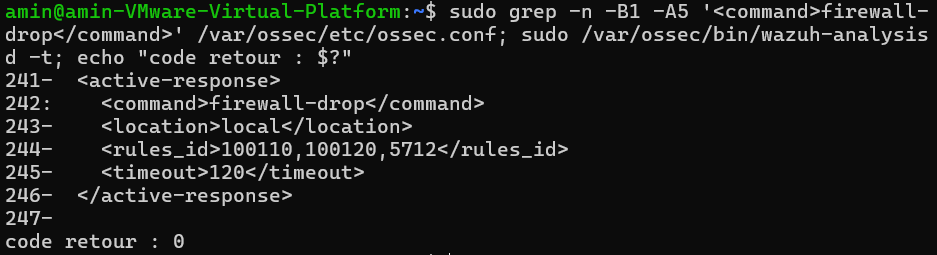
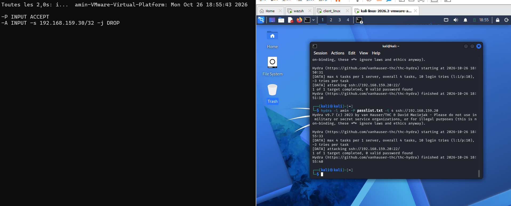
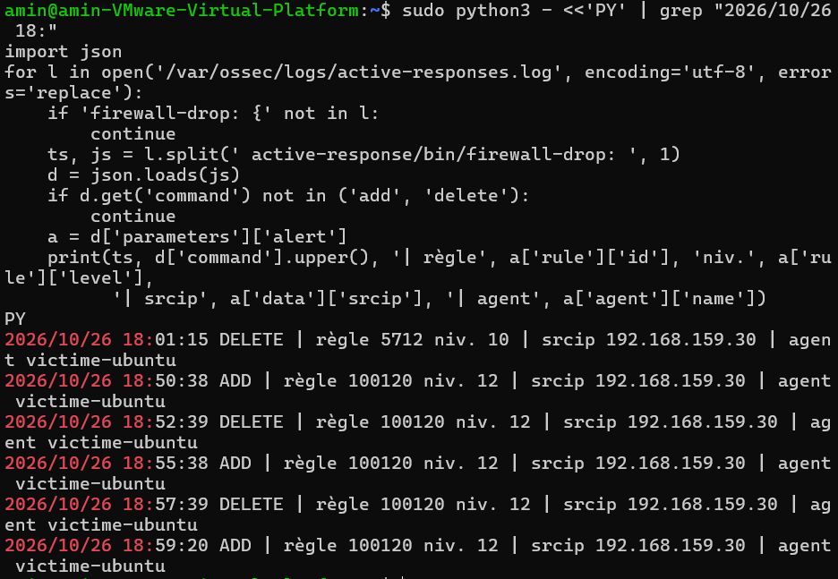
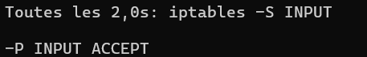
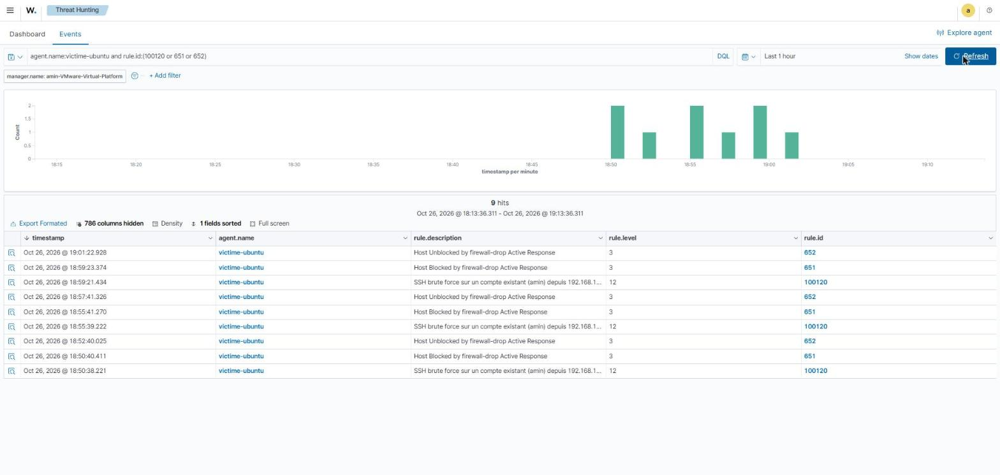
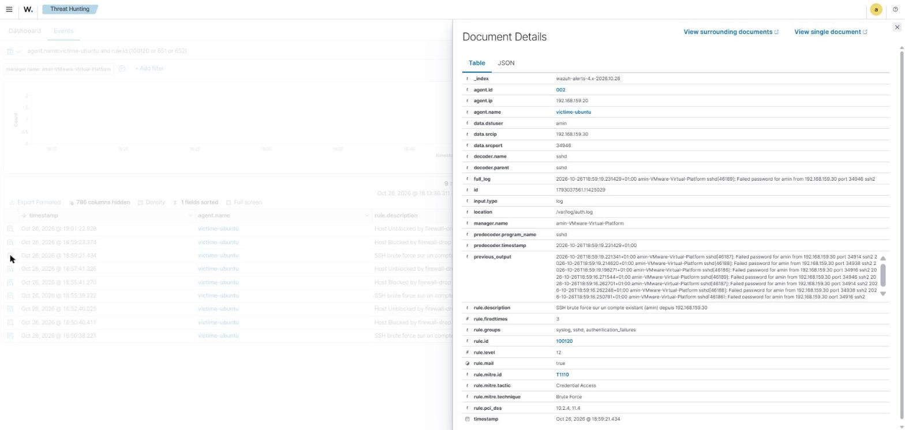
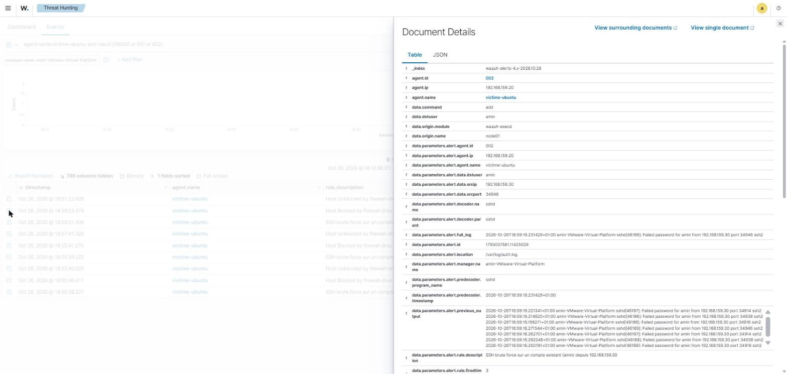

# Active Response — blocage automatique de l'IP source (firewall-drop)

**Statut :** validé le 26/10/2026

Les cas précédents s'arrêtent à la **détection**. Ici, Wazuh **réagit** : quand un brute force SSH est détecté, le manager ordonne à l'agent `victime-ubuntu` de bloquer l'IP de l'attaquant au pare-feu (`firewall-drop`, iptables), puis de lever le blocage automatiquement après 120 s.

```
Kali (hydra) → sshd victime-ubuntu → auth.log → agent → manager
   (compte inexistant : 5710 → 5712 → 100110 | compte existant : 5760 → 5763 → 100120)
   → <active-response> firewall-drop (location local) → wazuh-execd sur victime-ubuntu
   → iptables : DROP de l'IP source → timeout 120 s → firewall-drop delete (levée)
```

## Environnement

| Élément | Valeur |
|---|---|
| Manager | Wazuh 4.9.2, `192.168.159.141` — porte la conf Active Response et les règles |
| Agent (cible) | victime-ubuntu — Ubuntu 24.04, `192.168.159.20`, agent ID 002 — exécute le DROP |
| Attaquant | Kali — `192.168.159.30`, hydra 9.7 |
| Déclencheurs | **100110** (compte inexistant, escalade de 5712), **100120** (compte existant, escalade de 5763), 5712 en filet |
| Réponse | `firewall-drop` (iptables), `location local`, `timeout` 120 s |
| Collecte SSH | `/var/log/auth.log` (rsyslog) sur l'agent |

## 1. Principe

Une Active Response associe une **commande** (ce qu'on exécute) à des **règles** (quand on l'exécute) :

| Balise | Rôle |
|---|---|
| `command` | `firewall-drop` est **prédéfinie** dans l'`ossec.conf` du manager, avec `timeout_allowed yes` : rien à ajouter côté agent |
| `location local` | la commande s'exécute sur l'agent qui a remonté l'alerte (victime-ubuntu), pas sur le manager |
| `rules_id` | les règles qui déclenchent le blocage |
| `timeout` | durée du blocage ; la levée est gérée localement par `wazuh-execd` sur l'agent |

L'IP bloquée est le `srcip` de l'alerte : la règle déclencheuse doit en porter un (c'est le cas des règles SSH utilisées ici).

## 2. Règles de détection : 100110 et 100120

Le brute force SSH produit deux familles d'événements selon que le compte visé existe ou non. Chacune est agrégée par une règle native, que l'on escalade en niveau 12 :

| Règle | Escalade de | Native agrège | Cas |
|---|---|---|---|
| **100110** | 5712 (niveau 10) | 8 × 5710 en 120 s, même IP | compte **inexistant** (`Invalid user …`) |
| **100120** | 5763 (niveau 10) | 8 × 5760 en 120 s, même IP | compte **existant** (`Failed password for amin …`) |

Dans `/var/ossec/etc/rules/local_rules.xml` (manager) :

```xml
<group name="syslog,sshd,">
  <rule id="100110" level="12">
    <if_sid>5712</if_sid>
    <description>SSH brute force : échecs d'authentification répétés depuis $(srcip)</description>
    <mitre>
      <id>T1110</id>
    </mitre>
    <group>authentication_failures,pci_dss_10.2.4,pci_dss_11.4,</group>
  </rule>
  <rule id="100120" level="12">
    <if_sid>5763</if_sid>
    <description>SSH brute force sur un compte existant ($(dstuser)) depuis $(srcip)</description>
    <mitre>
      <id>T1110</id>
    </mitre>
    <group>authentication_failures,pci_dss_10.2.4,pci_dss_11.4,</group>
  </rule>
</group>
```

La 100110 d'origine (`frequency="6"` + `if_matched_group authentication_failed`, cf. [bruteforce-ssh.md](bruteforce-ssh.md)) ne se déclenchait plus : `wazuh-logtest -v` la montrait **essayée** sous 5710 et 5760 sans jamais valider sa condition de fréquence. Plutôt que de recompter les échecs, les deux règles s'appuient sur les natives, qui partent de façon fiable.

La corrélation **100117** (brute force puis connexion réussie) est rebranchée sur 100120 — on ne peut réussir une connexion qu'après avoir deviné le mot de passe d'un compte **existant** :

```xml
<if_matched_sid>100120</if_matched_sid>   <!-- au lieu de 100110 -->
```

Les deux modifications ont été faites par script Python (sauvegarde `.bak`, validation XML par un parseur), puis :

```bash
sudo /var/ossec/bin/wazuh-analysisd -t   # code retour 0
sudo systemctl restart wazuh-manager
```

Validation `wazuh-logtest` : 8 × `Failed password for amin from 192.168.159.30` → **100120 niveau 12** au 8ᵉ ; puis `Accepted password for amin from 192.168.159.30` → **100117 niveau 14**.

## 3. Configuration de l'Active Response (manager)

Bloc ajouté dans `/var/ossec/etc/ossec.conf`, dans `<ossec_config>`, juste avant `<!-- Log analysis -->` (versionné dans [`wazuh/manager/active-response.xml`](../wazuh/manager/active-response.xml)) :

```xml
<active-response>
  <command>firewall-drop</command>
  <location>local</location>
  <rules_id>100110,100120,5712</rules_id>
  <timeout>120</timeout>
</active-response>
```

Vérifications préalables :

```bash
sudo grep -n white_list /var/ossec/etc/ossec.conf                          # 192.168.159.30 absente → Kali peut être bloquée
sudo grep -n -A4 '<name>firewall-drop</name>' /var/ossec/etc/ossec.conf    # timeout_allowed yes
```

L'`ossec.conf` par défaut contient déjà un exemple `<active-response>`, mais **en commentaire** : pas de doublon. Même méthode d'édition (script Python, sauvegarde, parseur), puis `wazuh-analysisd -t` et redémarrage.



## 4. Rejeu de l'attaque depuis Kali

La réponse n'est pas rétroactive : l'attaque est rejouée **après** le redémarrage du manager, et une fois l'agent reconnecté (`Agent is now online` dans son `ossec.log`).

```bash
hydra -l amin -P passlist.txt -t 4 ssh://192.168.159.20   # compte existant → 100120
hydra -l aaa  -P passlist.txt -t 4 ssh://192.168.159.20   # compte inexistant → 100110
```

Dès le déclenchement, hydra reste bloqué sur `attacking` : la victime ne répond plus à Kali.

La victime est surveillée depuis **sa console** (ou en SSH depuis le poste Windows), **pas depuis Kali** : le DROP couperait la session.

## 5. Validation — blocage

Sur **victime-ubuntu** — l'AR s'exécute sur l'agent, le journal est donc celui de l'agent, pas du manager :

```bash
sudo watch -n2 "iptables -S INPUT"
```

Résultat : `-A INPUT -s 192.168.159.30/32 -j DROP` quelques secondes après le lancement d'hydra (brute force sur `amin` → 100120).



Chaque ligne de `/var/ossec/logs/active-responses.log` embarque l'alerte complète en JSON, illisible telle quelle. Résumé des ajouts et levées :

```bash
sudo python3 - <<'PY' | tail -n 4
import json
for l in open('/var/ossec/logs/active-responses.log', encoding='utf-8', errors='replace'):
    if 'firewall-drop: {' not in l:
        continue
    ts, js = l.split(' active-response/bin/firewall-drop: ', 1)
    d = json.loads(js)
    if d.get('command') not in ('add', 'delete'):
        continue
    a = d['parameters']['alert']
    print(ts, d['command'].upper(), '| règle', a['rule']['id'], 'niv.', a['rule']['level'],
          '| srcip', a['data']['srcip'], '| agent', a['agent']['name'])
PY
```

À 18:55:38 : `ADD | règle 100120 niv. 12 | srcip 192.168.159.30 | agent victime-ubuntu`, la source étant `/var/log/auth.log`. Dans le journal brut, l'ajout est suivi de l'échange `check_keys` → `continue` → `Ended` (firewall-drop vérifie auprès d'`execd` que l'IP n'est pas déjà bloquée).



## 6. Validation — levée automatique

**120 s après le blocage**, `wazuh-execd` rappelle `firewall-drop` avec `"command":"delete"` : la règle DROP disparaît et Kali est de nouveau joignable. Le résumé ci-dessus montre des cycles complets, chacun levé à la seconde près :

| Blocage (`ADD`) | Levée (`DELETE`) |
|---|---|
| 18:50:38 | 18:52:39 |
| 18:55:38 | 18:57:39 |

```
-P INPUT ACCEPT
```



## 7. Vue dashboard

L'agent lit aussi son `active-responses.log` : chaque blocage et chaque levée remontent au manager comme des alertes natives, **651** « Host Blocked by firewall-drop Active Response » et **652** « Host Unblocked ». **Threat Hunting → Events**, **Last 1 hour** :

```
agent.name:victime-ubuntu and rule.id:(100120 or 651 or 652)
```

→ **9 événements**, trois cycles complets `100120` (niveau 12) → `651` (2 s plus tard) → `652` (~120 s plus tard) : 18:50:38 / 18:50:40 / 18:52:40, 18:55:39 / 18:55:41 / 18:57:41, 18:59:21 / 18:59:23 / 19:01:22.



Le détail de l'alerte 100120 confirme l'attaquant (`data.srcip 192.168.159.30`), le compte visé (`data.dstuser amin`), la source (`location /var/log/auth.log`) et le tag MITRE **T1110** :



Celui de la 651 montre l'ordre envoyé par le manager : `data.command add`, `data.origin.module wazuh-execd`, et l'alerte déclencheuse embarquée (`data.parameters.alert.*`, srcip `192.168.159.30`) :



## Problèmes rencontrés

| Symptôme | Cause | Solution |
|---|---|---|
| Aucune alerte sshd de la victime, donc aucun blocage | la collecte **journald** de l'agent 4.9 s'arrêtait : `ERROR (1611): Failed to get the message from the journal`, puis arrêts sans erreur | collecte SSH via **`/var/log/auth.log`** (rsyslog) + `/var/log/syslog`, journald retiré (un seul canal, pas de doublon) |
| Plus aucun log SSH après une correction | `auth.log` retiré alors que journald n'était déjà plus collecté : seul `/var/log/syslog` restait, or sshd écrit dans `auth.log` | remettre le bloc `auth.log` ; vérifier avec `grep "Analyzing file" ossec.log` |
| Règle 100110 ne se déclenche plus (5712 native OK) | condition de fréquence `if_matched_group` jamais satisfaite, bien que la règle soit chargée et essayée (`logtest -v`) — cause exacte non établie | escalade de 5712 ; règle sœur 100120 sur 5763 pour les comptes existants (§2) |
| Corrélation 100117 muette sur un brute force réaliste | elle dépendait de 100110, qui ne couvre plus que les comptes inexistants | 100117 rebranchée sur 100120 |
| AR restée sur la seule 5712 après les tests | état intermédiaire du diagnostic jamais remis à jour | `rules_id 100110,100120,5712`, vérifié par `grep '<rules_id>'` |
| Heures incohérentes entre machines | horloge du manager non synchronisée (NTP sans DNS), jusqu'à ~3 h 45 de retard | `vmware-toolbox-cmd timesync enable` sur le manager ; lire les logs par règle et en direct (`tail -f`) |
| Attaque « invisible » juste après un redémarrage du manager | le logcollector de l'agent est en pause tant que le manager ne répond pas | attendre `Agent is now online` avant de rejouer |
| Session de surveillance figée | victime surveillée en SSH depuis Kali → coupée par le DROP | surveiller depuis la console de la victime ou le poste Windows |

## Limites et suite

- Le blocage tombe au **8ᵉ échec** : l'attaquant ne peut plus se connecter depuis cette IP pendant le ban. La corrélation 100117 ne peut donc se produire qu'après la levée (ou depuis une autre IP, que `same_source_ip` ne rattache pas).
- **100119 et les répétitions** : trois connexions réussies après un brute force (trois 100117) suffisent à déclencher la méta-règle, alors qu'il s'agit d'une seule étape. Un `ignore` sur 100117 éviterait ce comptage multiple.
- Bloquer sur un simple brute force coupe aussi un utilisateur légitime qui se trompe de mot de passe, et un attaquant peut faire bloquer une IP usurpée.
- Kali partage l'adresse `192.168.159.30` avec la VM elastic : à réaligner.
- `repeated_offenders` pour des bans progressifs sur les IP récidivistes.
- Étendre l'AR : scan Suricata, et côté Windows (`netsh` / `route-null`) pour le brute force RDP/SMB (100111).
- En production, bloquer sur un pare-feu ou un routeur plutôt que sur chaque hôte.
