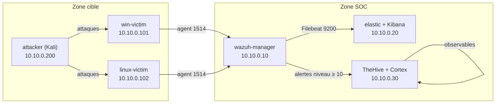

# Architecture du lab — SOC maison

## 1. Vue d'ensemble

Lab de détection composé de 6 machines virtuelles sur un réseau interne isolé.
Deux zones logiques :
- **Zone SOC** : collecte, corrélation et réponse (Wazuh, Elastic, TheHive).
- **Zone cible** : machines surveillées + attaquant, pour rejouer les scénarios.

Chaque membre reconstruit ce lab à l'identique sur son poste à partir du dépôt.

## 2. Réseau

- Réseau interne : `10.10.0.0/24`
- Type : réseau privé hôte-only / interne (pas d'accès direct depuis Internet)
- Passerelle / DNS de test : `10.10.0.1`

## 3. Machines virtuelles

| VM | Rôle | OS | vCPU | RAM | Disque | IP fixe |
|----|------|----|------|-----|--------|---------|
| wazuh-manager | Wazuh manager + indexer + dashboard | Ubuntu 22.04 | 4 | 8 Go | 60 Go | 10.10.0.10 |
| elastic | Elasticsearch + Kibana | Ubuntu 22.04 | 4 | 8 Go | 60 Go | 10.10.0.20 |
| thehive | TheHive 5 + Cortex | Ubuntu 22.04 | 2 | 4 Go | 40 Go | 10.10.0.30 |
| win-victim | Cible Windows + agent Wazuh + Sysmon | Windows 10/11 | 2 | 4 Go | 50 Go | 10.10.0.101 |
| linux-victim | Cible Linux + agent Wazuh + Suricata | Debian 12 | 1 | 2 Go | 25 Go | 10.10.0.102 |
| attacker | Machine d'attaque | Kali Linux | 2 | 4 Go | 40 Go | 10.10.0.200 |

> Besoin total ≈ 8 vCPU / 30 Go RAM. Sur un poste plus juste,
> fusionner wazuh-manager et elastic sur une seule VM à 12 Go.

## 4. Flux réseau et ports

| Source | Destination | Port | Protocole | Usage |
|--------|-------------|------|-----------|-------|
| Agents (win/linux) | wazuh-manager | 1514 | TCP | Envoi des événements |
| Agents (win/linux) | wazuh-manager | 1515 | TCP | Enrôlement des agents |
| Admin | wazuh-manager | 443 | TCP | Dashboard Wazuh |
| Admin / scripts | wazuh-manager | 55000 | TCP | API Wazuh |
| wazuh-manager | elastic | 9200 | TCP | Filebeat → Elasticsearch |
| Admin | elastic | 5601 | TCP | Interface Kibana |
| wazuh-manager | thehive | 9000 | TCP | Création de cas (API TheHive) |
| thehive | cortex | 9001 | TCP | Analyse des observables |
| attacker | win/linux-victim | * | TCP/UDP | Scénarios d'attaque |

## 5. Schéma

## 6. Prérequis pour reproduire le lab

- Hyperviseur : VirtualBox ou VMware Workstation
- ~30 Go de RAM libre et ~275 Go de disque
- Images ISO : Ubuntu 22.04, Debian 12, Windows 10/11, Kali Linux
- Un snapshot "propre" par VM après installation, avant de commencer les tests

## 7. Convention d'adressage

- `.10` à `.30` : services SOC
- `.101` à `.199` : machines cibles
- `.200+` : attaquant
