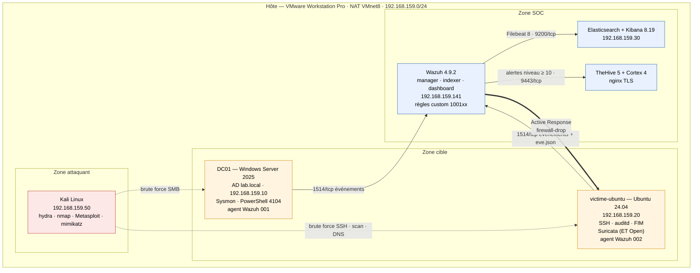

# Architecture du lab — Home SOC

## 1. Vue d'ensemble

Six machines virtuelles sur un réseau NAT VMware isolé, réparties en trois zones :

- **Zone SOC** : collecte, détection, corrélation, stockage et réponse (Wazuh, Elastic, TheHive/Cortex).
- **Zone cible** : machines surveillées, instrumentées (agent Wazuh, Sysmon, Suricata, auditd).
- **Zone attaquant** : Kali, pour rejouer les scénarios.



Les attaques Windows locales (PowerShell, mimikatz, création de compte) sont lancées directement sur DC01, d'où l'absence de flèche Kali → DC01 pour ces cas.

## 2. Machines virtuelles

| VM | Rôle | OS | vCPU | RAM | Disque | IP |
|----|------|----|------|-----|--------|----|
| wazuh | Manager, indexer, dashboard, Filebeat 8 vers Elastic | Ubuntu 22.04 | 2 | 8 Go | 50 Go | `192.168.159.141` |
| elastic | Elasticsearch + Kibana 8.19.21 (TLS) | Ubuntu 22.04 | 2 | 4 Go | 40 Go | `192.168.159.30` |
| thehive | TheHive 5.8 + Cortex 4.1 derrière nginx | Ubuntu 22.04 | 2 | 6 Go | 50 Go | à compléter |
| DC01 | Contrôleur de domaine `lab.local`, Sysmon, agent 001 | Windows Server 2025 | 2 | 4 Go | 60 Go | `192.168.159.10` |
| victime-ubuntu | SSH, Suricata, auditd, FIM, agent 002 (+ Apache sur le lab VirtualBox, cas 8) | Ubuntu 24.04 | 2 | 2 Go | 25 Go | `192.168.159.20` |
| kali | Attaquant | Kali 2026.x (image VMware) | 2 | 4 Go | 40 Go | `192.168.159.50` |

Passerelle et DNS du réseau NAT : `192.168.159.2` (DC01 est son propre DNS pour `lab.local`).

Tout allumé, le lab demande environ 28 Go de RAM. Sur un hôte de 16 Go, on travaille par phases : SOC + une seule victime + Kali.

## 3. Flux réseau

| Source | Destination | Port | Usage |
|--------|-------------|------|-------|
| Agents (DC01, victime-ubuntu) | wazuh | 1514/tcp | Envoi des événements |
| Agents | wazuh | 1515/tcp | Enrôlement |
| Poste admin | wazuh | 443/tcp | Dashboard Wazuh |
| wazuh (Filebeat 8) | elastic | 9200/tcp | Alertes vers Elasticsearch |
| Poste admin | elastic | 5601/tcp | Kibana |
| wazuh (intégration) | thehive | 9443/tcp | Création d'alertes TheHive (HTTPS via nginx) |
| thehive | thehive (local) | 9001/tcp | TheHive → Cortex (analyse des observables) |
| wazuh | agents | — | Ordres Active Response (canal agent existant) |
| kali | cibles | divers | Scénarios d'attaque |

## 4. Les deux labs

Le projet a été mené à distance : chaque membre a monté le lab sur son propre PC. Les configurations de détection sont identiques ; seuls l'hyperviseur et l'adressage diffèrent. Le lab VMware ci-dessus sert de **référence** pour le dépôt ; les cas 3, 7, 8, 9 et 10 ont été rejoués sur le lab VirtualBox, d'où les adresses `192.168.56.x` dans leurs runbooks et captures.

| Machine | Lab VMware (référence) | Lab VirtualBox |
|---------|------------------------|----------------|
| Réseau | NAT VMnet8 `192.168.159.0/24` | NAT + host-only `192.168.56.0/24` |
| wazuh | `192.168.159.141` | `192.168.56.10` |
| elastic | `192.168.159.30` | `192.168.56.20` |
| thehive | à compléter | `192.168.56.30` |
| DC01 | `192.168.159.10` | `192.168.56.106` |
| victime-ubuntu | `192.168.159.20` | `192.168.56.110` |
| kali | `192.168.159.50` | `192.168.56.109` |
| Interface Suricata | `ens33` | `enp0s8` |

Les scripts d'installation prennent l'adressage en variables (`NODE_IP`, `LAB_SUBNET`, `-Subnet` / `-HostId`) pour s'adapter à l'un ou l'autre.

## 5. Chaîne de traitement d'une alerte

```
source (sshd, Security, Sysmon, PowerShell, Suricata, syscheck)
  → agent Wazuh (logcollector / syscheck)
  → manager : décodeurs → règles natives → règles custom (wazuh/local_rules.xml)
       ├─ wazuh-indexer + dashboard (Threat Hunting)
       ├─ Filebeat 8 → Elasticsearch → Kibana (4 dashboards)
       ├─ niveau ≥ 10 → intégration → TheHive → Cortex
       └─ règles 100110 / 100120 / 5712 → Active Response firewall-drop sur l'agent
```

## 6. Prérequis pour reproduire le lab

- VMware Workstation Pro (ou VirtualBox 7, en adaptant l'adressage)
- 16 Go de RAM minimum (32 Go recommandés), environ 270 Go de disque
- ISO / images : Ubuntu Server 22.04 et 24.04, Windows Server 2025 Evaluation, image VMware Kali
- Un snapshot « propre » par VM après installation, avant de rejouer les attaques
- NTP actif sur toutes les VMs (un décalage d'horloge fausse les fenêtres de corrélation et l'affichage du dashboard)
