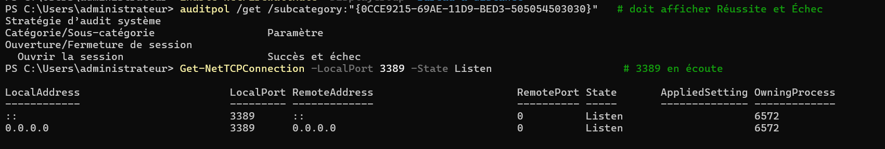
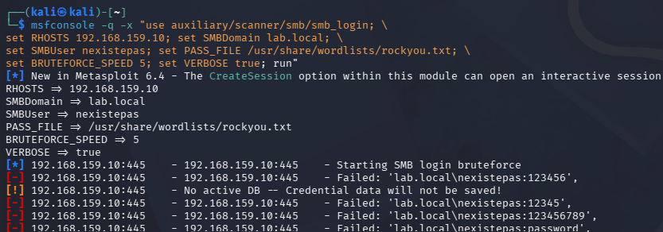
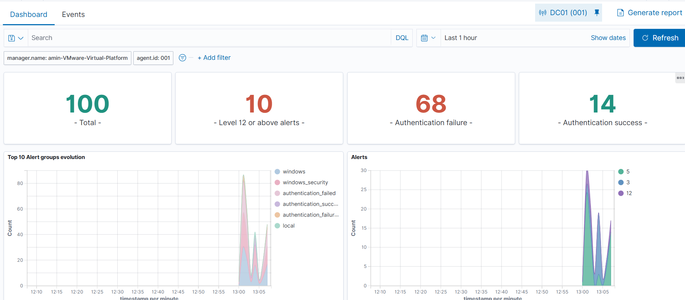
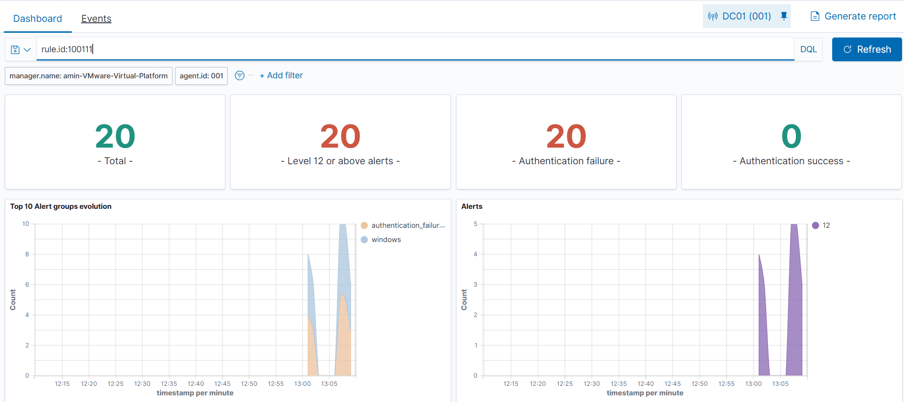
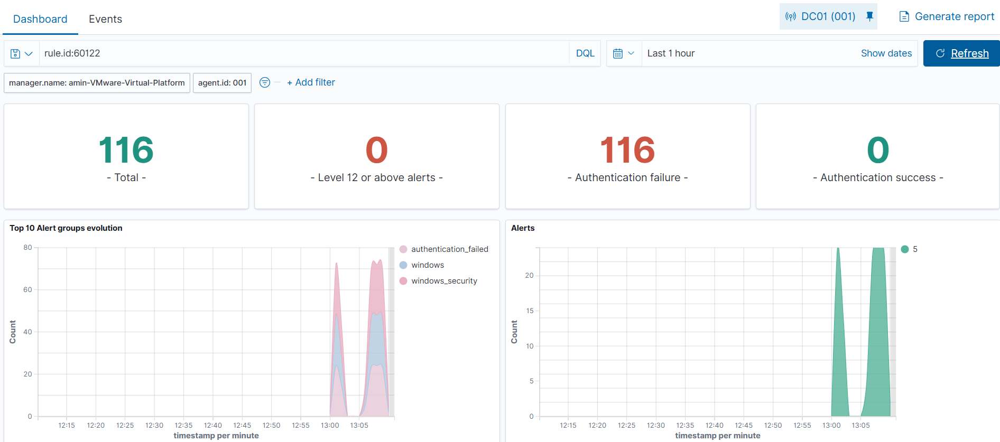
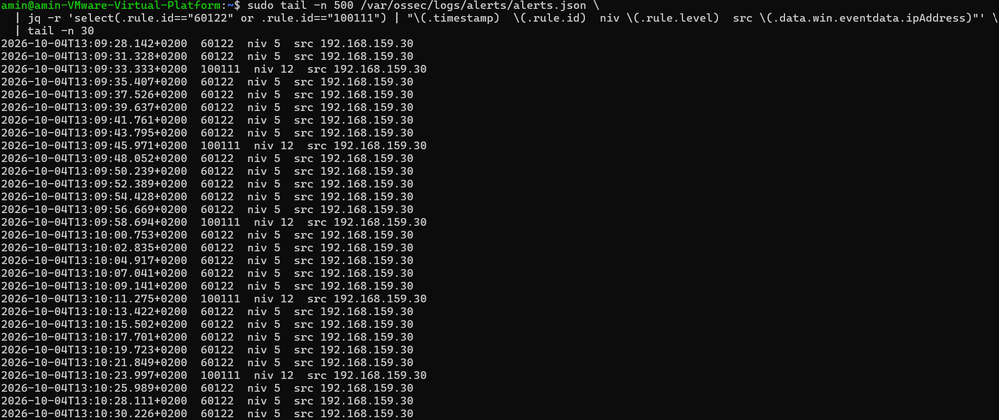

# Brute force RDP/SMB — détection Wazuh

**Statut :** validé le 04/10/2026

Attaque par force brute SMB depuis Kali (Metasploit) contre **DC01**. Les échecs d'authentification Windows (event **4625**) sont journalisés dans le canal Security, collectés par l'agent Wazuh et corrélés côté manager. Objectif : au-delà des échecs unitaires (niveau 5), lever une alerte agrégée de **niveau élevé** sur la rafale de 4625. Le vecteur RDP est traité en Limites (mis en échec par le NLA).

```
Kali (Metasploit smb_login) → SMB DC01 → canal Security (eventchannel) → agent Wazuh → manager (4625 → 60122 → règle 100111) → dashboard
```

## Environnement

| Élément | Valeur |
|---|---|
| Cible | DC01 — Windows Server 2025 Eval, domaine `lab.local` (NetBIOS LAB), `192.168.159.10`, VMnet8 (NAT), RDP + SMB actifs |
| Attaquant | Kali — `192.168.159.30`, VMnet8, Metasploit Framework |
| Wazuh | manager 4.9.2 (`192.168.159.141`), agent 4.9.2 `DC01` (ID 001) |
| Journal source | canal **Security** (eventchannel), collecté par défaut par l'agent Windows |

## 1. Pré-requis sur DC01 — rien à ajouter côté agent

Comme pour SSH (collecte journald), l'agent Windows 4.9 collecte **le canal Security par défaut**, ce qui couvre les 4625. Deux réglages système restent à activer, en **PowerShell administrateur** (le shell SSH par défaut est `cmd`, qui ne connaît pas les cmdlets) :

```powershell
# audit des échecs d'ouverture de session (GUID = indépendant de la langue)
auditpol /set /subcategory:"{0CCE9215-69AE-11D9-BED3-505054503030}" /failure:enable /success:enable

# activation de RDP
Set-ItemProperty 'HKLM:\System\CurrentControlSet\Control\Terminal Server' -Name fDenyTSConnections -Value 0
Enable-NetFirewallRule -DisplayGroup "Bureau à distance"
```

Vérification :

```powershell
auditpol /get /subcategory:"{0CCE9215-69AE-11D9-BED3-505054503030}"   # Succès et échec
Get-NetTCPConnection -LocalPort 3389 -State Listen                     # 3389 en écoute
```



## 2. Rejeu de l'attaque depuis Kali

`nxc` et `hydra` échouent sur ce DC (voir Problèmes rencontrés) ; **Metasploit `smb_login`** négocie correctement avec SMB2/3 signé et envoie réellement chaque couple. Utilisateur **inexistant** (`nexistepas`) pour éviter tout verrouillage de compte — même logique que le cas SSH.

```bash
sudo gunzip -k /usr/share/wordlists/rockyou.txt.gz   # rockyou livré compressé

msfconsole -q -x "use auxiliary/scanner/smb/smb_login; \
set RHOSTS 192.168.159.10; set SMBDomain lab.local; \
set SMBUser nexistepas; set PASS_FILE /usr/share/wordlists/rockyou.txt; \
set BRUTEFORCE_SPEED 5; set VERBOSE true; run"
# Ctrl-C + exit après ~10 s, inutile d'attendre la fin
```



## 3. Comportement natif de Wazuh

| Événement Windows | Règle | Niveau |
|---|---|---|
| 4625 « An account failed to log on » | **60122** — Logon failure: unknown user or bad password | 5 |
| plusieurs 4625 rapprochés | **18152** — Multiple Windows Logon Failures (agrégat natif) | 10 |

Le décodeur eventchannel et les règles Windows sont natifs : rien à configurer côté manager pour obtenir les 60122. Wazuh fournit aussi un agrégat natif (18152) ; comme pour SSH, on ne s'en contente pas et on écrit une règle custom au niveau et au comptage maîtrisés, seule à produire l'alerte corrélée de niveau 12.

## 4. Réglage — règle custom (agrège les 4625)

Dans `/var/ossec/etc/rules/local_rules.xml` sur le **manager** :

```xml
<group name="windows,authentication_failures,">
  <rule id="100111" level="12" frequency="6" timeframe="120">
    <if_matched_sid>60122</if_matched_sid>
    <description>Brute force RDP/SMB : échecs d'authentification Windows répétés (4625) depuis $(win.eventdata.ipAddress)</description>
    <mitre>
      <id>T1110</id>
    </mitre>
    <group>authentication_failures,pci_dss_10.2.4,pci_dss_11.4,</group>
  </rule>
</group>
```

Les réglages :
- `if_matched_sid 60122` → agrège tous les 4625 ; **RDP et SMB passent par cette unique règle**, là où SSH nécessitait un groupe (5710/5716/5760).
- `frequency 6` / `timeframe 120` → alerte dès le 6ᵉ échec en 120 s.
- `level 12` → au-dessus du natif, classé « Level 12 or above » dans le dashboard.
- ID **100111** : premier libre après 100110 (100100/100101 Sysmon, 100110 SSH).
- `<same_source_ip />` volontairement absent : sur Windows l'IP source est dans `win.eventdata.ipAddress`, non recopiée dans le champ générique `srcip` → `<same_source_ip/>` n'agrégerait pas. En labo mono-attaquant le comptage est identique.

Validation **avant** redémarrage :

```bash
sudo /var/ossec/bin/wazuh-analysisd -t   # doit se terminer sans ERROR
sudo systemctl restart wazuh-manager
```

## 5. Validation

Rejouer l'attaque, puis dashboard **Threat Hunting → Events**, **Last 15 minutes** :

```
rule.id:100111
```

Résultat : **20 alertes niveau 12** sur l'agent `DC01`, taguées **Brute Force (T1110)**, `data.win.eventdata.ipAddress: 192.168.159.30`, pour **116 échecs unitaires** (60122, niveau 5). Contrôle direct côté manager :

```bash
sudo tail -n 500 /var/ossec/logs/alerts/alerts.json \
  | jq -r 'select(.rule.id=="60122" or .rule.id=="100111") | "\(.timestamp)  \(.rule.id)  niv \(.rule.level)  src \(.data.win.eventdata.ipAddress)"' \
  | tail -n 30
```

La cadence confirme le réglage : une 100111 (niveau 12) tous les ~6 échecs 60122 (niveau 5).






## Problèmes rencontrés

| Symptôme | Cause | Solution |
|---|---|---|
| `auditpol … "Logon"` : erreur 0x57, paramètre incorrect | nom de sous-catégorie localisé (OS en français) | cibler le **GUID** `{0CCE9215-…}`, indépendant de la langue |
| `Set-ItemProperty`/`Enable-NetFirewallRule` « non reconnu », `HKLM` accès refusé | shell `cmd` (défaut SSH) + session non élevée | **PowerShell en administrateur** |
| `nxc smb` : aucune tentative après la bannière | session null OK + `signing:True` → nxc ne spray pas | Metasploit `smb_login` |
| `nxc` : `UnicodeDecodeError` sur rockyou | octets non-UTF-8 dans la liste | option `--ignore-pw-decoding` (ou msf) |
| `hydra smb` : `invalid reply from target` | module SMB incompatible SMB2/3 signé (Server 2025) | Metasploit `smb_login` |
| `hydra rdp` : `freerdp connection failed` | module `rdp` expérimental + NLA | vecteur RDP abandonné (SMB suffit) ; `crowbar` en option |
| heredoc `bash -c '…'` : erreur de syntaxe « ( » / newline | l'apostrophe de « d'authentification » ferme le quote | `sudo tee -a … <<'EOF'` (délimiteur quoté) |
| dashboard tracé à 02:00, « Last 15 min » vide | horloge VM Wazuh ~10 h en retard (dérive post-suspension VMware) | `timedatectl set-ntp true` + `chronyc makestep` |

## Limites et suite

- **Vecteur RDP non abouti** (module `rdp` d'hydra expérimental + NLA) : à retenter avec `crowbar`/`xfreerdp` ou `ncrack` pour documenter les deux vecteurs.
- `<same_source_ip />` inopérant sur Windows (IP dans `win.eventdata.ipAddress`) : pour une agrégation stricte par IP en multi-hôtes, matcher `<field name="win.eventdata.ipAddress">` plutôt que `<same_source_ip/>`.
- Distinguer RDP (`logonType` 10) et SMB (`logonType` 3) via `win.eventdata.logonType` si des alertes par vecteur sont souhaitées.
- **Active Response** (blocage de l'IP) sur 100111.
- L'attaque a visé un compte inexistant pour éviter le verrouillage ; sur un compte valide, le seuil de lockout coupe la rafale et génère un **4740** (signal complémentaire).
- Pérenniser l'heure : `chrony` sur toutes les VMs pointant DC01 (serveur de temps du domaine), sinon re-dérive à chaque snapshot.
- SSH ayant été activé sur le DC, ses échecs génèrent aussi des 4625 → agrégés par 100111 sans modification : 3ᵉ vecteur possible.
