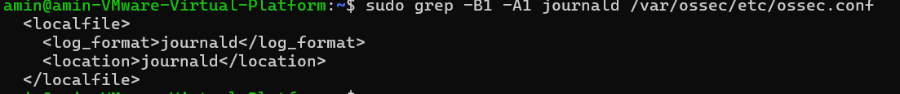
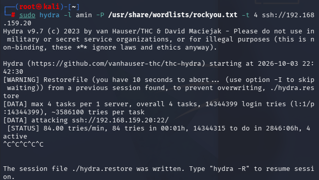
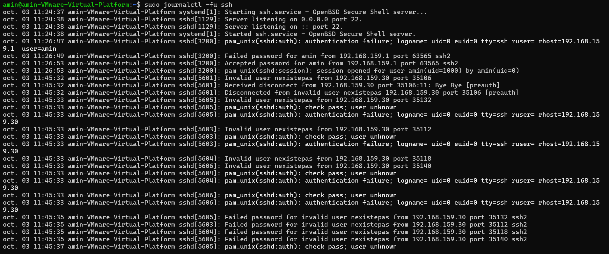
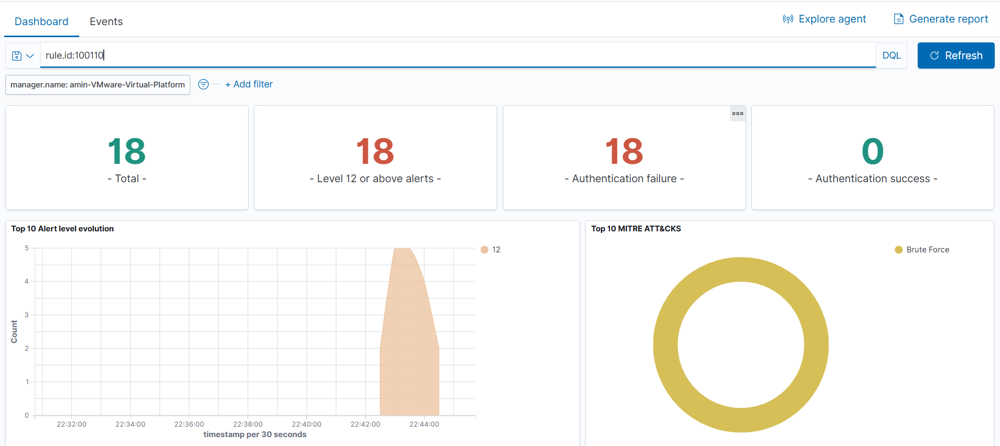

# Brute force SSH — détection Wazuh

**Statut :** validé le 03/10/2026

Attaque SSH par force brute depuis Kali (hydra) contre **victime-ubuntu**. Les échecs d'authentification sont journalisés par `sshd`, collectés via journald par l'agent Wazuh et corrélés côté manager. Objectif : au-delà des alertes unitaires (niveau 5), obtenir une alerte agrégée de **niveau élevé** quand plusieurs échecs surviennent en peu de temps.

```
Kali (hydra) → sshd victime-ubuntu → journald → agent Wazuh (logcollector) → manager (5710/5716/5760 → 5712 natif + règle 100110) → dashboard
```

## Environnement

| Élément | Valeur |
|---|---|
| Cible | victime-ubuntu — Ubuntu 24.04, `192.168.159.20`, VMnet8 (NAT), SSH actif |
| Attaquant | Kali — `192.168.159.30`, VMnet8, hydra 9.7 |
| Wazuh | manager 4.9.2 (`192.168.159.141`), agent 4.9.2 `victime-ubuntu` |
| Journal source | journald (collecte par défaut de l'agent 4.9) |

## 1. Collecte — rien à ajouter côté agent

Contrairement à Suricata (bloc `localfile` ajouté pour `eve.json`), l'agent 4.9 collecte **journald** par défaut, ce qui couvre `sshd`. Il ne lit pas `/var/log/auth.log`.

```bash
sudo grep -B1 -A1 journald /var/ossec/etc/ossec.conf
systemctl is-active wazuh-agent ssh
```



## 2. Rejeu de l'attaque depuis Kali

Petite liste pour un test rapide qui franchit vite le seuil, et deux passes pour couvrir les deux règles de base :

```bash
printf '%s\n' 123456 password azerty root toor admin letmein qwerty motdepasse ubuntu > passlist.txt
hydra -l nexistepas -P passlist.txt -t 4 ssh://192.168.159.20   # utilisateur inexistant → 5710
hydra -l amin       -P passlist.txt -t 4 ssh://192.168.159.20   # compte valide → 5716
```

Pour une attaque à volume réaliste (rockyou, livré compressé) — inutile d'attendre la fin, quelques secondes suffisent :

```bash
sudo gunzip -k /usr/share/wordlists/rockyou.txt.gz
hydra -l nexistepas -P /usr/share/wordlists/rockyou.txt -t 4 ssh://192.168.159.20
# laisser ~15 s puis Ctrl-C
```

Suivi en direct sur la cible : `sudo journalctl -fu ssh`.




## 3. Comportement natif de Wazuh

| Événement `sshd` | Règle | Niveau |
|---|---|---|
| « Failed password for invalid user … » | **5710** — non-existent user | 5 |
| « Failed password for \<user> … » | **5716** — authentication failed | 5 |
| 8× **5710**, même IP, < 120 s | **5712** — sshd: brute force | 10 (T1110) |

hydra provoque surtout des **5760** (connexions coupées en preauth), qui portent aussi le groupe `authentication_failed`. La 5712 native, elle, n'agrège que les **5710** : avec peu de 5710 et un rythme irrégulier, elle se déclenche mal — d'où la règle custom ci-dessous, qui agrège tous les échecs SSH.


## 4. Réglage — règle custom (agrège 5710 + 5716 + 5760)

Dans `/var/ossec/etc/rules/local_rules.xml` sur le **manager** :

```xml
<group name="syslog,sshd,">
  <rule id="100110" level="12" frequency="6" timeframe="120">
    <if_matched_group>authentication_failed</if_matched_group>
    <description>SSH brute force : échecs d'authentification répétés depuis $(srcip)</description>
    <mitre>
      <id>T1110</id>
    </mitre>
    <group>authentication_failures,pci_dss_10.2.4,pci_dss_11.4,</group>
  </rule>
</group>
```

Les réglages :
- `if_matched_group authentication_failed` → agrège **5710, 5716 et 5760** (tous dans ce groupe), là où la 5712 native ne compte que les 5710.
- `frequency 6` / `timeframe 120` → alerte dès le 6ᵉ échec en 120 s.
- `level 12` → au-dessus du natif (10), classé événement de forte importance (carte « Level 12 or above » du dashboard).
- ID **100110** : 100100/100101 étaient déjà pris par des règles Sysmon locales → premier ID libre.
- `<same_source_ip />` volontairement absent (voir Limites) : en labo mono-attaquant le comptage est identique.

Validation **avant** redémarrage :

```bash
sudo /var/ossec/bin/wazuh-analysisd -t   # doit se terminer sans ERROR
sudo systemctl restart wazuh-manager
```

## 5. Validation

Rejouer l'attaque, puis dashboard **Threat Hunting → Events**, **Last 15 minutes** :

```
rule.id:100110
```

Résultat : **18 alertes niveau 12** sur l'agent `victime-ubuntu`, taguées **Brute Force (T1110)**, `data.srcip: 192.168.159.30`. La 5712 native (niveau 10) remonte également. Contrôle direct côté manager :

```bash
sudo tail -n 300 /var/ossec/logs/alerts/alerts.json | jq -r 'select(.rule.id=="100110") | "\(.timestamp)  niveau \(.rule.level)"'
```




## Problèmes rencontrés

| Symptôme | Cause | Solution |
|---|---|---|
| `(1611) Failed to get the message from the journal` en boucle, plus aucune alerte SSH | l'agent n'accède plus à journald (droits / curseur) | `usermod -aG systemd-journal wazuh` + redémarrage agent ; purge du curseur journald |
| 5712 jamais déclenchée malgré des dizaines d'essais | hydra trop lent (< 8 échecs / 120 s), et surtout des 5760 plutôt que des 5710 | attaque à débit suffisant (rockyou) ; règle custom sur le groupe `authentication_failed` |
| Règle custom ignorée au chargement | ID 100100 déjà utilisé par une règle Sysmon (100100/100101) | renommer la règle SSH en 100110 |
| Dashboard vide alors que l'attaque a eu lieu | plage de temps trop courte + filtre épinglé `rule.mitre.technique:SSH` (la 5712 est taguée *Brute Force*) | élargir la plage ; retirer le filtre MITRE |
| `rockyou.txt` introuvable | livré en `.gz` sur Kali | `gunzip -k` |
| `grep '"id":"5712"'` sur `alerts.json` → 0 | JSON espacé (`"id": "5712"`) | utiliser `jq` |

## Limites et suite

- Réactiver `<same_source_ip />` dans la règle 100110 (retiré pendant le diagnostic du bug journald) et re-tester, pour une agrégation stricte par IP source — plus propre en multi-hôtes.
- **Active Response** (`firewall-drop`) sur 5712/100110 pour bloquer automatiquement l'IP.
- Kali a pris `192.168.159.30`, déjà attribuée en statique à la VM elastic → réaligner sur une adresse libre.
- Corrélation « échecs puis succès » (→ T1078) pour détecter une compromission réelle ; un brute force distribué (IP multiples) échappe à `same_source_ip`.
- Côté Kali : transition glibc interrompue → `apt` cassé (sans impact sur l'attaque, hydra étant déjà présent) ; réparer via `apt full-upgrade`.
