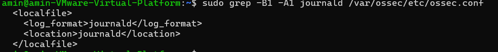
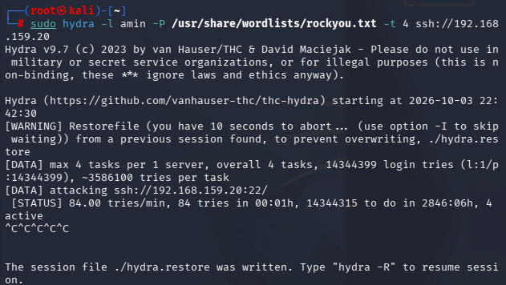
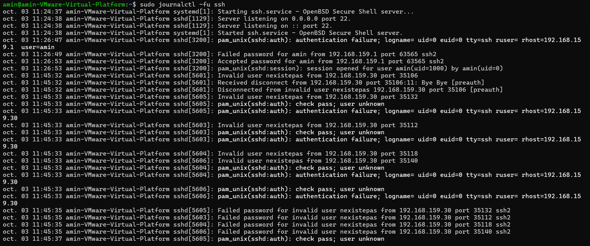
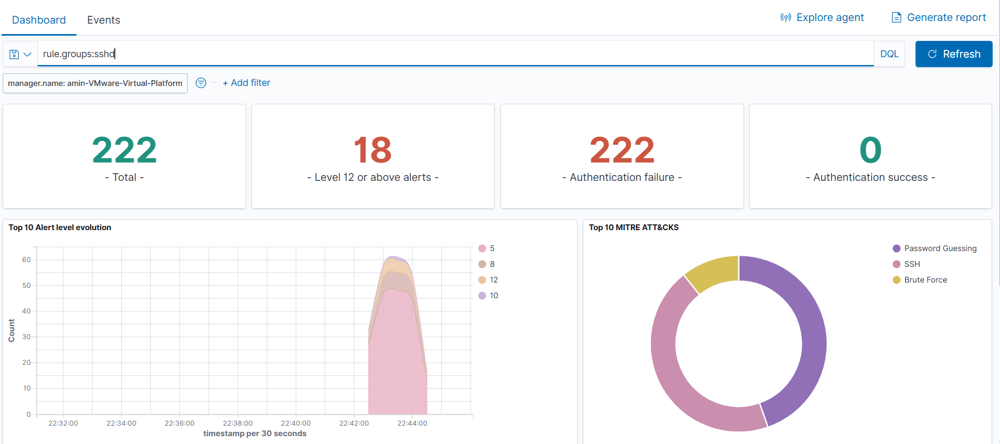
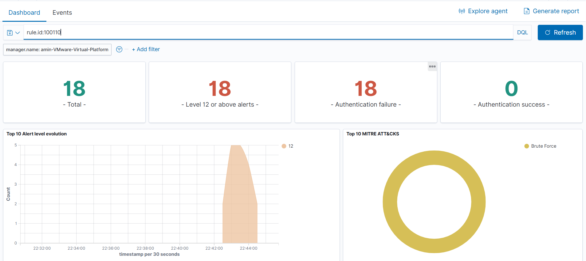
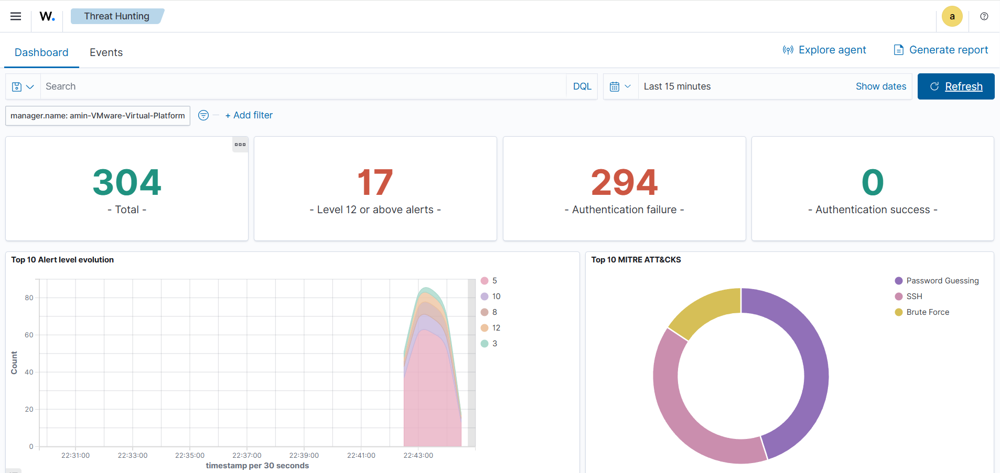

# Brute force SSH — détection Wazuh

**Statut :** validé le 03/10/2026 · règles finales le 26/10/2026

Attaque SSH par force brute depuis Kali (hydra) contre **victime-ubuntu**. Les échecs d'authentification sont journalisés par `sshd`, collectés par l'agent Wazuh et agrégés côté manager. Objectif : au-delà des alertes unitaires (niveau 5), obtenir une alerte agrégée de **niveau élevé** quand plusieurs échecs surviennent en peu de temps.

```
Kali (hydra) → sshd victime-ubuntu → /var/log/auth.log → agent Wazuh → manager
   compte inexistant : 5710 → 5712 (natif) → 100110
   compte existant   : 5760 → 5763 (natif) → 100120
→ dashboard (+ Active Response, + corrélation 100117)
```

## Environnement

| Élément | Valeur |
|---|---|
| Cible | victime-ubuntu — Ubuntu 24.04, `192.168.159.20`, VMnet8 (NAT), SSH actif |
| Attaquant | Kali — `192.168.159.50`, VMnet8, hydra 9.7 (`192.168.159.30` sur les captures, avant réalignement de l'IP) |
| Wazuh | manager 4.9.2 (`192.168.159.141`), agent 4.9.2 `victime-ubuntu` |
| Journal source | `/var/log/auth.log` (rsyslog) |

## 1. Collecte

L'agent 4.9 collecte journald par défaut, ce qui couvre `sshd`. Cette collecte s'est révélée instable sur le lab (`ERROR (1611): Failed to get the message from the journal`, puis arrêt silencieux, voir « Problèmes rencontrés »). La collecte retenue lit donc `/var/log/auth.log`, alimenté par rsyslog, et le bloc journald est retiré pour éviter les doublons. Dans `/var/ossec/etc/ossec.conf` de l'**agent** :

```xml
<localfile>
  <log_format>syslog</log_format>
  <location>/var/log/auth.log</location>
</localfile>
```

```bash
sudo systemctl restart wazuh-agent
systemctl is-active wazuh-agent ssh rsyslog
```

La capture ci-dessous date de la première version (collecte journald).



## 2. Rejeu de l'attaque depuis Kali

Petite liste pour un test rapide qui franchit vite le seuil, et deux passes pour couvrir les deux règles de base :

```bash
printf '%s\n' 123456 password azerty root toor admin letmein qwerty motdepasse ubuntu > passlist.txt
hydra -l nexistepas -P passlist.txt -t 4 ssh://192.168.159.20   # utilisateur inexistant → 5710 → 5712 → 100110
hydra -l amin       -P passlist.txt -t 4 ssh://192.168.159.20   # compte existant → 5760 → 5763 → 100120
```

Pour une attaque à volume réaliste (rockyou, livré compressé) — inutile d'attendre la fin, quelques secondes suffisent :

```bash
sudo gunzip -k /usr/share/wordlists/rockyou.txt.gz
hydra -l nexistepas -P /usr/share/wordlists/rockyou.txt -t 4 ssh://192.168.159.20
# laisser ~15 s puis Ctrl-C
```

Suivi en direct sur la cible : `sudo tail -f /var/log/auth.log`.




## 3. Comportement natif de Wazuh

| Événement `sshd` | Règle | Niveau |
|---|---|---|
| « Failed password for invalid user … » | **5710** — non-existent user | 5 |
| « Failed password for \<user> … » | **5716** — authentication failed | 5 |
| Échec sur un compte existant | **5760** — authentication failed | 5 |
| 8× **5710**, même IP, < 120 s | **5712** — sshd: brute force | 10 (T1110) |
| 8× **5760**, même IP, < 120 s | **5763** — sshd: brute force (compte existant) | 10 (T1110) |

Les deux natives agrégées (5712 et 5763) partent de façon fiable. On les escalade en niveau 12 pour les classer en événement de forte importance et leur donner un ID stable à requêter.

La vue d'ensemble `rule.groups:sshd` montre les niveaux côte à côte : échecs unitaires **niveau 5**, natives **niveau 10**, règle custom **niveau 12**.



## 4. Règles custom — 100110 et 100120

Dans `/var/ossec/etc/rules/local_rules.xml` sur le **manager** (référence complète : [`wazuh/local_rules.xml`](../wazuh/local_rules.xml)) :

```xml
<group name="syslog,sshd,">
  <rule id="100110" level="12">
    <if_sid>5712</if_sid>
    <description>SSH brute force : échecs d'authentification répétés depuis $(srcip)</description>
    <mitre>
      <id>T1110</id>
    </mitre>
    <group>authentication_failures,pci_dss_10.2.4,pci_dss_11.4,</group>
  </rule>

  <rule id="100120" level="12">
    <if_sid>5763</if_sid>
    <description>SSH brute force sur un compte existant ($(dstuser)) depuis $(srcip)</description>
    <mitre>
      <id>T1110</id>
    </mitre>
    <group>authentication_failures,pci_dss_10.2.4,pci_dss_11.4,</group>
  </rule>
</group>
```

Les réglages :
- **100110** escalade la 5712 (comptes **inexistants**), **100120** escalade la 5763 (comptes **existants**).
- `level 12` → au-dessus du natif (10), carte « Level 12 or above » du dashboard.
- Le regroupement par IP source est assuré par les natives (même IP sur 120 s).
- **100120 est la règle qui compte pour la suite** : une connexion ne peut réussir qu'après avoir deviné le mot de passe d'un compte existant. C'est donc sur elle que s'appuie la corrélation 100117 (brute force puis connexion réussie, voir [correlation-wazuh.md](correlation-wazuh.md)).
- Les deux règles déclenchent l'Active Response `firewall-drop` (voir [active-response-wazuh.md](active-response-wazuh.md)).

Validation **avant** redémarrage :

```bash
sudo /var/ossec/bin/wazuh-analysisd -t   # doit se terminer sans ERROR
sudo systemctl restart wazuh-manager
```

## 5. Validation

Rejouer l'attaque, puis dashboard **Threat Hunting → Events**, **Last 15 minutes** :

```
rule.id:(100110 OR 100120)
```

Résultat attendu : alertes **niveau 12** sur l'agent `victime-ubuntu`, taguées **Brute Force (T1110)**, avec l'IP de Kali en `data.srcip`. Les natives 5712 / 5763 (niveau 10) remontent également. Contrôle direct côté manager :

```bash
sudo tail -n 300 /var/ossec/logs/alerts/alerts.json \
  | jq -r 'select(.rule.id=="100110" or .rule.id=="100120") | "\(.timestamp)  \(.rule.id)  niveau \(.rule.level)"'
```

La capture ci-dessous a été prise avec la première version de 100110 (voir « Évolution »). La validation de 100120 est illustrée dans [active-response-wazuh.md](active-response-wazuh.md).




## Problèmes rencontrés

| Symptôme | Cause | Solution |
|---|---|---|
| `(1611) Failed to get the message from the journal` en boucle, plus aucune alerte SSH | l'agent n'accède plus à journald (droits / curseur) | correctif temporaire : `usermod -aG systemd-journal wazuh` + purge du curseur ; correctif définitif : collecte via `/var/log/auth.log` |
| 5712 jamais déclenchée malgré des dizaines d'essais | hydra trop lent (< 8 échecs / 120 s), et surtout des 5760 plutôt que des 5710 | attaque à débit suffisant (rockyou) ; règle 100120 sur la 5763 pour les comptes existants |
| Règle custom ignorée au chargement | ID 100100 déjà utilisé par une règle Sysmon (100100/100101) | renommer la règle SSH en 100110 |
| Dashboard vide alors que l'attaque a eu lieu | plage de temps trop courte + filtre épinglé `rule.mitre.technique:SSH` (la 5712 est taguée *Brute Force*) | élargir la plage ; retirer le filtre MITRE |
| `rockyou.txt` introuvable | livré en `.gz` sur Kali | `gunzip -k` |
| `grep '"id":"5712"'` sur `alerts.json` → 0 | JSON espacé (`"id": "5712"`) | utiliser `jq` |

## Évolution de la règle

La première version de 100110 (3 oct.) agrégeait elle-même tous les échecs du groupe `authentication_failed` :

```xml
<rule id="100110" level="12" frequency="6" timeframe="120">
  <if_matched_group>authentication_failed</if_matched_group>
  ...
</rule>
```

Le 26 oct., elle a cessé de se déclencher : `wazuh-logtest -v` la montrait essayée sous 5710 et 5760 sans jamais valider sa condition de fréquence, alors que la 5712 native partait. Plutôt que de recompter les échecs, les deux règles actuelles s'appuient sur les natives agrégées, plus fiables.

## Limites et suite

- Un brute force **distribué** (IP multiples, faible débit par IP) échappe aux natives 5712 / 5763, qui regroupent par IP source.
- Les seuils natifs (8 échecs / 120 s) laissent passer un brute force lent ; une règle à fenêtre longue (ex. 30 échecs / 1 h) compléterait la détection.
- Côté Kali : transition glibc interrompue → `apt` cassé (sans impact sur l'attaque, hydra étant déjà présent) ; réparer via `apt full-upgrade`.
