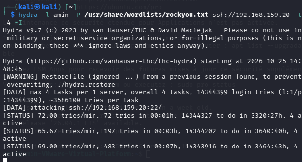
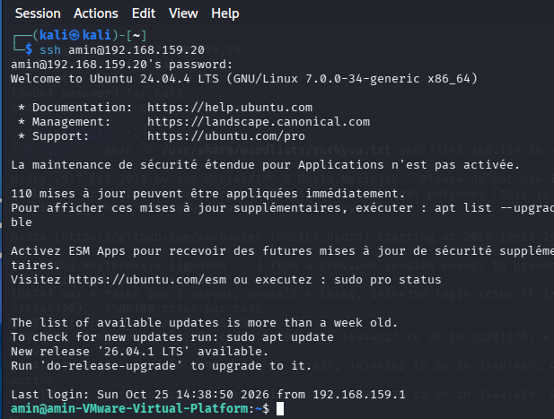
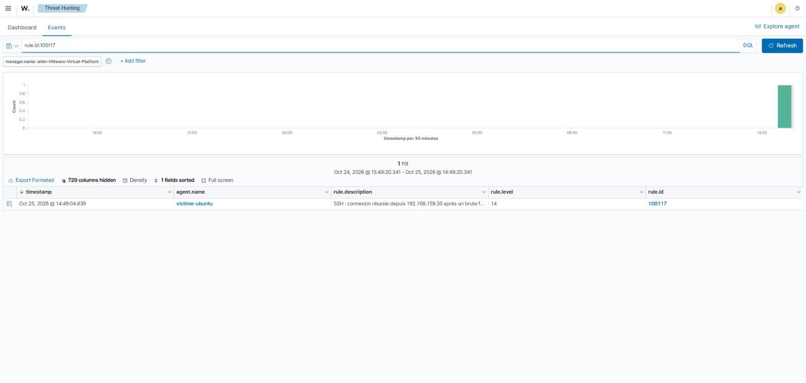
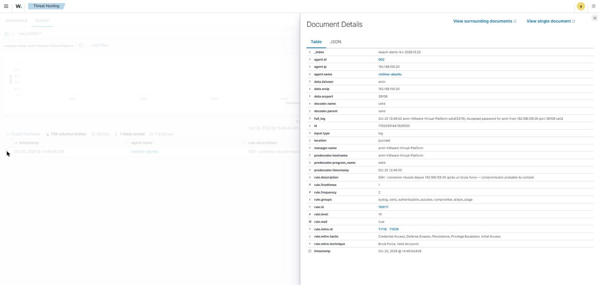
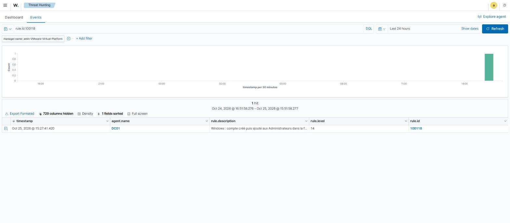
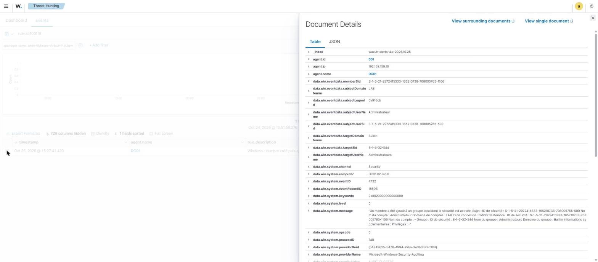
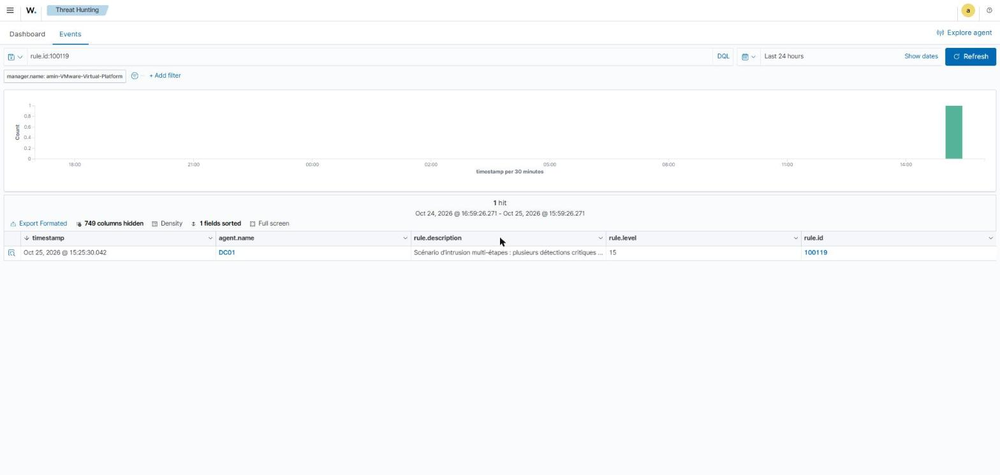
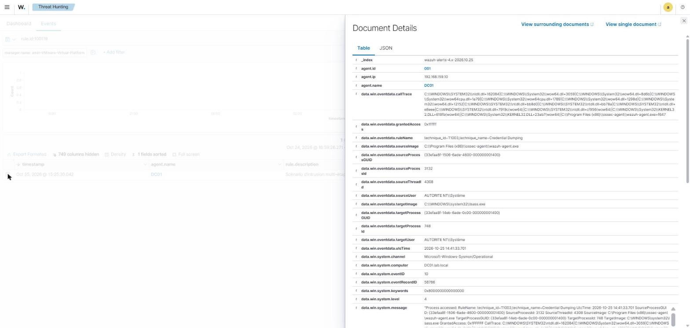

# Corrélation d'alertes — règles de kill-chain Wazuh

**Statut :** 100117, 100118 et 100119 validées le 25/10/2026.

Au-delà des règles qui détectent une étape isolée (brute force, création de compte, PowerShell suspect…), on ajoute trois règles de **corrélation** qui relient plusieurs événements pour reconnaître un *scénario* d'attaque et non plus un fait unitaire. Une séquence « brute force **puis** connexion réussie depuis la même IP » est bien plus grave qu'un brute force seul : elle signale une **compromission probable**.

```
étapes unitaires (100110/100111/100113…) → règles de corrélation (100117/100118/100119) → alerte niveau 14-15 « compromission probable » → dashboard
```

## Environnement

| Élément | Valeur |
|---|---|
| Cible SSH | victime-ubuntu — Ubuntu 24.04, `192.168.159.20`, VMnet8 (NAT) |
| Attaquant | Kali — `192.168.159.30`, VMnet8, hydra 9.7 |
| Wazuh | manager 4.9.2 (`192.168.159.141`), agent `victime-ubuntu` |
| Fichier | `/var/ossec/etc/rules/local_rules.xml` sur le manager |

## 1. Les trois règles de corrélation

| ID | Scénario | Déclencheur | Niveau | MITRE |
|---|---|---|---|---|
| **100117** | brute force SSH **puis** login réussi, même IP | `100110` corrélée + `5715` natif + `same_source_ip` | 14 | T1110 + T1078 |
| **100118** | compte Windows créé **puis** ajouté aux Administrateurs | `60109` natif corrélé + règle `100113` | 14 | T1136 + T1098 |
| **100119** | méta kill-chain : 3 détections critiques en < 15 min | 3× groupe `attack_stage` en 900 s | 15 | — |

Le principe commun : Wazuh garde en mémoire les alertes récentes, et `if_matched_sid` / `if_matched_group` permet à une règle de ne se déclencher **que si** une autre alerte a déjà eu lieu dans la fenêtre de temps.

## 2. Les règles (`local_rules.xml`)

```xml
<group name="syslog,sshd,">
  <rule id="100117" level="14">
    <if_sid>5715</if_sid>
    <if_matched_sid>100110</if_matched_sid>
    <same_source_ip />
    <description>SSH : connexion réussie depuis $(srcip) après un brute force — compromission probable du compte</description>
    <mitre>
      <id>T1110</id>
      <id>T1078</id>
    </mitre>
    <group>authentication_success,compromise,attack_stage,</group>
  </rule>
</group>

<group name="windows,windows_security,account_management,">
  <rule id="100118" level="14">
    <if_sid>100113</if_sid>
    <if_matched_sid>60109</if_matched_sid>
    <same_location />
    <description>Windows : compte créé puis ajouté aux Administrateurs dans la foulée — persistance + élévation (compromission probable)</description>
    <mitre>
      <id>T1136</id>
      <id>T1098</id>
    </mitre>
    <group>account_management,privilege_escalation,compromise,attack_stage,</group>
  </rule>
</group>

<group name="correlation,">
  <rule id="100119" level="15" frequency="3" timeframe="900">
    <if_matched_group>attack_stage</if_matched_group>
    <description>Scénario d'intrusion multi-étapes : plusieurs détections critiques corrélées en moins de 15 min — compromission probable</description>
    <group>compromise,attack_chain,</group>
  </rule>
</group>
```

> **Mise à jour du 26/10/2026.** 100117 s'appuie désormais sur `if_matched_sid 100120` (brute force sur un compte existant) au lieu de 100110, réécrite pour ne couvrir que les comptes inexistants — voir [active-response-wazuh.md](active-response-wazuh.md#2-règles-de-détection--100110-et-100120). Validé par `wazuh-logtest` (8 échecs → 100120, puis connexion réussie → 100117 niveau 14).

Points de réglage :
- **`same_source_ip` / `same_location`** : la corrélation n'a de sens que si les deux étapes viennent du même acteur (même IP pour SSH, même agent pour Windows).
- **`timeframe` est un attribut de `<rule>`, jamais une balise fille** — et ne s'emploie jamais sans `frequency`. 100117/100118 s'appuient sur la fenêtre par défaut de `if_matched_sid` et n'en déclarent donc pas.
- **Le groupe `attack_stage`** est ce qui alimente la méta-règle 100119. Il a été ajouté aux règles de détection existantes **100111, 100113, 100114, 100115, 100116**. Il n'a **pas** été mis sur 100110 : l'étape SSH de la kill-chain est portée par 100117 (sinon un brute force seul, qui répète 100110, suffirait à nourrir 100119).
- **`ignore="900"` sur 100111** (brute force RDP/SMB) : une alerte au plus toutes les 15 min, pour qu'un seul brute force ne déclenche pas à lui seul la 100119.

Validation **avant** redémarrage :

```bash
sudo /var/ossec/bin/wazuh-analysisd -t   # doit se terminer sans ERROR
sudo systemctl restart wazuh-manager
```

## 3. Rejeu de l'attaque (SSH) depuis Kali

Le scénario qui déclenche 100117 : un brute force, **puis** une connexion réussie depuis **la même machine** (Kali, `192.168.159.30`).

```bash
# 1. brute force → génère les alertes 100110 (srcip = 192.168.159.30)
hydra -l amin -P /usr/share/wordlists/rockyou.txt ssh://192.168.159.20 -t 4 -I

# 2. tout de suite après, connexion réussie depuis la MÊME IP
ssh amin@192.168.159.20
```




La connexion réussie doit partir de Kali, pas du poste d'administration : si le login vient d'une autre IP que le brute force, `same_source_ip` ne correspond pas et 100117 **ne se déclenche pas** — comportement voulu.

## 4. Validation

Dashboard **Threat Hunting → Events**, **Last 15 minutes** :

```
rule.id:100117
```

Résultat : **1 alerte niveau 14** sur l'agent `victime-ubuntu`, description « SSH : connexion réussie depuis 192.168.159.30 après un brute force », taguée **Brute Force (T1110)** + **Valid Accounts (T1078)**.



Le détail du document confirme la corrélation : `data.srcip = 192.168.159.30` (l'IP du brute force), `data.dstuser = amin`, et le `full_log` « Accepted password for amin from 192.168.159.30 ».



## 5. Anti-faux-positif (100119)

Avec `rule.id:100119` sur la même période → **0 résultat**. Un brute force seul, même long, ne doit pas être présenté comme une intrusion multi-étapes : grâce au retrait de `attack_stage` sur 100110 et à l'`ignore="900"` sur 100111, la méta-règle reste muette tant qu'il n'y a qu'une seule étape réelle. Elle n'alertera que lorsque plusieurs étapes **distinctes** (ex. brute force réussi *puis* création de compte) surviendront en moins de 15 min.

## 6. Validation 100118 (Windows)

Sur DC01, création d'un compte puis ajout immédiat aux Administrateurs (OS en français). Supprimer d'abord pour générer des événements frais :

```bat
net user pirate /delete
net user pirate "P@ssw0rd2026!" /add          :: -> 4720 -> règle native 60109
net localgroup Administrateurs pirate /add     :: -> 4732 -> règle 100113
```

Dashboard, **Last 24 hours** (horloge DC01/manager décalée), `rule.id:100118` → **1 alerte niveau 14** sur l'agent `DC01` : « compte créé puis ajouté aux Administrateurs dans la foulée », MITRE **T1136 + T1098**. La corrélation `if_sid 100113` + `if_matched_sid 60109` fonctionne.



Le détail confirme le 4732 vers le groupe **Builtin\Administrateurs** (`targetSid S-1-5-32-544`), déclenché par `subjectUserName: Administrateur`.



Nettoyage : `net localgroup Administrateurs pirate /delete` puis `net user pirate /delete`.

## 7. Validation 100119 (méta kill-chain)

Pour déclencher la méta-règle, on provoque **3 alertes du groupe `attack_stage` en moins de 15 min** : la séquence Windows en fournit deux (100113 + 100118), à compléter par une troisième (ici la connexion SSH réussie → 100117).

```bat
:: sur DC01 : 100113 + 100118
net user pirate /delete & net user pirate "P@ssw0rd2026!" /add & net localgroup Administrateurs pirate /add
```
```bash
# sur Kali : 100117
hydra -l amin -P /tmp/wl.txt ssh://192.168.159.20 -t 4 -I
ssh amin@192.168.159.20
```

Dashboard, `rule.id:100119` → **1 alerte niveau 15** : « Scénario d'intrusion multi-étapes : plusieurs détections critiques corrélées en moins de 15 min ». La méta-corrélation `if_matched_group attack_stage` (frequency 3 / timeframe 900) fonctionne.



Point à noter dans le détail : la **3ᵉ étape** qui a complété la corrélation n'était pas la 100117 mais une détection d'**accès à LSASS** (Sysmon EID 10 → règle **100116**, groupe `attack_stage`). Or ici l'accès à LSASS venait de `wazuh-agent.exe` lui-même — un **faux positif** de la 100116. Cela illustre un risque réel : la 100119 n'est fiable que si les règles d'étape qui l'alimentent sont bien réglées, sinon une activité bénigne peut compter comme une « étape ».



## Problèmes rencontrés

| Symptôme | Cause | Solution |
|---|---|---|
| `wazuh-analysisd -t` → `Invalid option 'timeframe'` | `timeframe` écrit comme balise fille de `<rule>` | `timeframe`/`frequency` sont des **attributs** de `<rule>`, et jamais `timeframe` sans `frequency` |
| `XMLERR: Element not opened (line 8)`, le manager ne recharge plus ses règles | `tee -a` a dupliqué les blocs, puis un `awk` « anti-doublons » a cassé le XML | repartir d'une sauvegarde `.bak.*` bien formée, éditer le fichier via un parseur XML (cf. `scripts/fix-correlation-rules.sh`) |
| 100117 jamais déclenchée malgré un login réussi | le login venait du poste Windows (`192.168.159.1`), pas de Kali (`.30`) → `same_source_ip` ne correspond pas | refaire la connexion réussie **depuis Kali** |
| « Permission denied / mot de passe faux » sur Kali | `sudo ssh …` : c'était le mot de passe **sudo de l'utilisateur kali** qui était demandé | lancer `ssh …` **sans** `sudo` |
| Mot de passe SSH rejeté en le tapant | compte `amin` (et non `amine`) ; attention aussi au clavier QWERTY/AZERTY de Kali | utiliser `amin`, `setxkbmap fr` si besoin |

## Limites et suite

- **Régler les règles d'étape** qui alimentent la 100119 : lors du test, la 100116 (accès LSASS) s'est déclenchée sur `wazuh-agent.exe` et a compté comme une étape (faux positif). Ajouter une exclusion de l'image de l'agent sur la 100116 pour fiabiliser la méta-corrélation.
- Un brute force **distribué** (IP multiples) échappe à `same_source_ip` : 100117 ne corrélerait pas le login réussi avec le brute force.
- **Active Response** possible sur 100117 (compromission avérée) : blocage de l'IP et/ou désactivation du compte.
