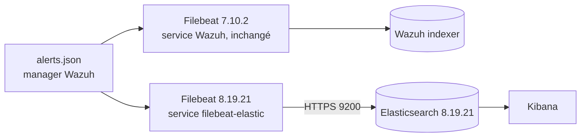
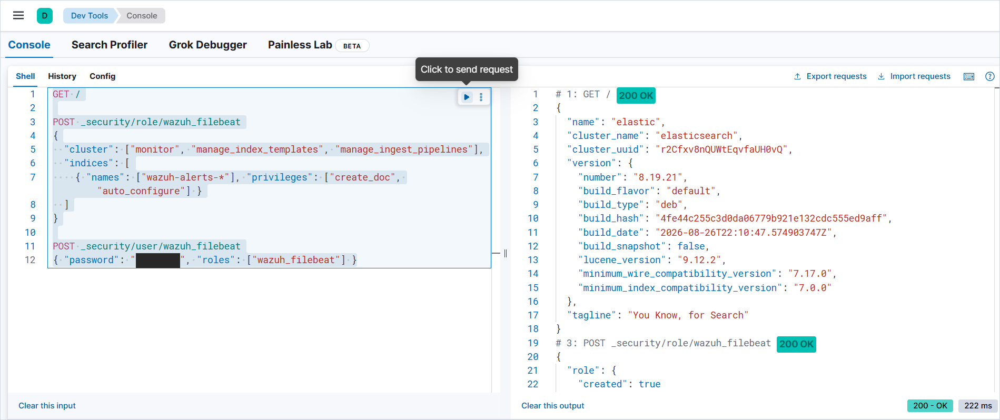
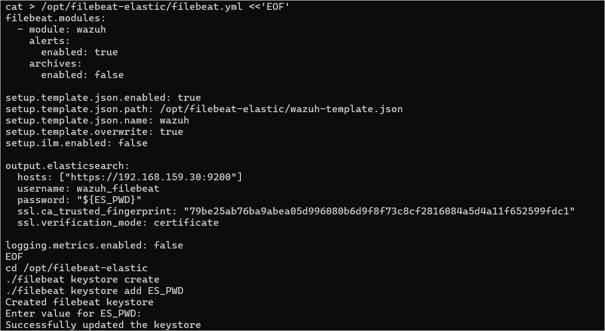
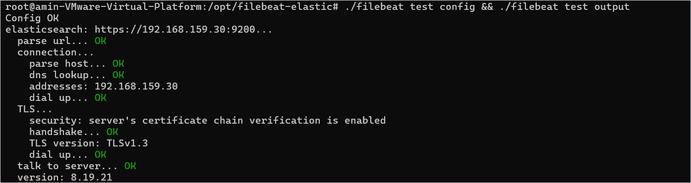
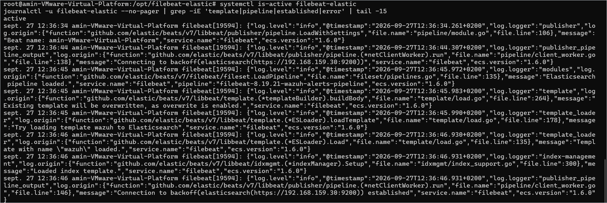
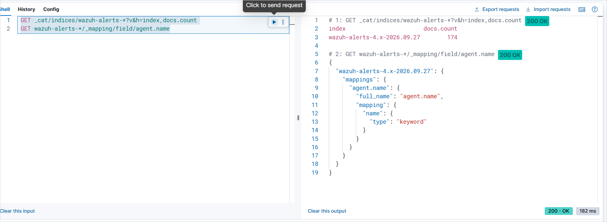

#  Filebeat : alertes Wazuh → Elasticsearch

Tâche terminée le 27/09/2026.

Objectif : envoyer les alertes du manager Wazuh vers Elasticsearch, dans les index `wazuh-alerts-4.x-*`, sans toucher à la remontée existante vers le Wazuh indexer.

| Composant | Lab de référence |
|---|---|
| Manager Wazuh 4.9.2 | `192.168.159.141` |
| Elasticsearch / Kibana 8.19.21 | `192.168.159.30` (9200 et 5601, en HTTPS) |
| Réseau | VMware NAT (VMnet8) |

Dans les commandes, remplacer `<IP_ELASTIC>` par l'IP de la VM elastic de votre lab.

## Architecture



## Choix techniques

- **Une deuxième instance de Filebeat.** Filebeat n'accepte qu'une seule sortie, et celle installée par Wazuh alimente déjà le Wazuh indexer. On ajoute donc une instance séparée dans `/opt/filebeat-elastic`, avec son propre service.
- **Une version alignée sur Elasticsearch (8.19.21), installée depuis l'archive tar.gz.** Le paquet `.deb` d'Elastic remplacerait le Filebeat 7.10.2 dont Wazuh a besoin.
- **Le module `wazuh` repris du manager** (`/usr/share/filebeat/module/wazuh`). On garde ainsi le même pipeline d'ingestion que côté Wazuh et le même nommage d'index.
- **Le template officiel Wazuh pour Elasticsearch 8** (`wz-es-4.x-8.x-template.json`, au format composable). Celui de `/etc/filebeat` est au format legacy, que Filebeat 8 ne sait plus charger.
- **Un compte dédié `wazuh_filebeat`** limité au strict nécessaire. Son mot de passe est rangé dans le keystore de Filebeat, jamais en clair.
- **Un TLS vérifié par l'empreinte du CA** (`ssl.ca_trusted_fingerprint`), sans fichier CA à copier. On utilise `verification_mode: certificate` parce que le certificat HTTP d'Elasticsearch a été généré avec les IP d'origine de la VM et ne contient pas celle du lab.

## 1. Rôle et utilisateur dédiés

Dans Kibana → Dev Tools :

```
POST _security/role/wazuh_filebeat
{
  "cluster": ["monitor", "manage_index_templates", "manage_ingest_pipelines"],
  "indices": [
    { "names": ["wazuh-alerts-*"], "privileges": ["create_doc", "auto_configure"] }
  ]
}

POST _security/user/wazuh_filebeat
{ "password": "<mot_de_passe>", "roles": ["wazuh_filebeat"] }
```



## 2. Installation sur le manager

En root (`sudo -i`) :

```bash
VER=8.19.21
cd /opt
curl -LO https://artifacts.elastic.co/downloads/beats/filebeat/filebeat-$VER-linux-x86_64.tar.gz
tar xzf filebeat-$VER-linux-x86_64.tar.gz && mv filebeat-$VER-linux-x86_64 /opt/filebeat-elastic
cp -r /usr/share/filebeat/module/wazuh /opt/filebeat-elastic/module/
curl -so /opt/filebeat-elastic/wazuh-template.json \
  https://packages.wazuh.com/integrations/elastic/4.x-8.x/dashboards/wz-es-4.x-8.x-template.json
chown -R root:root /opt/filebeat-elastic
```

## 3. Configuration

L'empreinte du CA d'Elasticsearch a été écrite dans `kibana.yml` lors de l'enrôlement de Kibana. Pour la récupérer depuis le manager :

```bash
ssh -t <utilisateur>@<IP_ELASTIC> "sudo grep -o 'ca_trusted_fingerprint: [0-9a-f]*' /etc/kibana/kibana.yml"
```

Contenu de `/opt/filebeat-elastic/filebeat.yml` :

```yaml
filebeat.modules:
  - module: wazuh
    alerts:
      enabled: true
    archives:
      enabled: false

setup.template.json.enabled: true
setup.template.json.path: /opt/filebeat-elastic/wazuh-template.json
setup.template.json.name: wazuh
setup.template.overwrite: true
setup.ilm.enabled: false

output.elasticsearch:
  hosts: ["https://<IP_ELASTIC>:9200"]
  username: wazuh_filebeat
  password: "${ES_PWD}"
  ssl.ca_trusted_fingerprint: "<empreinte_CA>"
  ssl.verification_mode: certificate

logging.metrics.enabled: false
```

Enregistrer ensuite le mot de passe dans le keystore, puis tester :

```bash
cd /opt/filebeat-elastic
./filebeat keystore create
./filebeat keystore add ES_PWD          # mot de passe de wazuh_filebeat
./filebeat test config && ./filebeat test output
```





## 4. Service systemd

Contenu de `/etc/systemd/system/filebeat-elastic.service` :

```ini
[Unit]
Description=Filebeat - alertes Wazuh vers Elasticsearch
Wants=network-online.target
After=network-online.target

[Service]
ExecStart=/opt/filebeat-elastic/filebeat --environment systemd -c /opt/filebeat-elastic/filebeat.yml --path.home /opt/filebeat-elastic
Restart=always

[Install]
WantedBy=multi-user.target
```

Activer et démarrer le service, puis lire ses logs :

```bash
systemctl daemon-reload && systemctl enable --now filebeat-elastic
journalctl -u filebeat-elastic --no-pager | grep -iE 'template|pipeline|established|error' | tail -15
```

Au démarrage, Filebeat charge le pipeline `filebeat-8.19.21-wazuh-alerts-pipeline` et le template `wazuh`, puis établit la connexion :



## 5. Vérification

Dans Dev Tools :

```
GET _cat/indices/wazuh-alerts-*?v&h=index,docs.count
GET wazuh-alerts-*/_mapping/field/agent.name
```

Au moment de la capture, l'index du jour contient 174 alertes, soit tout ce que Wazuh avait produit depuis minuit. Le champ `agent.name` est en `keyword` : le mapping vient bien du template Wazuh.



Pour tester en direct, tenter une connexion SSH avec un utilisateur inexistant sur `victime-ubuntu` (`ssh inexistant@<IP_victime>`). Elle déclenche la règle 5710, qui apparaît quelques secondes plus tard :

```
GET wazuh-alerts-*/_search
{
  "size": 1,
  "sort": [{ "timestamp": "desc" }],
  "_source": ["timestamp", "agent.name", "rule.id", "rule.description"],
  "query": { "term": { "rule.id": "5710" } }
}
```

## Pièges rencontrés

- **Import VirtualBox → VMware.** VMware refuse une OVA exportée en OVF 2.0 (`Unsupported element 'StorageItem'`). Il faut la réexporter en OVF 1.0, ou extraire l'OVA et remplacer dans le `.ovf` les éléments `StorageItem` et `EthernetPortItem` par `Item`.
- **Pas d'IP après l'import.** Les interfaces sont renommées (`enp0s3` → `ens33`), donc l'ancienne conf netplan ne s'applique plus. La solution : une nouvelle conf `/etc/netplan/01-lab.yaml` avec une IP fixe.
- **Kibana injoignable.** Il est servi en HTTPS (`server.ssl.enabled: true`) et pointait vers l'IP NAT de VirtualBox (`elasticsearch.hosts: https://10.0.2.15:9200`). Il faut remplacer cette adresse par `https://localhost:9200`, que couvre le certificat, puis redémarrer Kibana.

## Suite

HOMESOC-14 (index et mapping) et HOMESOC-15 (dashboards Kibana) s'appuient sur les index `wazuh-alerts-4.x-*`.
