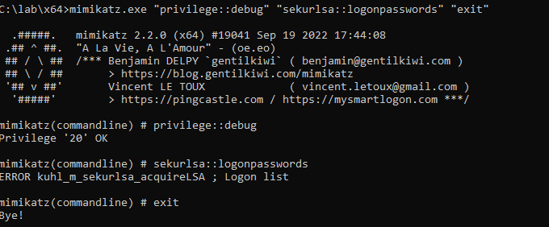
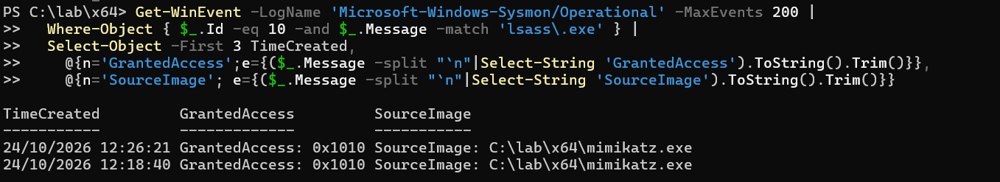
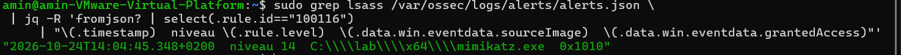
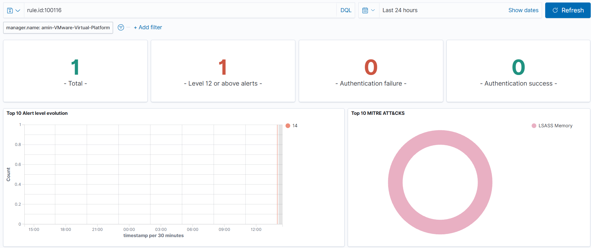
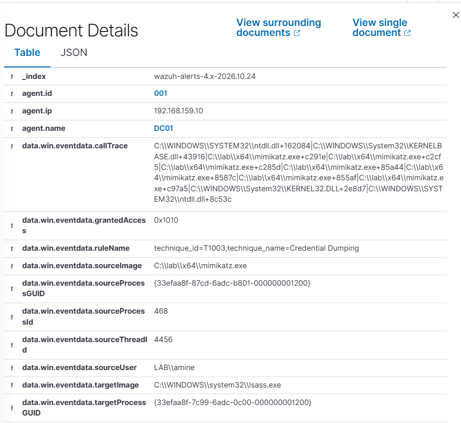
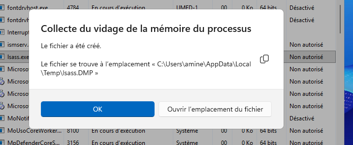

# Mimikatz / accès LSASS — détection Wazuh

**Statut :** validé le 24/10/2026

Exécution de **Mimikatz** (`sekurlsa::logonpasswords`) sur **DC01** et détection de l'**accès à la mémoire de `lsass.exe`** via **Sysmon (Event ID 10 — ProcessAccess)**. Point clé défensif : l'Event 10 se déclenche sur **l'ouverture du handle** vers `lsass`, pas sur l'extraction réussie des secrets — la détection tient donc même quand le dump échoue (ici bloqué par la LSA Protection). Objectif : promouvoir cet accès en **alerte critique (niveau 14)** taguée **T1003.001**.

```
DC01 : mimikatz  privilege::debug + sekurlsa::logonpasswords
   → ouverture d'un handle sur lsass.exe (GrantedAccess 0x1010)
   → Sysmon Event 10 (ProcessAccess) → canal Microsoft-Windows-Sysmon/Operational
   → agent Wazuh (eventchannel) → manager (sysmon_event_10 → règle 100116) → dashboard
```

## Environnement

| Élément | Valeur |
|---|---|
| Cible | DC01 — Windows Server 2025, domaine `lab.local` (LAB), `192.168.159.10`, VMnet8 (NAT) |
| Journal source | Sysmon (`Microsoft-Windows-Sysmon/Operational`, **déjà collecté**) |
| Sysmon | config sysmon-modular ; `ProcessAccess` (EID 10) **déjà réglé pour lsass** (voir §1) |
| Outil d'attaque | Mimikatz 2.2.0 x64 (build officielle gentilkiwi) dans `C:\lab\x64` |
| Wazuh | manager 4.9.2 (`192.168.159.141`), agent 4.9.2 `DC01` (ID 001) |
| Acteur | session élevée, `sourceUser = LAB\amine` |

## 1. Pré-requis — l'Event 10 journalise l'accès à LSASS

Rien à ajouter côté collecte : le canal Sysmon est déjà lu par l'agent (cas Sysmon précédents). Le vrai point de vigilance est **Sysmon lui-même** : `ProcessAccess` est l'événement le plus volumineux et beaucoup de configs le filtrent fortement — s'il ne logue pas l'accès à `lsass`, aucune télémétrie → aucune détection.

Vérification de la config active (`sysmon -c`) : la config sysmon-modular en place **couvre déjà lsass**, avec des règles d'`include` dédiées sur les masques classiques du credential dumping —

```
TargetImage = lsass.exe  +  GrantedAccess ∈ { 0x1FFFFF, 0x1F1FFF, 0x1010, 0x143A }
+ CallTrace ntdll;kernelbase;UNKNOWN  (0x1410 / 0x147A / 0x1F0FFF…)
+ CallTrace contenant dbghelp.dll / dbgcore.dll
```

→ **aucune modification Sysmon nécessaire** : l'accès de Mimikatz en `0x1010` est capté d'office.

> **Piège mis en évidence.** La même config contient une exclusion `ProcessAccess` sur `SourceImage` finissant par `taskmgr.exe`. Le vidage LSASS « natif » (Gestionnaire des tâches → clic droit `lsass.exe` → *Créer un fichier de vidage*) **ne génère donc aucun Event 10** : il est supprimé à la source. Impossible de valider le cas par cette voie → il faut un véritable outil de dumping (Mimikatz).

Diagnostic (après un accès de test) :

```powershell
Get-WinEvent -LogName 'Microsoft-Windows-Sysmon/Operational' -MaxEvents 200 |
  Where-Object { $_.Id -eq 10 -and $_.Message -match 'lsass\.exe' } |
  Select-Object -First 3 TimeCreated,
    @{n='GrantedAccess';e={($_.Message -split "`n"|Select-String 'GrantedAccess').ToString().Trim()}},
    @{n='SourceImage'; e={($_.Message -split "`n"|Select-String 'SourceImage').ToString().Trim()}}
```

## 2. Exécution de l'attaque (DC01)

Build officielle `gentilkiwi/mimikatz` déposée dans `C:\lab\x64`. **Trois couches de Microsoft Defender bloquent Mimikatz**, à distinguer car elles ne se lèvent pas de la même façon (labo isolé uniquement) :

1. **Scan de fichier** — `mimikatz.exe` est quarantainé à l'écriture. Levé par une **exclusion de dossier** (`Add-MpPreference -ExclusionPath C:\lab`). Le binaire survit (`Test-Path` → `True`).
2. **AMSI PowerShell** — lancer la commande *depuis PowerShell* échoue avec `ScriptContainedMaliciousContent` : l'AMSI inspecte la ligne de commande (`mimikatz`, `sekurlsa`) avant exécution. L'exclusion de dossier **ne couvre pas** ce canal → lancer depuis **`cmd`**, pas PowerShell.
3. **Détection comportementale sur la ligne de commande** — même depuis `cmd`, Defender tue le process avant la bannière (« Accès refusé »). `Get-MpThreatDetection` confirme le blocage sur `{CmdLine: …\mimikatz.exe privilege::debug sekurlsa::logonpasswords exit}` (`HackTool:Win32/Mimikatz`).

Seule la **désactivation temporaire de la protection temps réel + de la règle ASR LSASS** (Tamper Protection OFF au préalable, sur VM isolée) lève la 3ᵉ couche :

```powershell
Set-MpPreference -DisableRealtimeMonitoring $true
Set-MpPreference -AttackSurfaceReductionRules_Ids 9e6c4e1f-7d60-472f-ba1a-a39ef669e4b2 -AttackSurfaceReductionRules_Actions Disabled
Get-MpComputerStatus | Select-Object RealTimeProtectionEnabled   # doit afficher False
```

Exécution depuis **`cmd` élevé** :

```bat
cd C:\lab\x64
mimikatz.exe "privilege::debug" "sekurlsa::logonpasswords" "exit"
```



`privilege::debug` → `Privilege '20' OK`, puis `sekurlsa::logonpasswords` → **`ERROR kuhl_m_sekurlsa_acquireLSA ; Logon list`**. Cette erreur = **LSA Protection (RunAsPPL)** probablement active sur Server 2025 : Mimikatz n'a **pas** lu les secrets. Sans importance pour la détection : **l'ouverture du handle sur lsass a bien eu lieu**, et c'est elle que Sysmon capture.

Remise en état après le test :

```powershell
Set-MpPreference -DisableRealtimeMonitoring $false
Set-MpPreference -AttackSurfaceReductionRules_Ids 9e6c4e1f-7d60-472f-ba1a-a39ef669e4b2 -AttackSurfaceReductionRules_Actions Enabled
Remove-MpPreference -ExclusionPath 'C:\lab'
```
(+ Tamper Protection ON à la souris.)

L'Event 10 émis porte bien le masque attendu (`0x1010`, source `mimikatz.exe`) :



## 3. Comportement natif de Wazuh

| Événement | Règle native | Niveau |
|---|---|---|
| Sysmon EID 10 — ProcessAccess | groupe `sysmon_event_10` (`0800-sysmon_id_10.xml`) | 0 (décodé, pas d'alerte) |

Comme l'EID 1 au cas PowerShell, l'Event 10 reste **niveau 0** : décodé mais non alertant. C'est la règle custom qui promeut l'accès LSASS. Le groupe d'ancrage se confirme sur un event réel :

```bash
sudo /var/ossec/bin/wazuh-logtest   # coller un Event 10, lire le groupe déclenché
```

## 4. Réglage — règle custom (credential access critique)

Dans `/var/ossec/etc/rules/local_rules.xml` sur le **manager**. ID **100116** : premier libre après 100100/100101 (Sysmon), 100110 (SSH), 100111 (RDP/SMB), 100113 (user/admin) et 100114/100115 (PowerShell).

```xml
<group name="windows,sysmon,">
  <rule id="100116" level="14">
    <if_group>sysmon_event_10</if_group>
    <field name="win.eventdata.targetImage" type="pcre2">(?i)\\lsass\.exe$</field>
    <field name="win.eventdata.grantedAccess" type="pcre2">(?i)^0x(1010|1038|1410|1438|143a|147a|1f1fff|1fffff)$</field>
    <description>Credential dumping : acces memoire LSASS ($(win.eventdata.grantedAccess)) depuis $(win.eventdata.sourceImage)</description>
    <mitre>
      <id>T1003.001</id>
    </mitre>
    <group>credential_access,</group>
  </rule>
</group>
```

Les réglages :
- `if_group sysmon_event_10` → évaluée sur chaque ProcessAccess décodé.
- `targetImage …lsass\.exe$` → le groupe seul couvre **tous** les ProcessAccess ; le filtre sur la cible est indispensable.
- `grantedAccess` dans l'ensemble des masques de lecture du credential dumping. `0x1010` (= `PROCESS_QUERY_LIMITED_INFORMATION + PROCESS_VM_READ`) est celui réellement observé ; les autres (`0x1410`, `0x143A`, `0x1FFFFF`…) couvrent les autres modes/outils, et correspondent à ceux que la config Sysmon elle-même juge dignes d'intérêt.
- `level 14` → au-dessus du niveau 12 « forte importance » des cas précédents, pour marquer le caractère **critique** (dump de secrets sur un DC).
- `T1003.001` (*OS Credential Dumping: LSASS Memory*), groupe `credential_access`.

Validation **avant** redémarrage :

```bash
sudo /var/ossec/bin/wazuh-analysisd -t   # doit se terminer sans ERROR
sudo systemctl restart wazuh-manager
```

## 5. Validation

> Une règle ne s'applique **pas rétroactivement** : le 1ᵉʳ run de Mimikatz (antérieur au chargement de la règle) n'a rien déclenché. Il faut **rejouer** un accès après le `restart` (re-couper le temps réel le temps du run).

Contrôle direct côté manager (lecture robuste même si `tail` coupe la 1ʳᵉ ligne) :

```bash
sudo grep lsass /var/ossec/logs/alerts/alerts.json \
 | jq -R 'fromjson? | select(.rule.id=="100116")
     | "\(.timestamp)  niveau \(.rule.level)  \(.data.win.eventdata.sourceImage)  \(.data.win.eventdata.grantedAccess)"'
```



Dashboard **Threat Hunting**, filtre `rule.id:100116` → alerte **niveau 14**, carte *Level 12 or above* et **MITRE ATT&CK : LSASS Memory** :



Détail de l'alerte (Threat Hunting → Events → ligne dépliée) — tous les champs forensiques :



L'événement remonte : `agent.name = DC01`, `sourceImage = C:\lab\x64\mimikatz.exe`, `grantedAccess = 0x1010`, `targetImage = …\lsass.exe`, `sourceUser = LAB\amine`, `sourceProcessId = 468`. Deux éléments renforcent la qualification :
- un `callTrace` contenant les modules `mimikatz.exe+…` (signal fort : lecture depuis une image non signée, typique de Mimikatz) ;
- le `ruleName` posé par Sysmon lui-même : `technique_id=T1003,technique_name=Credential Dumping`.

> **Contre-exemple.** Le vidage via Gestionnaire des tâches (§1) crée bien un `lsass.DMP`, mais **ne lève aucune alerte** : l'exclusion Sysmon `taskmgr.exe` supprime l'Event 10 à la source. À garder comme illustration de la limite de couverture.
>
> 

## Problèmes rencontrés

| Symptôme | Cause | Solution |
|---|---|---|
| `Get-WinEvent` EID 10 + lsass → vide | aucun accès lsass récent, ou vidage via taskmgr (exclu) | générer un accès réel (Mimikatz) **avant** de vérifier |
| Vidage Task Manager non détecté | `ProcessAccess exclude` sur `SourceImage …taskmgr.exe` | utiliser un vrai outil de dumping (Mimikatz) |
| `ScriptContainedMaliciousContent` sous PowerShell | AMSI inspecte la ligne de commande | lancer depuis **`cmd`**, pas PowerShell |
| « Accès refusé » avant la bannière | détection comportementale Defender sur la CmdLine (`Get-MpThreatDetection`) | désactiver temps réel + ASR LSASS (labo isolé) |
| `privilige::debug` ignoré, puis « Accès refusé » | **faute de frappe** (privi**le**ge) | orthographe exacte `privilege::debug` |
| « Accès refusé » (shell non élevé) | cmd lancé en utilisateur standard | *Exécuter en tant qu'administrateur* |
| `ERROR … acquireLSA` / dump vide | **LSA Protection (RunAsPPL)** sur Server 2025 | sans impact : l'ouverture du handle génère quand même l'Event 10 |
| Règle muette | mauvais `if_group` | confirmer `sysmon_event_10` via `wazuh-logtest` |
| Aucune alerte après le 1ᵉʳ run | règle chargée **après** l'accès (pas de rétroactif) | rejouer un accès après `restart wazuh-manager` |

## Limites et suite

- **Faux positifs** : des accès LSASS légitimes existent (AV, `wmiprvse.exe`, processus Windows). Durcir en combinant avec `win.eventdata.callTrace` (modules `UNKNOWN` ou pointant vers une image non signée = fort signal) et/ou une whitelist de `sourceImage` connus (`level 0`).
- **Contournements à couvrir** : dump via `comsvcs.dll`/`rundll32` (toujours un Event 10, mais `SourceImage = rundll32.exe`), duplication de handle, ou lecture par driver signé susceptible d'éviter l'Event 10 → compléter avec l'**Event 25 (ProcessTampering)** et, à terme, un EDR.
- **Active Response** (`kill` du `sourceImage`, voire isolation de l'hôte) sur 100116.
- **Corréler avec l'Event 1** du même `sourceProcessGUID`/`processID` pour relier l'accès à son processus initiateur et à l'utilisateur.
- **RunAsPPL comme mesure préventive** : la LSA Protection a ici neutralisé l'extraction — à documenter comme durcissement, et tester le contournement `mimidrv` pour vérifier que l'Event 10 reste émis malgré tout.
