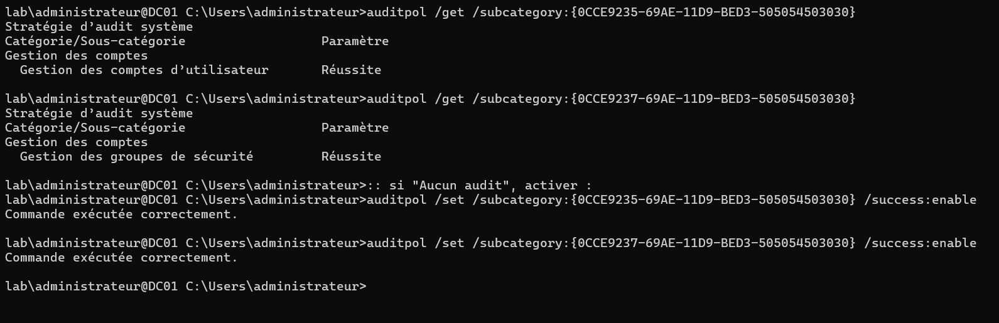
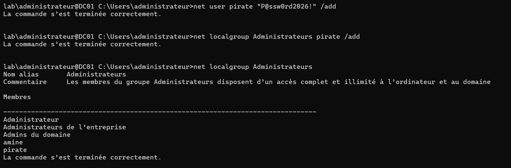
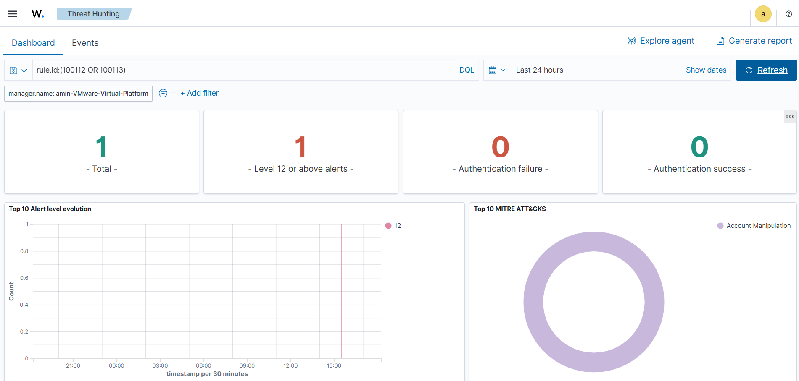
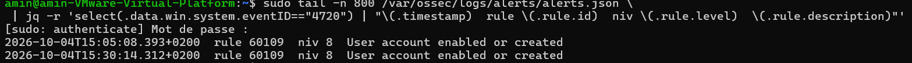

# Création d'utilisateur et ajout aux administrateurs — détection Wazuh

**Statut :** validé le 04/10/2026

Création d'un compte puis ajout au groupe Administrateurs sur **DC01**, et détection des événements Windows **4720** (création de compte) et **4732** (ajout à un groupe local) par Wazuh. Au-delà de la détection native de chaque événement, objectif : une alerte de **niveau élevé « changement de privilèges »** sur l'ajout d'un compte au groupe Administrateurs (builtin, SID `S-1-5-32-544`).

```
DC01 (net user + net localgroup Administrateurs) → journal Security (4720 + 4732) → agent Wazuh (eventchannel) → manager (60109 natif pour 4720 / 60103 → règle 100113 pour 4732) → dashboard
```

## Environnement

| Élément | Valeur |
|---|---|
| Cible | DC01 — Windows Server 2025, domaine `lab.local` (LAB), `192.168.159.10`, VMnet8 (NAT) |
| Journal source | canal **Security** (eventchannel), collecte par défaut de l'agent |
| Audit | sous-catégories *Gestion des comptes d'utilisateur* et *Gestion des groupes de sécurité* en **Réussite** (défaut d'un DC) |
| Wazuh | manager 4.9.2 (`192.168.159.141`), agent 4.9.2 `DC01` (ID 001) |
| Acteur | compte `Administrateur` du domaine (OS en français) |

## 1. Pré-requis — politique d'audit (rien à ajouter côté agent)

Contrairement à Suricata (bloc `localfile` ajouté pour `eve.json`), le canal **Security** est collecté par défaut par l'agent Windows, et les 4720/4732 en font partie. Seule condition : l'audit de la gestion des comptes et des groupes doit être en **Réussite** — activé par défaut sur un contrôleur de domaine.

```bat
:: GUID = indépendant de la langue de l'OS ; les deux doivent renvoyer « Réussite »
auditpol /get /subcategory:{0CCE9235-69AE-11D9-BED3-505054503030}   :: Gestion des comptes d'utilisateur
auditpol /get /subcategory:{0CCE9237-69AE-11D9-BED3-505054503030}   :: Gestion des groupes de sécurité
```



## 2. Création du compte et ajout aux administrateurs (DC01)

Sur un DC, les cmdlets *LocalAccounts* (`New-LocalUser`, `Add-LocalGroupMember`) ne fonctionnent pas (pas de SAM local) : on passe par `net`, qui opère sur l'annuaire et le groupe builtin.

```bat
net user pirate "P@ssw0rd2026!" /add          :: -> 4720 (compte de domaine créé)
net localgroup Administrateurs pirate /add     :: -> 4732 (ajout au builtin Administrateurs, SID S-1-5-32-544)
net localgroup Administrateurs                 :: vérification des membres
```



Contrôle direct dans le journal Security :

```bat
wevtutil qe Security /q:"*[System[(EventID=4720 or EventID=4732)]]" /c:5 /rd:true /f:text
```

Les deux événements sont bien présents : le **4720** porte le nouveau compte, le **4732** porte le groupe Administrateurs (côté *Membre*, seul le SID du compte ajouté apparaît, le nom est `-`).

```
Event ID: 4720  — Un compte d'utilisateur a été créé.
  Nouveau compte : Nom du compte = pirate   SID = ...-1104

Event ID: 4732  — Un membre a été ajouté à un groupe local dont la sécurité est activée.
  Membre : SID = ...-1104   (Nom du compte : -)
  Groupe : Nom = Administrateurs   SID = S-1-5-32-544   Domaine = Builtin
  Sujet  : Administrateur
```

## 3. Comportement natif de Wazuh

| Événement Security | Règle | Niveau |
|---|---|---|
| 4720 — compte créé | **60109** — *user account enabled or created* | 8 |
| 4732 — ajout à un groupe local | **60103** (parent audit succès) → **60113** — *group management* (taggée T1484) | 0 → 5 |

Le **4720 est déjà couvert nativement** (60109, niveau 8 ; technique ATT&CK T1136). Le **4732** déclenche la native 60113 (niveau 5), insuffisante comme signal d'élévation de privilèges — d'où la règle custom ci-dessous, qui hausse spécifiquement l'ajout au groupe Administrateurs.

## 4. Réglage — règle custom (alerte changement de privilèges)

Dans `/var/ossec/etc/rules/local_rules.xml` sur le **manager** :

```xml
<group name="windows,windows_security,account_management,">
  <rule id="100113" level="12">
    <if_sid>60103</if_sid>
    <field name="win.system.eventID">^4732$</field>
    <field name="win.eventdata.targetSid">^S-1-5-32-544$</field>
    <description>Windows : élévation de privilèges — compte ajouté aux Administrateurs par $(win.eventdata.subjectUserName)</description>
    <mitre>
      <id>T1098</id>
    </mitre>
    <group>account_management,privilege_escalation,</group>
  </rule>
</group>
```

Les réglages :
- `if_sid 60103` + `win.system.eventID ^4732$` → règle évaluée sur chaque 4732 (audit succès).
- `targetSid ^S-1-5-32-544$` → restreint au builtin **Administrateurs** (SID indépendant de la langue). Ce champ supplémentaire rend la règle **plus spécifique** que la native 60113 : c'est 100113 (niveau 12) qui l'emporte. Retirer cette ligne alerterait sur l'ajout à **n'importe quel** groupe local.
- `level 12` → au-dessus du natif, classé événement de forte importance (carte « Level 12 or above » du dashboard).
- `T1098` (*Account Manipulation*) — manipulation de compte / élévation via appartenance à un groupe privilégié.
- ID **100113** : premier libre après 100110 (SSH) et 100111 (RDP/SMB). Une règle 100112 sur le 4720 a été testée puis retirée (voir *Problèmes*) : à spécificité égale, la native 60109 la supplantait — le 4720 est laissé au natif.

Validation **avant** redémarrage :

```bash
sudo /var/ossec/bin/wazuh-analysisd -t   # doit se terminer sans ERROR
sudo systemctl restart wazuh-manager
```

## 5. Validation

Les 4720/4732 émis **avant** le déploiement de la règle ne la déclenchent pas rétroactivement, et un `/add` sur un compte/membre existant ne produit aucun événement : on supprime puis recrée pour générer des événements frais.

```bat
net user pirate /delete
net user pirate "P@ssw0rd2026!" /add
net localgroup Administrateurs pirate /add
```

Dashboard **Threat Hunting → Dashboard**, requête `rule.id:100113` :

Résultat : **1 alerte niveau 12** (carte « Level 12 or above »), taguée **Account Manipulation (T1098)** dans « Top 10 MITRE ATT&CKS », sur l'agent `DC01`, `data.win.eventdata.subjectUserName: Administrateur`.



Le 4720, lui, reste visible sous la règle native 60109 :

```bash
sudo tail -n 800 /var/ossec/logs/alerts/alerts.json \
 | jq -r 'select(.data.win.system.eventID=="4720") | "\(.timestamp)  rule \(.rule.id)  niveau \(.rule.level)  \(.rule.description)"'
```



Nettoyage du compte de test : `net user pirate /delete`.

## Problèmes rencontrés

| Symptôme | Cause | Solution |
|---|---|---|
| Aucune alerte custom après la 1re création | 4720/4732 émis avant le déploiement de la règle ; `/add` sur compte existant = aucun event | supprimer puis recréer (`net user /delete`) **après** redémarrage du manager |
| Règle 100112 (4720) jamais déclenchée | native 60109 de même spécificité (match sur l'EventID seul) la supplante | retirer 100112 ; laisser le 4720 au natif (60109, niveau 8) |
| Dashboard vide en « Last 15 minutes » | horloges désynchronisées DC01/manager (4732 tamponné ~2 h après l'heure du manager) | élargir la plage à « Last 24 hours » ; synchroniser l'heure (NTP) |
| *Membre* du 4732 affiché « Nom du compte : - » | l'événement ne porte que le SID du membre ajouté, pas le nom | identifier/corréler sur le SID (`…-1104`), pas sur le nom |

## Limites et suite

- **Synchroniser l'heure (NTP)** sur DC01 et le manager : les horloges décalées faussent plages de temps, timelines et corrélations.
- Corréler **4720 → 4732** pour la même cible (compte fraîchement créé puis promu admin, fort signal de persistance/priv-esc) : délicat en natif car les champs diffèrent — SID du nouveau compte en `targetSid` (4720) vs `memberSid` (4732) — piste pour une règle de corrélation.
- **Active Response** (`disable-account` ou retrait du groupe) sur 100113 pour réagir automatiquement.
- Étendre aux ajouts à des groupes de domaine privilégiés : **4728** (groupe global, ex. *Admins du domaine*) et **4756** (groupe universel, ex. *Administrateurs de l'entreprise* / *du schéma*), non couverts par le filtre builtin `S-1-5-32-544`.
