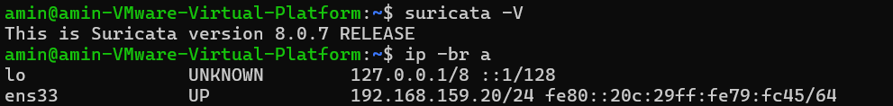
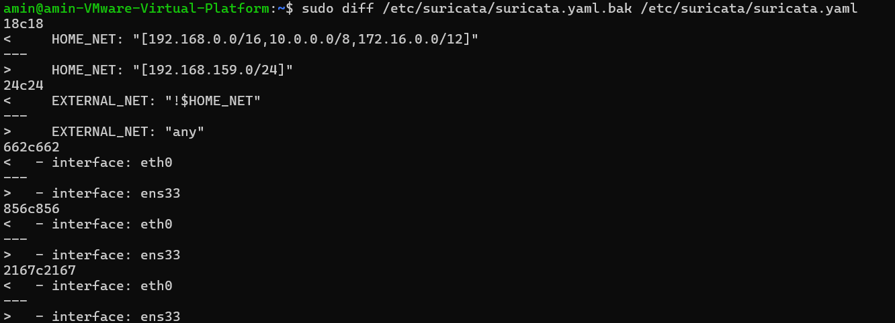
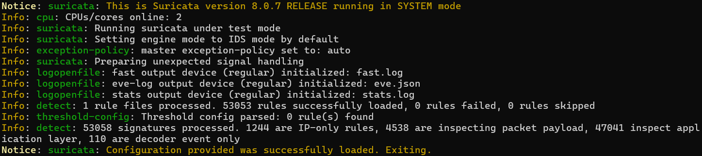
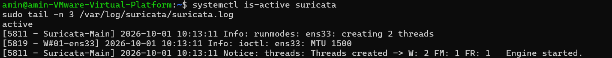
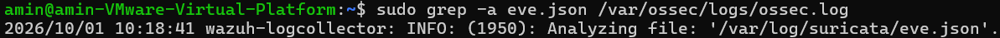
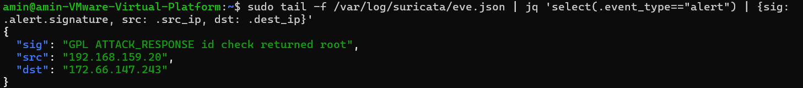
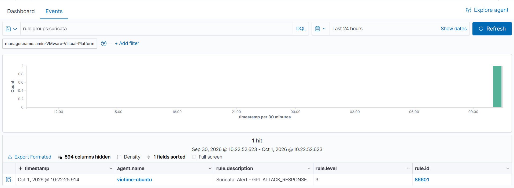
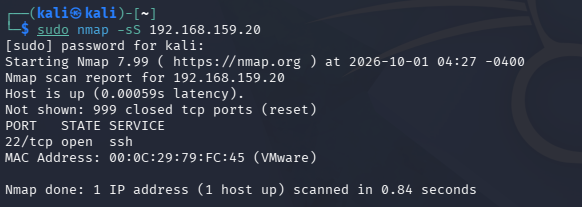
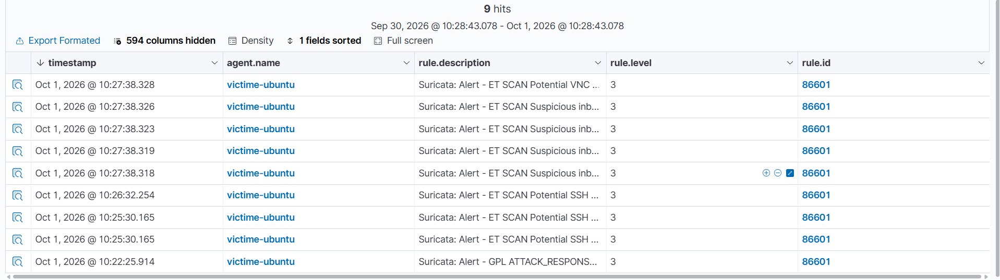

# Suricata + intégration Wazuh

**Statut :** validé le 01/10/2026

Suricata est installé en NIDS sur **victime-ubuntu**. Ses événements sont écrits en JSON dans `eve.json`, collectés par l'agent Wazuh et consultables dans le dashboard.

```
Suricata (ens33) → /var/log/suricata/eve.json → agent Wazuh (logcollector) → manager (règles 86600/86601) → dashboard
```

## Environnement

| Élément | Valeur |
|---|---|
| Sonde | victime-ubuntu — Ubuntu 24.04, `192.168.159.20`, VMnet8 (NAT) |
| Suricata | 8.0.7 (PPA OISF), mode IDS, capture AF_PACKET sur `ens33` |
| Règles | ET Open via `suricata-update` (53 053 règles chargées) |
| Wazuh | manager 4.9.2 (`192.168.159.141`), agent 4.9.2 `victime-ubuntu` |
| Attaquant | Kali, même réseau VMnet8 |

## 1. Installation

```bash
sudo apt install -y software-properties-common
sudo add-apt-repository -y ppa:oisf/suricata-stable
sudo apt update && sudo apt install -y suricata jq
suricata -V
ip -br a
```



L'installation ne touche pas à l'agent Wazuh, épinglé en 4.9.2-1.

## 2. Configuration

Trois paramètres de `/etc/suricata/suricata.yaml` sont modifiés, après sauvegarde dans `suricata.yaml.bak` :

| Paramètre | Défaut | Labo | Raison |
|---|---|---|---|
| `HOME_NET` | plages RFC 1918 | `[192.168.159.0/24]` | réseau du labo ; reste valide si l'IP DHCP de la VM change |
| `EXTERNAL_NET` | `!$HOME_NET` | `any` | Kali est dans le même /24 : avec la valeur par défaut, elle serait vue comme interne et les règles `ET SCAN` (`$EXTERNAL_NET → $HOME_NET`) ne se déclencheraient jamais |
| `af-packet` › `interface` | `eth0` | `ens33` | nom réel de l'interface |

```bash
F=/etc/suricata/suricata.yaml
sudo cp $F $F.bak
sudo sed -i -E "s|^(\s*HOME_NET:).*|\1 \"[192.168.159.0/24]\"|" $F
sudo sed -i -E "s|^(\s*EXTERNAL_NET:).*|\1 \"any\"|" $F
sudo sed -i "s|interface: eth0|interface: ens33|g" $F
sudo diff $F.bak $F
```



La sortie `eve-log` (`/var/log/suricata/eve.json`) est active par défaut, rien à modifier.

## 3. Règles et démarrage

```bash
sudo suricata-update                                  # ET Open → /var/lib/suricata/rules/suricata.rules
sudo suricata -T -c /etc/suricata/suricata.yaml -v    # test de la configuration
sudo systemctl enable suricata && sudo systemctl restart suricata
systemctl is-active suricata
sudo tail -n 3 /var/log/suricata/suricata.log
```

Le test charge les 53 053 règles sans échec :



Le moteur démarre en capture sur `ens33` avec deux threads de travail :



## 4. Intégration Wazuh

Bloc ajouté à la fin de `/var/ossec/etc/ossec.conf` sur l'agent :

```xml
<ossec_config>
  <localfile>
    <log_format>json</log_format>
    <location>/var/log/suricata/eve.json</location>
  </localfile>
</ossec_config>
```

```bash
sudo systemctl restart wazuh-agent
sudo grep -a eve.json /var/ossec/logs/ossec.log
```



Rien à configurer côté manager : le décodeur JSON et les règles Suricata sont natifs. Seuls les événements `event_type: alert` produisent une alerte (règle **86601**, niveau 3). Les `flow`, `dns`, `http`, `tls`… sont décodés mais restent au niveau 0, donc non indexés.

## 5. Validation

### Alerte IDS de test

La signature ET Open 2100498 (`GPL ATTACK_RESPONSE id check returned root`) se déclenche sur tout paquet contenant `uid=0(root)`. Une requête HTTP portant ce motif suffit.

```bash
# terminal 1 : alertes en direct
sudo tail -f /var/log/suricata/eve.json | jq 'select(.event_type=="alert") | {sig: .alert.signature, src: .src_ip, dst: .dest_ip}'

# terminal 2 : génération du trafic
curl -s -o /dev/null "http://example.com/uid=0(root)"
```

L'alerte est écrite dans `eve.json` :



Puis elle remonte dans Wazuh (**Threat Hunting** → **Events**, requête `rule.groups:suricata`) :



### Scan réseau depuis Kali

```bash
sudo nmap -sS 192.168.159.20
```





| Heure | Signature | Origine |
|---|---|---|
| 10:22:25 | `GPL ATTACK_RESPONSE id check returned root` | test `curl` |
| 10:25:30 – 10:26:32 | `ET SCAN Potential SSH …` (×3) | à identifier (voir Limites et suite) |
| 10:27:38 | `ET SCAN Suspicious inbound to …` (×4) | scan nmap |
| 10:27:38 | `ET SCAN Potential VNC …` | scan nmap |

Toutes ces alertes passent par la règle 86601 (niveau 3) sur l'agent `victime-ubuntu`.

## Problèmes rencontrés

| Symptôme | Cause | Solution |
|---|---|---|
| `curl testmynids.org` : `Could not resolve host` | domaine non résolu par le DNS de la VM | requête vers example.com contenant `uid=0(root)`, qui déclenche la même signature |
| `grep` sur `suricata.yaml` : permission refusée | fichier lisible par root uniquement | `sudo grep` |
| `grep` sur `ossec.log` : « fichiers binaires correspondent » | octets non texte dans le log | `grep -a` |

## Limites et suite

- La sonde tourne sur la victime et ne voit a priori que le trafic de victime-ubuntu. En entreprise, ce rôle revient à une sonde dédiée branchée sur un port SPAN ou un TAP.
- Les alertes `ET SCAN Potential SSH …` de 10:25 – 10:26 précèdent le scan : leur origine reste à identifier via `data.src_ip` et `data.dest_ip`.
- Toutes les alertes Suricata sortent au niveau 3 : une règle custom (niveau relevé, MITRE T1046) reste à écrire pour la détection de scan.
