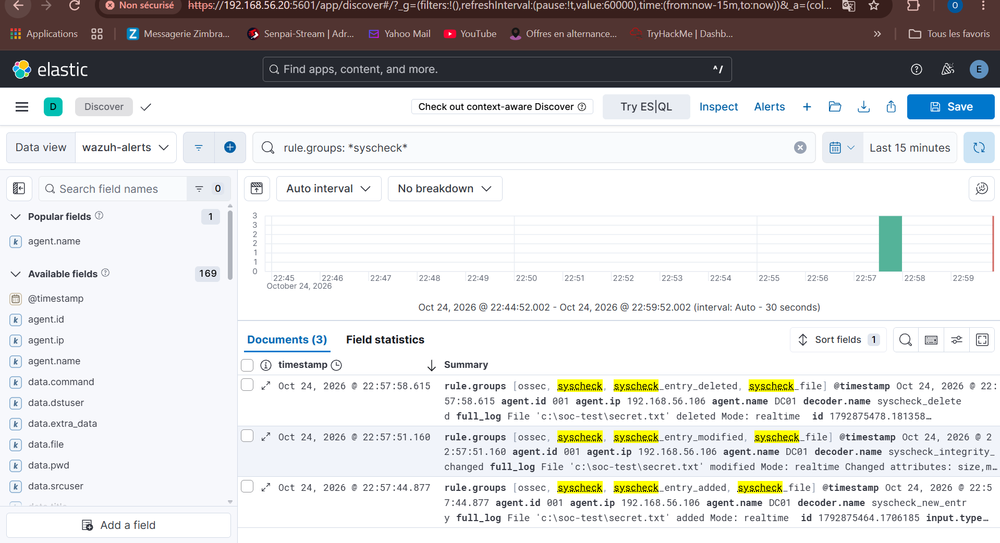
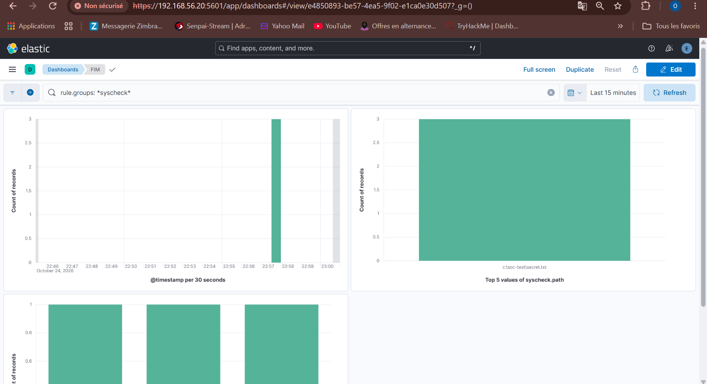

# Runbook — Cas 10 : FIM — modification d'un fichier sensible

| | |
|---|---|
| **Cas** | 10 |
| **Hôtes cibles** | DC01 (`C:\soc-test`) · victime-ubuntu (`/var/www`, `/etc`) |
| **Source de log** | Wazuh syscheck (FIM temps réel) |
| **Règle(s) Wazuh** | 554 (ajout) · 550 (modification) · 553 (suppression), groupe `syscheck` |
| **Niveau** | natif ≈ 5-7 (voir Remédiation : relever le niveau) |
| **MITRE ATT&CK** | T1565.001 — Stored Data Manipulation |
| **Requête dashboard** | `rule.groups:syscheck` |
| **TheHive** | seulement si le niveau est relevé ≥ 10 (voir Remédiation) |

## Description

Le **File Integrity Monitoring (FIM)** surveille des fichiers et répertoires sensibles et alerte à toute **création, modification ou suppression**. Il couvre plusieurs intentions d'attaque : altération de fichiers système (`/etc/passwd`, `/etc/shadow`, confs), sabotage de données, ou dépôt de fichiers (recoupe le cas 8 pour le webroot).

Wazuh distingue trois événements, chacun avec sa règle native :

| Événement | Règle native | `syscheck.event` |
|---|---|---|
| Fichier ajouté | 554 | `added` |
| Fichier modifié | 550 | `modified` |
| Fichier supprimé | 553 | `deleted` |

## Détection

- **Chaîne :** modification du fichier → syscheck (temps réel) → agent → manager → règle 554/550/553 → dashboard + Elastic → TheHive (si niveau relevé).
- **Config agent (déjà en place) :**
  ```xml
  <directories realtime="yes" check_all="yes" report_changes="yes">C:\soc-test</directories>
  ```
  `report_changes="yes"` fait remonter le **diff du contenu** (champ `syscheck.diff`) pour les fichiers texte — précieux en investigation.
- Sous Linux, surveiller `/etc` (comptes, confs) et `/var/www` (cas 8) ; `check_all="yes"` suit hash, taille, permissions, propriétaire, mtime.
- **Dashboards :** Kibana → **FIM** (chronologie, `syscheck.path`, `syscheck.event`).

## Procédure d'investigation

1. **Confirmer** — FIM, filtre `rule.groups:syscheck`. Noter `syscheck.path`, `syscheck.event` (added/modified/deleted) et l'horodatage.
2. **Lire ce qui a changé** :
   - `syscheck.sha256_before` / `syscheck.sha256_after` — confirme un changement de contenu réel.
   - `syscheck.diff` — le détail des lignes modifiées (si `report_changes`). Pour `/etc/passwd` : un compte UID 0 ajouté ? un shell changé ?
   - `syscheck.uname_after` / `syscheck.perm_after` — changement de propriétaire ou de permissions (ex. un fichier passé en SUID).
3. **Identifier l'acteur** — le FIM dit *quoi* a changé, pas *qui*. Corréler par horodatage avec :
   - Linux : événements `auditd` / commandes shell (qui a édité le fichier), connexions actives.
   - Windows : EID 1 (Sysmon) des processus actifs au moment du changement.
4. **Qualifier l'intention** — modification de `/etc/shadow` ou `/etc/sudoers` = escalade de privilèges probable ; suppression de logs = anti-forensique ; ajout dans `/var/www` = cas 8.
5. **Évaluer la portée** — un seul fichier ou une série ? Un balayage de modifications = incident actif.

## Remédiation

- **Immédiat :** restaurer le fichier depuis une sauvegarde de référence ; si un compte/privilège a été altéré, le corriger et auditer ; isoler l'hôte si l'altération fait partie d'une intrusion active.
- **Durcissement / prévention :**
  - **Relever le niveau** des alertes FIM sur les chemins critiques via une règle custom : modification de `/etc/shadow`, `/etc/sudoers`, `/etc/passwd` → niveau 12, tag **T1565.001**, pour dépasser le seuil de transmission à TheHive.
    ```xml
    <rule id="100300" level="12">
      <if_sid>550,553,554</if_sid>
      <field name="syscheck.path" type="pcre2">^/etc/(passwd|shadow|sudoers)</field>
      <description>FIM : modification d'un fichier systeme critique ($(syscheck.path))</description>
      <mitre><id>T1565.001</id></mitre>
    </rule>
    ```
  - Permissions strictes et immuabilité (`chattr +i`) sur les fichiers de référence qui ne changent jamais.
  - Sauvegarde hors-ligne des fichiers de conf pour la restauration et le diff.
- **Limites connues :** le FIM temps réel peut manquer des changements très rapides si la file est saturée (un scan périodique `frequency` en complément) ; il détecte le changement, pas l'auteur — d'où la corrélation obligatoire avec les logs d'exécution.

## Captures

**Les 3 événements FIM (added / modified / deleted) dans Discover**



**Dashboard Kibana « FIM » rempli : chronologie, `syscheck.path`, `syscheck.event`**


