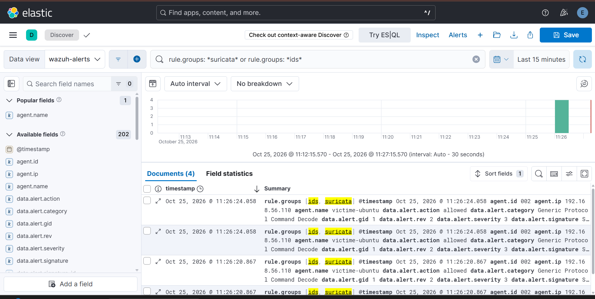
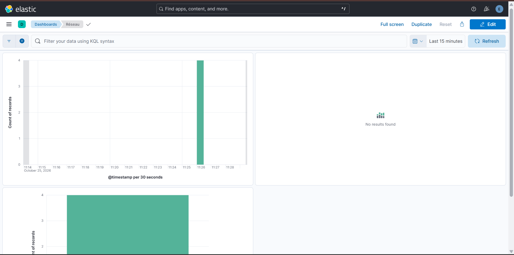
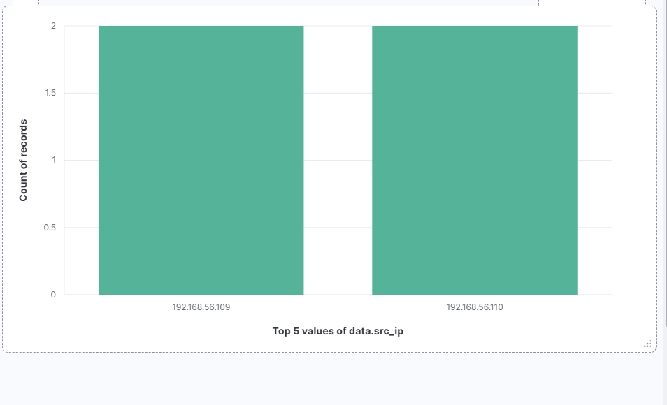

# Runbook — Cas 3 : Scan réseau nmap (Suricata NIDS)

| | |
|---|---|
| **Cas** | 3 |
| **Hôte sonde / cible** | victime-ubuntu (`192.168.56.110`, Suricata sur `enp0s8`) |
| **Attaquant (labo)** | Kali (`192.168.56.109`) |
| **Source de log** | Suricata → `/var/log/suricata/eve.json` → agent Wazuh (002) |
| **Règle(s) Wazuh** | 86601 (alerte Suricata, native) |
| **Niveau** | 3 |
| **MITRE ATT&CK** | T1046 — Network Service Discovery |
| **Requête dashboard** | `rule.groups:suricata AND data.src_ip:192.168.56.109` |
| **TheHive** | Non par défaut — niveau 3, sous le seuil de transmission de l'intégration (`<level>10</level>`) |

## Description

Détection d'un **scan de ports et de services** lancé avec nmap depuis Kali. C'est la phase de **reconnaissance** : l'attaquant cartographie les ports ouverts, les versions de services et l'OS avant de choisir un vecteur d'exploitation.

Le scan `nmap -A` est volontairement bruyant : il combine scan SYN, détection de version (`-sV`), détection d'OS (`-O`) et scripts NSE (`-sC`). Les scripts NSE envoient notamment des requêtes HTTP avec un User-Agent nmap, facilement reconnues par les signatures **ET SCAN** d'Emerging Threats.

> Toutes les alertes Suricata remontent au **niveau 3** (règle native 86601). C'est un signal faible : il déclenche un triage, il ne prouve pas un incident à lui seul.

## Rejouer le cas

Depuis Kali :
```bash
nmap -A -T4 192.168.56.110
```

Prérequis côté victime : Suricata démarré sur `enp0s8` avec les règles ET à jour (`sudo suricata-update && sudo systemctl restart suricata`), et `jq` installé (`sudo apt install -y jq`).
## Détection

- **Chaîne :** Kali (nmap) → trafic capturé par Suricata sur `enp0s8` → `eve.json` → logcollector de l'agent → manager (décodeur JSON natif) → dashboard Wazuh + Elastic (Filebeat 8) → TheHive.
- Seuls les événements `event_type: alert` produisent une alerte Wazuh (règle **86601**, niveau 3). Les `flow`, `dns`, `http`, `tls` sont décodés mais restent au niveau 0.
- **Signatures typiques sur un `nmap -A` :** `ET SCAN Possible Nmap User-Agent Observed`, `ET SCAN Nmap Scripting Engine User-Agent Detected`, `ET SCAN Suspicious inbound to <port>`, `ET SCAN Potential SSH Scan`.
- **Dashboards :** Wazuh → Threat Hunting → Events (filtre `rule.groups:suricata`) ; Kibana → dashboard **Réseau** (évolution, `data.src_ip`, signatures).

## Procédure d'investigation

1. **Confirmer** — Threat Hunting, **Last 15 minutes**, requête `rule.groups:suricata`. Attendu : une rafale d'alertes niveau 3 depuis la même `data.src_ip`.
2. **Identifier origine, cible et signatures** — champs `data.src_ip`, `data.dest_ip`, `data.dest_port`, `data.alert.signature`. En direct sur la sonde :
   ```bash
   sudo tail -f /var/log/suricata/eve.json \
     | jq -c 'select(.event_type=="alert") | {ts: .timestamp, sig: .alert.signature, src: .src_ip, dst: .dest_ip, port: .dest_port}'
   ```
3. **Qualifier l'ampleur** — nombre de ports touchés, durée, rythme :
   ```bash
   sudo jq -r 'select(.event_type=="alert" and .src_ip=="192.168.56.109") | .dest_port' \
     /var/log/suricata/eve.json | sort -n | uniq -c | sort -rn | head -20
   ```
   Beaucoup de ports en quelques secondes depuis une seule IP = scan actif. Des User-Agent nmap = outil identifié.
4. **Qualifier la source** — IP interne ou externe ? Scanner légitime (audit planifié, supervision) ou origine inconnue ? En labo : Kali, attendu.
5. **Enrichir la source** — dans TheHive, ajouter `data.src_ip` comme observable et lancer les analyseurs Cortex **AbuseIPDB_2_0** et **VirusTotal_GetReport_3_1** pour obtenir sa réputation. *Limite labo : l'IP de Kali (192.168.56.109) est privée, ces services ne renvoient rien d'utile ; l'enrichissement prend son sens pour une IP source externe.*
6. **Chercher la suite** — un scan précède souvent une tentative d'accès. Rechercher sur la même `src_ip`, dans les minutes qui suivent : brute force SSH (`rule.groups:authentication_failed`), attaques web (`rule.groups:attack`), dépôt de fichier dans `/var/www` (cas 8).
7. **TheHive** — l'alerte n'étant pas transmise automatiquement (niveau 3), créer le cas manuellement à partir d'un modèle adapté et y regrouper les observables (IP source, ports visés). Avec la règle de corrélation décrite plus bas, le scan passerait au niveau 10 et serait escaladé automatiquement.

## Remédiation

- **Si hostile :** bloquer l'IP source au pare-feu ; vérifier que seuls les services nécessaires sont exposés sur l'hôte visé (`sudo ss -tlnp`).
- **Si scanner légitime non déclaré :** documenter la source et l'exclure du périmètre d'alerte (règle de niveau 0 sur `data.src_ip`).
- **Durcissement / amélioration de la détection :**
  - **Règle custom de corrélation** : plus de N alertes `86601` depuis la même `src_ip` en moins de 60 s → niveau 10, tag **T1046**. Le scan devient une alerte unique et lisible au lieu d'une rafale de niveau 3.
  - **Escalade vers TheHive** : les alertes de niveau 3 ne sont pas transmises aujourd'hui. Baisser le seuil inonderait TheHive (un `nmap -A` produit des dizaines d'alertes). La règle de corrélation ci-dessus règle les deux problèmes : une seule alerte agrégée de niveau 10, transmise automatiquement.
  - **Sonde dédiée** sur port SPAN ou TAP : la sonde actuelle tourne sur la victime et ne voit que son propre trafic.
- **Limites connues :** un scan lent (`-T1`, `-T0`) ou fragmenté passe sous les seuils des signatures ; un scan sans scripts NSE ne déclenche pas les signatures User-Agent.

## Captures

**Alertes Suricata de la victime dans Elastic (Discover, `rule.groups: *suricata*`)**



**Dashboard Kibana « Réseau » : pic du scan et règles déclenchées**



**Panneau des IP sources (`data.src_ip`) : Kali en 192.168.56.109**


