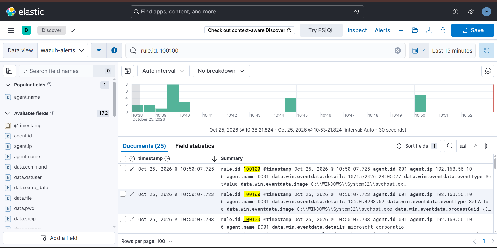
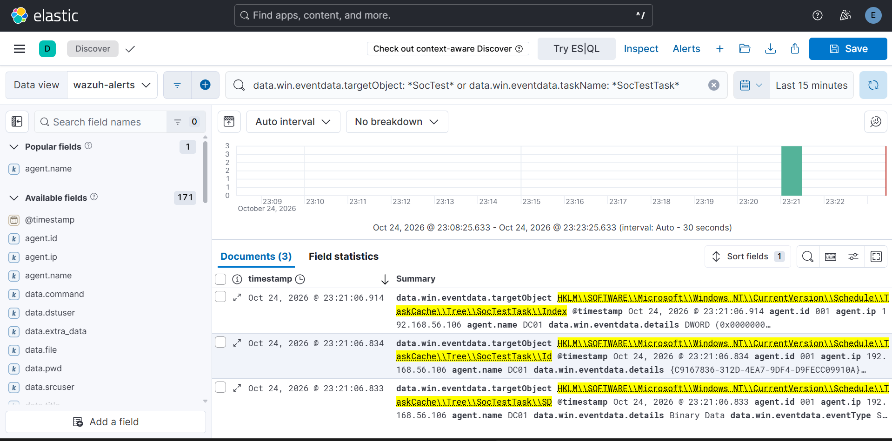
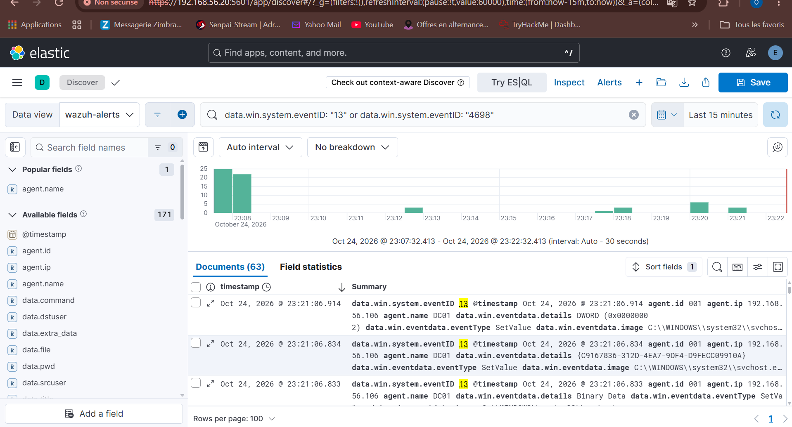

# Runbook — Cas 7 : Persistance par clé Run et tâche planifiée

| | |
|---|---|
| **Cas** | 7 |
| **Hôte cible** | DC01 — Windows (`192.168.56.106`, agent Wazuh 001) |
| **Source de log** | Sysmon (`Microsoft-Windows-Sysmon/Operational`) |
| **Événement Windows** | Sysmon EID 13 — RegistryEvent (Value Set) ; Windows Security EID 4698 pour la tâche planifiée |
| **Règle(s) Wazuh** | 61615 (Sysmon EID 13, natif, niveau 0) → **100100** (custom, niveau 10) |
| **Niveau** | 10 |
| **MITRE ATT&CK** | T1547.001 — Registry Run Keys / Startup Folder · T1053.005 — Scheduled Task |
| **Requête dashboard** | `rule.id:100100` |
| **TheHive** | Oui — niveau ≥ 10, transmis par `integration-wazuh.py` |

## Description

Après un premier accès, un attaquant cherche à **survivre au redémarrage** de la machine. Deux techniques classiques sous Windows, toutes deux couvertes ici du point de vue défensif :

- **Clé Run** — une valeur sous `HKLM\Software\Microsoft\Windows\CurrentVersion\Run` (ou `HKCU\...\Run`) relance un programme à chaque ouverture de session.
- **Tâche planifiée** — une tâche déclenchée au démarrage, à l'ouverture de session ou à intervalle régulier.

> **Angle mort identifié pendant le projet.** La config Sysmon de départ ne surveillait pas les clés `Run`, et la règle native de l'EID 13 (61615) est de **niveau 0** (décodée, pas d'alerte). La clé Run n'était donc pas détectée. Deux correctifs : config Sysmon enrichie (SwiftOnSecurity) pour couvrir les clés `Run`, puis règle **100100** qui promeut l'événement en alerte de niveau 10. La tâche planifiée, elle, laisse une empreinte registre sous `...\Schedule\TaskCache\Tree\...` déjà visible via le même canal.

## Détection

- **Chaîne :** DC01 → Sysmon journalise l'écriture registre (EID 13) → agent Wazuh (eventchannel) → manager → dashboard + Elastic → TheHive.
- Comportement natif : EID 13 → règle **61615**, niveau 0. Sans règle custom, aucune alerte.
- Règle custom **100100** (`wazuh/local_rules.xml`) :
  ```xml
  <rule id="100100" level="10">
    <if_sid>61615</if_sid>
    <field name="win.eventdata.targetObject" type="pcre2">(?i)\\CurrentVersion\\Run</field>
    <description>Persistance : cle de demarrage Run ajoutee ($(win.eventdata.targetObject))</description>
    <mitre><id>T1547.001</id></mitre>
  </rule>
  ```
- **Tâche planifiée :** l'empreinte registre (`TaskCache\Tree`) remonte aussi en EID 13 ; l'événement Windows Security **4698** (A scheduled task was created) est le signal natif de référence côté annuaire.
- **Dashboards :** Wazuh → Threat Hunting (filtre `rule.id:100100`) ; Kibana → dashboard **Processus**.

## Procédure d'investigation

1. **Confirmer** — Threat Hunting, requête `rule.id:100100` → alerte niveau 10 taguée **T1547.001**.
2. **Lire les champs forensiques** (ligne dépliée) :
   - `win.eventdata.targetObject` — la clé écrite (quel `Run`, HKLM ou HKCU).
   - `win.eventdata.details` — la valeur posée : chemin du binaire lancé au démarrage.
   - `win.eventdata.image` — le processus qui écrit la clé (le point clé : `reg.exe`, un script, un binaire inconnu ?).
   - `win.eventdata.user` — l'acteur.
3. **Contrôle direct côté manager :**
   ```bash
   sudo grep 100100 /var/ossec/logs/alerts/alerts.json \
     | jq -r 'select(.rule.id=="100100") | "\(.timestamp)  \(.data.win.eventdata.targetObject)  ->  \(.data.win.eventdata.details)"'
   ```
4. **Évaluer le mécanisme de persistance** — le binaire pointé existe-t-il réellement ? Où est-il (`C:\Users\...\AppData`, `C:\Temp` = suspect ; `C:\Program Files` signé = plus probablement légitime) ? Est-il signé ?
5. **Chercher la tâche planifiée associée** — sur DC01 : `schtasks /query /fo LIST /v` et comparer aux événements 4698 ; une tâche créée dans la même fenêtre que la clé Run = même acteur.
6. **Remonter la chaîne** — corréler avec l'EID 1 (création de processus) du même `processGUID` pour identifier ce qui a posé la persistance, et avec les cas amont (accès initial, exécution).

## Remédiation

- **Immédiat :** supprimer la valeur Run malveillante et la tâche planifiée ; mettre en quarantaine le binaire pointé ; isoler l'hôte si la persistance est confirmée.
- **Durcissement / prévention :**
  - **Active Response** Wazuh sur 100100 (alerte + journalisation renforcée ; suppression automatique à manier avec prudence).
  - Réduire les faux positifs : ignorer les écritures légitimes par `svchost.exe` / `System32` (mise à jour, pilotes) via un filtre `level 0` sur ces `image`.
  - Étendre la règle aux autres emplacements de persistance : `RunOnce`, clés `Winlogon\Shell`/`Userinit`, dossier `Startup`.
  - Ajouter une règle custom dédiée sur **4698** (tâche planifiée) avec tag **T1053.005** pour distinguer les deux techniques dans le dashboard.
- **Limites connues :** la persistance par service (EID 7045), par WMI ou par DLL de démarrage n'est pas couverte par 100100 et demanderait ses propres règles.

## Captures

**Clé de registre Run détectée par la règle custom 100100 (Discover)**



**Tâche planifiée détectée via son empreinte registre (TaskCache)**



**Événement Sysmon EID 13 (RegistryEvent) sur l'agent DC01**


