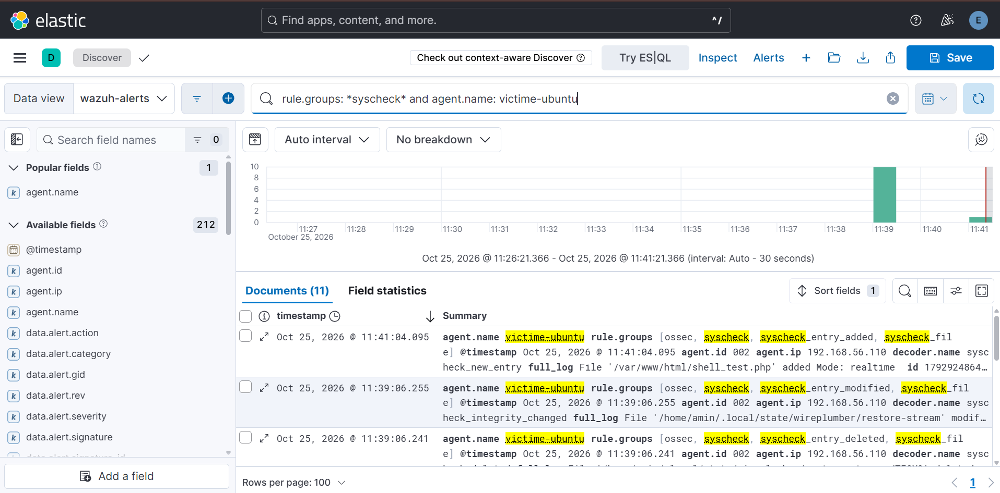
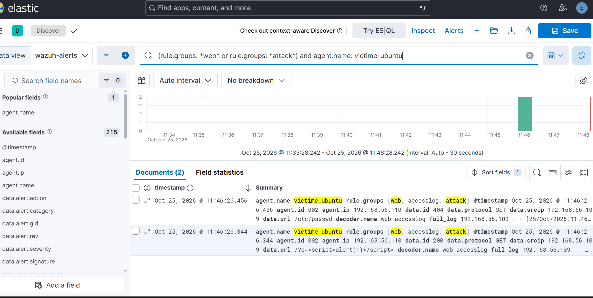

# Runbook — Cas 8 : Web shell déposé dans le webroot

| | |
|---|---|
| **Cas** | 8 |
| **Hôte cible** | victime-ubuntu (Apache, `/var/www/html`, agent Wazuh 002) |
| **Source de log** | Wazuh syscheck (FIM `/var/www`) + logs d'accès Apache (`/var/log/apache2/access.log`) |
| **Règle(s) Wazuh** | 554 (fichier ajouté, FIM) ; groupes `web,accesslog,attack` (motifs d'attaque web) |
| **Niveau** | variable (554 ≈ niveau 5 ; règles web d'attaque niveau 6+) |
| **MITRE ATT&CK** | T1505.003 — Server Software Component : Web Shell |
| **Requête dashboard** | `syscheck.path:/var/www* OR rule.groups:attack` |
| **TheHive** | Alertes niveau ≥ 10 uniquement (voir Remédiation : relever le niveau) |

## Description

Un **web shell** est un fichier (souvent `.php`) déposé dans l'arborescence servie par le serveur web, qui donne à l'attaquant l'exécution de commandes à distance via de simples requêtes HTTP. C'est un moyen d'**accès persistant** après l'exploitation d'une application web.

La détection repose sur **deux signaux complémentaires** :
1. **L'apparition du fichier** dans le webroot — FIM Wazuh en temps réel.
2. **Les accès au fichier et les requêtes malveillantes** — logs Apache analysés par les règles web natives.

> En labo, le fichier PHP déposé est **inoffensif** : seule compte la détection de son apparition et des accès. Il ne faut jamais déposer de vrai web shell fonctionnel, même sur une VM de test isolée.

## Détection

- **Chaîne (FIM) :** dépôt du fichier dans `/var/www` → syscheck temps réel → agent → manager → règle **554** (nouveau fichier) → dashboard + Elastic.
- **Chaîne (accès) :** requête HTTP → `access.log` → logcollector de l'agent → décodeurs web natifs → groupes `web,accesslog,attack`.
- **Config agent (déjà en place) :**
  ```xml
  <directories realtime="yes" check_all="yes" report_changes="yes">/var/www</directories>
  <localfile>
    <log_format>apache</log_format>
    <location>/var/log/apache2/access.log</location>
  </localfile>
  ```
- **Dashboards :** Kibana → **FIM** (chronologie, `syscheck.path`, `syscheck.event`) et **Réseau/Web** (requêtes d'attaque).

## Procédure d'investigation

1. **Confirmer l'apparition du fichier** — FIM, filtre `syscheck.path:/var/www*` et `syscheck.event:added`. Noter le chemin exact, l'horodatage, et `syscheck.sha256_after`.
2. **Identifier le fichier suspect** — extension `.php`/`.jsp`/`.aspx` inattendue dans un répertoire de contenu statique = signal fort. Sur l'hôte :
   ```bash
   sudo find /var/www -name '*.php' -newermt '-1 hour' -printf '%TY-%Tm-%Td %TH:%TM  %p\n'
   ```
3. **Analyser les accès au fichier** — dans les logs Apache, chercher les requêtes vers ce fichier :
   ```bash
   sudo grep -i 'suspect.php' /var/log/apache2/access.log
   ```
   Regarder l'**IP source**, le **User-Agent**, la **méthode** (POST = exécution de commande probable) et les **paramètres** passés.
4. **Corréler avec les motifs d'attaque** — requêtes taguées `rule.groups:attack` (SQLi, traversée de répertoire `../`, XSS) depuis la même IP juste avant le dépôt : c'est probablement le vecteur d'exploitation initial.
5. **Évaluer l'exécution** — le web shell a-t-il été utilisé ? Chercher des processus enfants anormaux d'Apache (`www-data` lançant `sh`, `bash`, `nc`, `python`) et des connexions sortantes inattendues.
6. **Remonter à la cause** — comment le fichier est-il arrivé ? Upload applicatif mal filtré, inclusion de fichier, accès FTP/SSH compromis.

## Remédiation

- **Immédiat :** retirer le fichier du webroot (après copie forensique) ; couper l'accès de l'IP source ; si exécution confirmée, isoler l'hôte et chasser les processus/connexions lancés par `www-data`.
- **Durcissement / prévention :**
  - Interdire l'exécution PHP dans les répertoires d'upload (config Apache / `php_admin_flag engine off`).
  - Droits stricts sur le webroot : `www-data` ne doit pas pouvoir écrire dans les répertoires servis.
  - WAF (ModSecurity + règles OWASP CRS) devant Apache.
  - **Relever le niveau de la détection FIM** sur `/var/www` via une règle custom (ajout d'un `.php` dans le webroot → niveau 12, tag **T1505.003**) pour que l'alerte dépasse le seuil de transmission à TheHive.
- **Limites connues :** un web shell déposé via une modification d'un fichier `.php` **existant** (plutôt qu'un ajout) remonte en événement « modifié » (règle 550) et non « ajouté » — prévoir la couverture des deux. Le FIM n'est pas instantané si `realtime` est saturé : garder les logs Apache comme second filet.

## Captures

**Dépôt du fichier détecté par le FIM (`syscheck_entry_added` sur `/var/www/html/shell_test.php`)**



**Attaques web détectées via les logs d'accès Apache (groupes `web,accesslog,attack`)**


