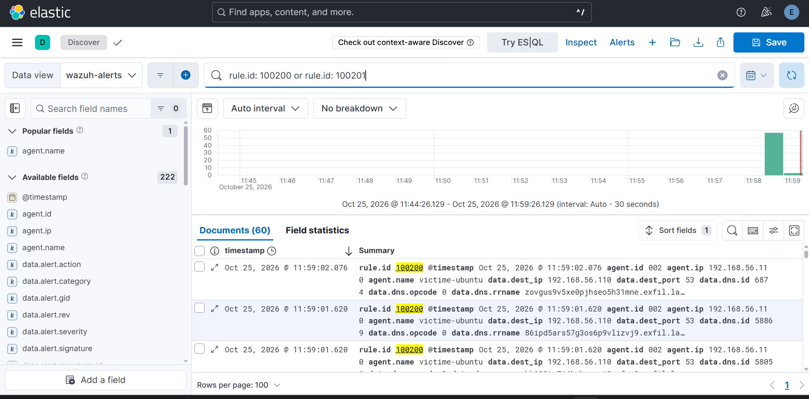

# Runbook — Cas 9 : Exfiltration / tunneling DNS

| | |
|---|---|
| **Cas** | 9 |
| **Hôte sonde** | victime-ubuntu (Suricata sur `enp0s8`, agent Wazuh 002) |
| **Source / cible (labo)** | requêtes DNS depuis Kali (`192.168.56.109`) vers `192.168.56.110` |
| **Source de log** | Suricata `dns` → `/var/log/suricata/eve.json` → agent Wazuh |
| **Règle(s) Wazuh** | 86603 (Suricata dns, natif, niveau 0) → **100200** (sous-domaine long, niveau 10) + **100201** (volume, niveau 12) |
| **Niveau** | 10 / 12 (custom) |
| **MITRE ATT&CK** | T1048.003 — Exfiltration Over Alternative Protocol : DNS · T1071.004 |
| **Requête dashboard** | `rule.id:100200 OR rule.id:100201` |
| **TheHive** | Oui — 100200 (10) et 100201 (12) transmis par `integration-wazuh.py` |

## Description

Le **tunneling DNS** détourne le protocole DNS pour faire sortir des données d'un réseau : l'attaquant encode l'information dans des **sous-domaines** (`<données-encodées>.exfil.lab`) et interroge un serveur qu'il contrôle, qui reçoit ainsi les données. Le DNS étant presque toujours autorisé en sortie, c'est un canal d'exfiltration discret.

Deux signatures défensives complémentaires :
1. **Forme** — les sous-domaines sont **anormalement longs** et aléatoires (l'encodage gonfle la taille).
2. **Volume** — l'exfiltration génère une **rafale** de requêtes en peu de temps.

> Les événements Suricata `dns` ne génèrent **aucune alerte** par défaut (règle native 86603, niveau 0). Sans les deux règles maison, le tunneling passe inaperçu.

## Détection

- **Chaîne :** requêtes DNS → capturées par Suricata sur `enp0s8` → `eve.json` (`event_type: dns`) → agent → manager → règles custom → dashboard + Elastic → TheHive.
- Règles custom (`wazuh/local_rules.xml`) :
  ```xml
  <!-- Signature : sous-domaine anormalement long -->
  <rule id="100200" level="10">
    <if_sid>86603</if_sid>
    <field name="dns.rrname" type="pcre2">[a-zA-Z0-9]{20,}\.</field>
    <description>Exfiltration DNS possible : sous-domaine anormalement long ($(dns.rrname))</description>
    <mitre><id>T1048.003</id></mitre>
  </rule>

  <!-- Volume : trop de requetes DNS en peu de temps -->
  <rule id="100201" level="12" frequency="20" timeframe="30">
    <if_matched_sid>86603</if_matched_sid>
    <description>Exfiltration DNS possible : volume anormal de requetes DNS (plus de 20 en 30s)</description>
    <mitre><id>T1048.003</id></mitre>
  </rule>
  ```
- **Dashboards :** Kibana → **Réseau** (évolution des requêtes, `data.dns.rrname`, `data.src_ip`).

## Procédure d'investigation

1. **Confirmer** — Threat Hunting, requête `rule.id:100200 OR rule.id:100201`. Un pic de 100201 (volume) accompagné de 100200 (forme) = tunneling probable.
2. **Lire les champs** — `data.dns.rrname` (le nom interrogé : longueur, aléa, domaine de destination), `data.src_ip` (l'hôte qui exfiltre), `data.dest_ip` (le résolveur/serveur contacté).
3. **Qualifier la forme** — en direct sur la sonde :
   ```bash
   sudo jq -r 'select(.event_type=="dns") | .dns.rrname' /var/log/suricata/eve.json \
     | awk '{ if (length($0) > 40) print length($0), $0 }' | sort -rn | head
   ```
   Des noms de 40+ caractères, à forte entropie, tous sous le même domaine parent = signature d'exfiltration.
4. **Qualifier le volume et le rythme** — nombre de requêtes par minute depuis la `src_ip`, régularité (un rythme machine, non humain, est suspect).
5. **Identifier le domaine de collecte** — le domaine parent récurrent (`exfil.lab` en labo) est le point de collecte de l'attaquant : à bloquer et à investiguer.
6. **Évaluer l'impact** — depuis quand ? quel volume cumulé ? l'hôte source est-il par ailleurs compromis (corréler avec les cas d'accès et de persistance) ?

## Remédiation

- **Immédiat :** bloquer le domaine de collecte sur le résolveur et au pare-feu ; isoler l'hôte source si l'exfiltration est confirmée ; estimer les données potentiellement sorties.
- **Durcissement / prévention :**
  - Forcer tout le DNS sortant à passer par un **résolveur interne** (interdire le DNS direct vers Internet au pare-feu) pour centraliser la journalisation et le filtrage.
  - Filtrage DNS / threat intel sur les domaines connus de tunneling.
  - Affiner 100200 : ajouter un critère d'**entropie** et un seuil de longueur par label (63 car. max) pour réduire les faux positifs (certains CDN et services légitimes utilisent des sous-domaines longs).
- **Limites connues :** une exfiltration **lente** (quelques requêtes par heure) passe sous le seuil de 100201 ; un encodage produisant des labels courts passe sous celui de 100200. La détection par forme + volume attrape le tunneling bruyant, pas le canal furtif à bas débit — qui demanderait une analyse statistique (volume DNS par hôte dans le temps).

## Captures

**Requêtes DNS à sous-domaines anormalement longs détectées par la règle custom 100200**


